# Castlevania: Dawn of Sorrow: Recompiled

<p align="center">
  
</p>

<p align="center">
  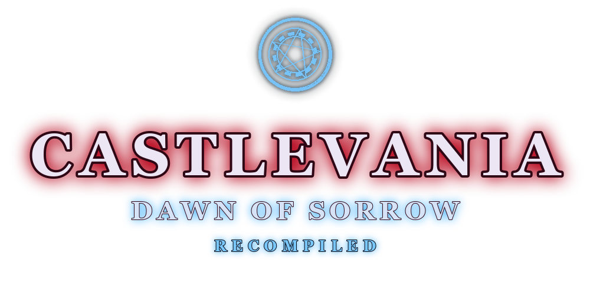
</p>

<p align="center">
  <a href="https://recomplauncher.com/game/cdos-nintendods-recomp"><picture><source media="(prefers-color-scheme: dark)" srcset="https://recomplauncher.com/assets/press/launcher/badge-light.svg"></picture></a>
  <a href="https://github.com/Neguchads/cdos-nintendods-recomp/releases/tag/v1.3.0"></a>
  <a href="https://github.com/Neguchads/cdos-nintendods-recomp/actions/workflows/ci.yml"></a>
  <a href="https://recompstore.com/dev/neguchads"></a>
  <a href="https://discord.gg/s7CWbpZJ"></a>
</p>

[](README.md) [](README.pt-BR.md)

---


## English

Native PC port of *Castlevania: Dawn of Sorrow* (Nintendo DS, USA, game code `ACVE`) built on [`RetroPortingToolKit/ndsrecomp`](https://github.com/RetroPortingToolKit/ndsrecomp): the ARM9/ARM7 code is statically recompiled to C/C++ (no JIT, no Dynarmic). Ships with **Direct3D 12 (`DXIL ps_6_0`)** and **Vulkan 1.1 (`SPIR-V`)** HD-2D shaders, a bilingual **Dear ImGui (`F1`)** menu, **modular stackable in-memory mod support** (combine **Tradução PT-BR v1.1** with **Dawn of Dignity**, **No Magic Seals**, **Fixed Luck**, **Voice Restore**, or any `.xdelta` / `.ips` / `.dospatch` locally), **Minimap HUD (Samus Returns 16:9)**, **Exact 60 Hz Pitch-Preserving VSync**, **GBA Slot-2 *Aria of Sorrow* Bonus**, **Custom Music**, and first-class **[RecompLauncher](https://recomplauncher.com/game/cdos-nintendods-recomp)** support.

> **Legal & creator-respect notice:** this repository contains **no ROMs, no commercial BIOS, no copyrighted game data, and no bundled third-party mods or translations**. You must provide your own legally dumped copy of `Castlevania - Dawn of Sorrow (USA).nds`: 64 MiB, CRC32 `135737f6`, SHA-1 `47530ff87e608f88105a314fdf36dc385f8dec94`. Community patches and translations obtained directly from their authors are loaded locally in memory via `F1 -> Mods` (`{data}/mods/profiles/`) without ever modifying your ROM.


### Development progress / Status dashboard

<a href="docs/FEATURE_STATUS.md">
<picture>
  <source media="(prefers-color-scheme: dark)" srcset="assets/dashboard/project-status-dark.svg">
  <source media="(prefers-color-scheme: light)" srcset="assets/dashboard/project-status.svg">
  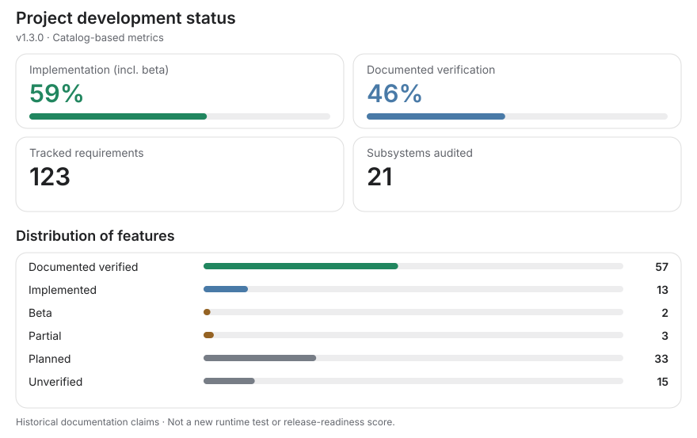
</picture>
</a>

<details>
<summary>View progress cards for all 21 subsystems</summary>

<picture>
  <source media="(prefers-color-scheme: dark)" srcset="assets/dashboard/subsystems-dark.svg">
  <source media="(prefers-color-scheme: light)" srcset="assets/dashboard/subsystems.svg">
  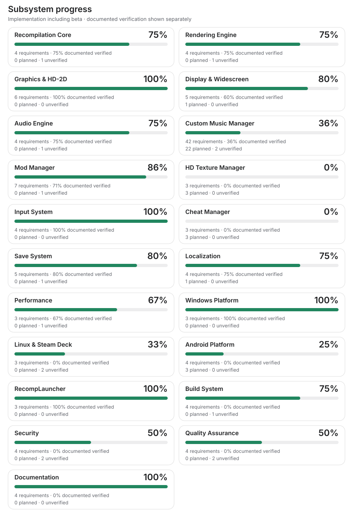
</picture>

</details>

[Full feature audit](docs/FEATURE_STATUS.md) · [Quality methodology and platform matrix](docs/FEATURE_ASSURANCE.md) · [Machine-readable metrics](quality/progress.json)

Percentages are catalog-based implementation and historical documented verification, not overall release readiness or newly executed tests.

### Key Features at a Glance

- **Modular Stackable Mods & Authorized PT-BR v1.1 (`F1 -> Mods`):** freely combine **Tradução PT-BR v1.1** (authorized by `@leomontenegro6` in `cdos-traducao-ptbr#1`) with **Dawn of Dignity**, **No Magic Seals**, **Fixed Luck**, and **Voice Restore Project** via checkboxes using our **3-way in-memory byte-diff merger** + automatic NDS header CRC-16 recomputation (inspired by `cdos-patcher-tool`). Includes per-mod **`Patch...`**, **`Official Page`**, and **`Info`** preview cards, bundled **`xdelta3.exe`** (Apache-2.0) for DJW/LZMA `.xdelta` patches out of the box, isolated saves per stack, and zero bundled third-party files.
- **Minimap HUD (Samus Returns 16:9) & True 2D Widescreen:** compact translucent `24%` top-right map overlay + **1-Click 16:9 Metroidvania HUD** preset, **Widescreen Theatre**, **16:9 Smart Crop**, **21:9 Ultrawide**, and opt-in **True 2D Widescreen `342×192`** (Beta) with seamless `BG2` sky wrap and automatic `256×192` pillarbox on menus.
- **Multi-Pass HD-2D Upscalers & Exact `60.0 Hz` Sync:** 8 curated GPU scalers (`Pixellate`, `Pixel-AA`, `Bandlimited`, `MMPX 2×`, `OmniScale`, `ScaleFX-Hybrid 3×`), `GDAPT` Anti-Dither, 5-pass Dual Kawase Bloom, 6 one-click Visual Profiles, and **Exact `60.0 Hz` Pitch-Preserving VSync (`sync60`)** via real-time WSOLA audio splicing (stutter-free on 60 Hz monitors with zero pitch shift).
- **GBA Slot-2 *Aria of Sorrow* Bonus & Custom Music:** toggleable clean-room 192-byte GBA Slot-2 header (`A2CE`) unlocking **Rare Ring** + **Mina's Doll** without a GBA ROM, plus native **`.wav` / `.mp3` / `.ogg` Custom Music** with Per-Stage Mapper & Global Jukebox while keeping 100% of original DS sound effects and voices.
- **Community & Support:** join our **[Discord Server](https://discord.gg/s7CWbpZJ)** for setup help, testing, and mod compatibility discussion.

### Community contributions welcome

This is a community-driven open-source project. **All help is welcome!** Whether you are a developer, tester, player, modder or simply interested in the project, your contributions matter.

- Pull requests, code reviews, bug fixes, performance improvements and refactoring.
- Testing, reproducible bug reports, compatibility feedback and technical support for other users.
- New features, ideas, documentation, translations and accessibility improvements.

You can [open an issue](https://github.com/Neguchads/cdos-nintendods-recomp/issues), [submit a pull request](https://github.com/Neguchads/cdos-nintendods-recomp/pulls), [start a discussion](https://github.com/Neguchads/cdos-nintendods-recomp/discussions) or join our [Discord community](https://discord.gg/s7CWbpZJ). Contributions of any size are appreciated. Please keep submissions respectful, reproducible and consistent with the project's clean-room and creator-permission policies.

**Before opening an issue:** please search both open and closed issues and existing pull requests, check the [feature status and audit](docs/FEATURE_STATUS.md), [roadmap](ROADMAP.md), [release notes](https://github.com/Neguchads/cdos-nintendods-recomp/releases) and current game settings (F1). Confirm whether the feature or idea already exists, is planned, or has been reported. If a matching issue exists, add useful information there instead of creating a duplicate. If the existing feature is incomplete or broken, explain the missing behavior and include the version you tested. New ideas and genuine regressions are always welcome.

See [CONTRIBUTING.md](CONTRIBUTING.md) for practical guidelines.

### Help us expand the Castlevania recompilation ecosystem

We are looking for community support, technical ideas and collaborators to explore future Castlevania recompilation projects beyond Dawn of Sorrow:

- **Dominus Collection / Nintendo DS trilogy:** explore independent native ports and shared technology for Dawn of Sorrow, Portrait of Ruin and Order of Ecclesia, as well as possible compatibility with legally obtained Dominus Collection assets where technically and legally feasible.
- **Game Boy Advance trilogy:** explore native recompilation of Circle of the Moon, Harmony of Dissonance and Aria of Sorrow from legally dumped original ROMs.

Developers, reverse engineers, tooling maintainers, testers, modders and players are invited to share research, open-source tools, technical proposals, code reviews and pull requests. We welcome ideas for reusable recompilation pipelines, rendering, audio, controls, modding and cross-platform support.

These are exploratory community goals, not announced releases or commitments. Please share ideas in [Discussions](https://github.com/Neguchads/cdos-nintendods-recomp/discussions) or [Discord](https://discord.gg/s7CWbpZJ) and review existing work before opening new issues. This is an unofficial, independent effort; do not submit commercial ROMs, BIOS, proprietary game assets or unauthorized third-party content. Dawn of Sorrow remains the current repository's primary focus.

### How to play

**Option A — RecompLauncher (recommended):**
1. Install **RecompLauncher** and add this recomp (or a release `.zip` that contains `recomplauncher.json`).
2. When Easy Setup asks for the game, pick your USA `.nds`. The launcher checks the game code (`ACVE`) and the dump (CRC32 `135737f6`) and shows the verified badge.
3. Press **Play**. The game starts in **English (`en`)** by default; press **`F1`** at any time to open the settings menu or switch the menu/game language to **Português (BR)** in memory (also configurable inside RecompLauncher).

Saves, settings, savestates and screenshots live in RecompLauncher's `{data}` folder (`recompdata/`), so they move, back up and uninstall with the game.

**Option B — Standalone Windows (`CastlevaniaDawnOfSorrow.exe`):**
1. Extract the release `.zip` and double-click **`CastlevaniaDawnOfSorrow.exe`** (with embedded Soma Cruz icon).
2. On first run, select your legal USA `.nds` file (`64 MiB`, `ACVE`, CRC32 `135737f6`). The launcher verifies it, installs a local copy inside `game/`, offers to create a **Desktop shortcut**, and launches the game.
3. On every subsequent run, double-clicking the Desktop shortcut or `CastlevaniaDawnOfSorrow.exe` opens the game directly with one click.

### Media kit (RecompLauncher artwork)

Every image RecompLauncher asks for is in [`assets/recomplauncher/`](assets/recomplauncher), validated by [`tools/prepare_media_assets.py`](tools/prepare_media_assets.py).

| Slot | File | Size | Preview |
|---|---|---|---|
| Icon | [`icon.png`](assets/recomplauncher/icon.png), [`icon.ico`](assets/recomplauncher/icon.ico) | 256 x 256 (ICO: 256, 64, 48, 32, 16) | 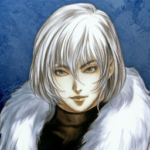 |
| Cover | [`cover.jpg`](assets/recomplauncher/cover.jpg), [`cover.png`](assets/recomplauncher/cover.png) | 600 x 900 (2:3) | 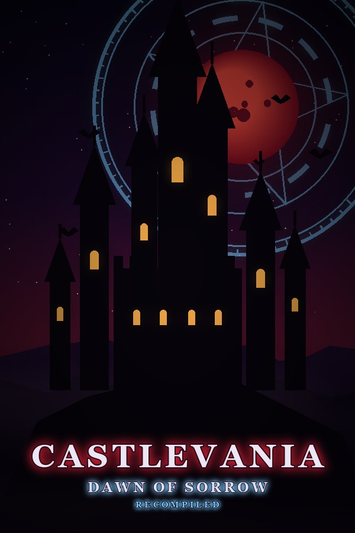 |
| Hero / background | [`hero.jpg`](assets/recomplauncher/hero.jpg), [`hero.png`](assets/recomplauncher/hero.png) | 1920 x 620 | 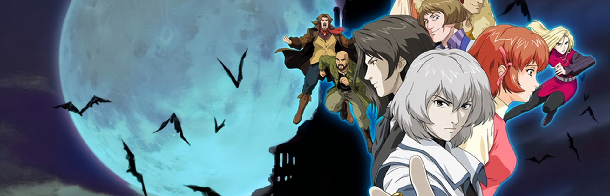 |
| Logo (transparent) | [`logo.png`](assets/recomplauncher/logo.png) | 1000 x 500 (RGBA) |  |
| Wallpaper | [`wallpaper.png`](assets/recomplauncher/wallpaper.png) | 1920 x 1080 (16:9) | 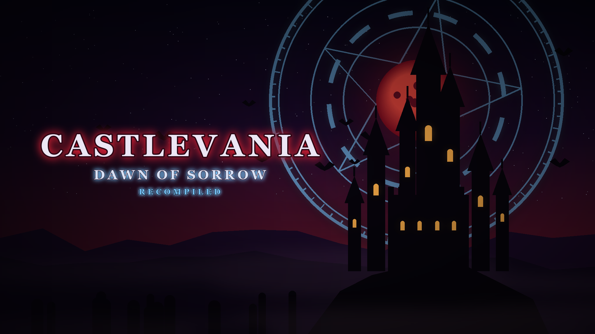 |
| Key artwork (DS cartridge) | [`artwork.png`](assets/recomplauncher/artwork.png) | 1024 x 1024 | 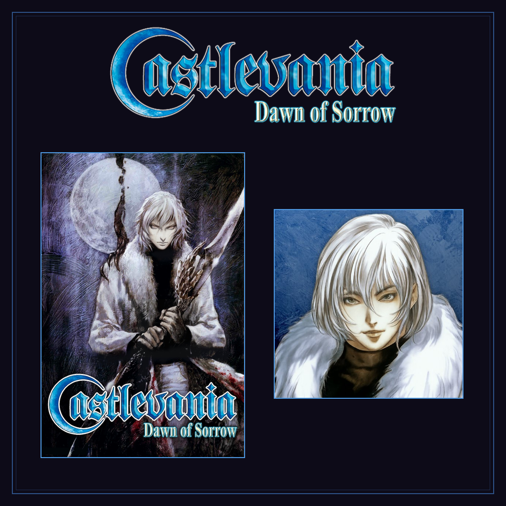 |
| Catalog entry | [`catalog-entry.json`](assets/recomplauncher/catalog-entry.json) | `media_design` kind `ds` | n/a |

How to apply: [`docs/RECOMPLAUNCHER.md`](docs/RECOMPLAUNCHER.md).

### In-engine screenshots

Real captures from `nds_runner.exe` (1920 x 1080), in [`assets/screenshots/`](assets/screenshots).

| Direct3D 12, HD GPU shader, picture-in-picture | `F1` menu over the two real screens | Vulkan SPIR-V, side-by-side, PT-BR |
|---|---|---|
| 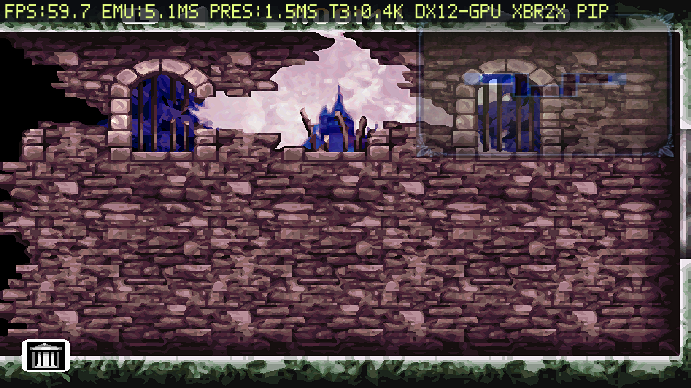 | 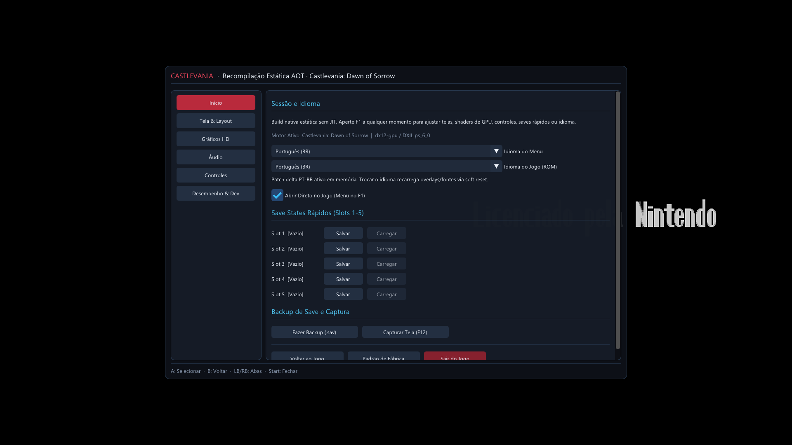 | 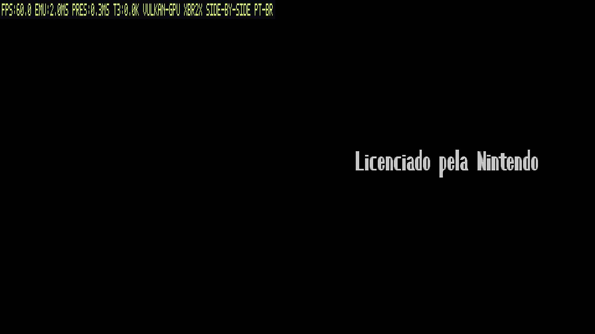 |

### Highlights

- **Static AOT execution at about 60 FPS:** `34` promoted banks (`49,059` functions) plus `dos_arm9` / `dos_arm7` banks built with `--validate-live-bytes`, so code changed by a translation falls back safely. Clean PT-BR measurement in a visible DX12 window: **59.86 FPS** (`emu=3.72 ms`, `pres=0.78 ms`, `readback=0.00 ms`, `underruns=0`). Vulkan SPIR-V was checked visually at 60.0 FPS.
- **`F1` menu (Dear ImGui v1.92.9b, also `Esc` / controller `Guide`):** 7 tabs (Home, Screen & Layout, HD Graphics, Audio, Controls, Mods & Campaigns, Performance & Dev), **English (`en`) default** with **Português (BR)** selectable live, drawn over the two real screens (the old "third screen" bug is fixed). Live brightness, contrast, saturation and vignette, PiP size (`20..50%`), VSync, stick deadzone, mouse/keyboard/gamepad remapping with per-key **`X`** clear, **Clear All Mappings**, and **Restore Default Controls**, pause/mute when unfocused, 5 savestate slots, `.sav` backup, `F12` screenshot.
- **Generic Local Mod Support & Pre-Wired Manual-Import Slots (`F1 -> Mods & Campaigns`, zero third-party mods bundled):** clean [`mods/registry.json`](mods/registry.json) shipping only the retail **Original USA** baseline plus attributed `manual_import` slots (**Tradução PT-BR v1.1 Vanilla & Definitive Edition** by Hyllian, Solid One/`@leomontenegro6`, Neko Belmont, Mysterioso, denim, djmatheusito, victoriemini — ref. [João13 Traduções](https://joao13traducoes.com/2018/02/nds-castlevania-dawn-of-sorrow-varios-autores/), **Definitive Edition+**, **Eternity of Sorrow** authorized by `@Wet-Band-Aid` in #44, **Alucard's Requiem**, and **Dracula's Curse** — zero files bundled or downloaded). Every slot has inline **`Patch...`** (targeted 1-click `.xdelta`/`.ips`/`.dospatch` importer) and **`Official Page`** buttons inside `F1 -> Mods`, alongside generic **`Import Patch...`** and **`Open Mods Folder`** backed by native C++ **`.xdelta` / `.vcdiff` (RFC 3284, with automatic `xdelta3.exe` fallback for DJW/LZMA), `.ips`, and `.dospatch`** loaders in `{data}/mods/profiles/`, 3-state `ConflictEngine`, isolated saves/savestates, power-of-two cartridge padding, offline **Native C++ Seed Mutator**, and `tools/import_dsvrandom.py`. See [`docs/CREDITS.md`](docs/CREDITS.md) and [`docs/CREATOR_OUTREACH.md`](docs/CREATOR_OUTREACH.md).
- **Native Opening Video Player (Windows Media Foundation + SDL3):** optionally place a user-supplied H.264/AAC MP4 at `{data}/mods/intro/opening.mp4` to play a custom opening video natively on launch (zero FFmpeg/external DLLs, skippable with any key/click/button, toggleable and replayable in `F1`).
- **Custom Music Support (`.wav` / `.mp3` / `.ogg`, Issue #16):** drop audio files with **any filename** into `{data}/mods/music/`, or double-click **`mods/music/Configurar_Musica.bat`** to pick files via Windows Explorer and assign them automatically. Inside **`F1 -> Audio`**, you can map any file to any of the 30 game stages (**Per-Stage Visual Track Mapper**), or enable **Global Jukebox / Playlist Mode** (mutes all 30 DS BGMs and plays your selected song(s) continuously with Shuffle/Prev/Next) while keeping **100% of original DS sound effects and voices** (see [`mods/music/README.md`](mods/music/README.md) and `python tools/list_bgm_tracks.py`).
- **Multi-Pass GPU Upscalers & HD-2D Display Suite (`F1 -> HD Graphics` & `Screen & Layout`, DXIL `ps_6_0` + Vulkan 1.1 SPIR-V):**
  - **8 curated 2D pixel-art & modern scalers (`<= 0.8 ms` GPU time):** linear-sRGB **`Pixellate`** (crisp shimmerless default), **`Pixel-AA`**, **`Bandlimited Pixel`** (TheMaister cosine integral), **`MMPX 2×`** (NVIDIA detail-preserving 2× offscreen pass), **`OmniScale`** (smooth perceptual diagonals), **`ScaleFX-Hybrid 3×`** (vector-clean curves + subtle interior reverse-AA), plus `Nearest` and `Bilinear`.
  - **Selective Anti-Dither (`GDAPT`) & 5-Pass Dual Kawase HD-2D Bloom:** smoothly blends 1px checkerboard/stripe fog in linear light without blurring outlines or text, paired with wide cinematic bloom aligned to CRT curvature, bezel, and vignette, moiré-free analytical `Scanlines`/`CRT`/`NDS LCD Grid`, live Gamma/Color Temperature/Contrast/Saturation, **6 one-click Visual Profiles** (*Modern HD Crisp*, *HD-2D Remaster*, *Vector HD ScaleFX*, *Pixel Purist*, *Classic CRT*, *DS Handheld*), multi-monitor SDL3 selector, `2x..6x` windowed scale presets, `21:9 Ultrawide Cinema`, `0..10%` Display Safe Zone, 4-mode VSync (`Off`/`On`/`Adaptive`/`60Hz Exact Sync` with pitch-preserving WSOLA audio pacing — Issue #39), live `120 Hz` Frame Interpolation, and persistent 3D MSAA (`Off/2x/4x/8x`).
- **Seamless 2D Widescreen & Samus Returns Minimap HUD (Issue #7):** includes **Minimap HUD (Samus Returns 16:9)** (compact translucent `24%` top-right map overlay + **1-Click 16:9 Metroidvania HUD** preset in `F1 -> Screen & Layout`), **Widescreen Theatre** (`342×192` 16:9 canvas with 4:3 gameplay + docked Map/Status sidebar, *Dominus Collection* style), **16:9 Smart Crop** (1:1 square pixels with `-24..+24 px` vertical offset and exact touch mapping), **16:10 Balanced**, **21:9 Ultrawide**, and opt-in **True 2D Widescreen `16:9` (`342×192`)** with `Edge-Anchored` vs `Centered 4:3` HUD, seamless `1×N` hardware `BG2` sky/castle wrapping and wide 3D atmospheric fog expansion (zero black bands or `x = 271` seam on Lost Village Bridge & Plaza), plus automatic `256×192` pillarbox on menus, prologues, and single-screen rooms.
- **Open-Source Attribution & Creator Policy:** engine and library credits plus our creator-permission policy (no third-party mods bundled or auto-fetched without explicit author permission) are documented in [`docs/CREDITS.md`](docs/CREDITS.md).
- **RecompLauncher SDK & Native MSVC Standalone `.exe`:** [`recomplauncher.json`](recomplauncher.json) with named `inputs`, verified `dumps`, `{install}`/`{data}` path resolution, `49` INI settings (`config.new` defaults), `looks`, `actions`, `system` and `exit_codes`, plus native MSVC 2022 [`CastlevaniaDawnOfSorrow.exe`](launcher/launcher_win32.cpp) (`443 KB`, embedded icon & UTF-8 `asInvoker` manifest) and strict `runtime/` packaging allowlist.
- **Multiplatform:** [`CMakePresets.json`](CMakePresets.json), [`tools/build_linux.sh`](tools/build_linux.sh) and an Android ARM64 skeleton in [`android/`](android). Only Windows is built and tested here; see [`docs/MULTIPLATFORM.md`](docs/MULTIPLATFORM.md).

### Feature Status (Verified vs. Experimental)

| Feature | Status | Notes |
|---|---|---|
| Original USA (`ACVE`) Clean Baseline | **Verified** | Default clean-room execution at ~60 FPS (`emu ~3.7 ms`, `0` audio underruns) |
| Modular Stackable Add-Ons & Local Mod Loader (`.xdelta`/`.ips`/`.dospatch`, bundled `xdelta3.exe`) | **Verified** | 3-way in-memory byte-diff merger (combine PT-BR v1.1 + *Dawn of Dignity*, *No Magic Seals*, *Fixed Luck*, *Voice Restore*) + per-mod `Patch...` / `Official Page` / `Info` cards + isolated saves; zero bundled third-party mods |
| GBA Slot-2 Bonus: *Aria of Sorrow* (`dos_gba_slot2_aria`) | **Verified** | Clean-room 192-byte `A2CE` header toggleable in `F1 -> Mods` & `recomplauncher.json` (unlocks **Rare Ring** + **Mina's Doll**) |
| Exact `60.0 Hz` Pitch-Preserving VSync (`sync60`) | **Verified** | Real-time Hann-windowed WSOLA audio splicer (`0` crackles, `0.00%` pitch shift) for stutter-free 60 Hz LCD playback |
| Custom Music (`.wav`/`.mp3`/`.ogg`, F1 Mapper, Global Jukebox, Explorer Wizard) | **Verified** | Live-verified selective BGM mute (`DS BGM = 0`, `DS SFX = 100%`) |
| Multi-Pass GPU Upscalers (`Pixellate`, `Pixel-AA`, `Bandlimited`, `MMPX 2×`, `OmniScale`, `ScaleFX-Hybrid 3×`), Anti-Dither & Dual Kawase HD-2D Bloom | **Verified** | Live-verified on DX12 (`DXIL ps_6_0`) & Vulkan (`SPIR-V`), `<= 0.8 ms` GPU time |
| Expanded Display Suite (Multi-Monitor, `2x..6x`, `21:9`, Safe Zone, 4-Mode VSync, 120 Hz Interpolation, 6 Visual Profiles) | **Verified** | Full SDL3 & 80-byte GPU shader controls persisted in INI and `recomplauncher.json` |
| 2D Widescreen & Minimap HUD (`Minimap HUD 16:9`, `Theatre`, `Smart Crop 16:9`, `Balanced 16:10`, `Ultrawide 21:9`) | **Verified** | Samus Returns-style `24%` top-right map overlay + 1-click Metroidvania 16:9 HUD preset + distortion-free touch mapping |
| True 2D Widescreen `16:9` (`342×192`) | **Opt-in (Beta)** | Seamless `BG2` sky wrap + atmospheric quad expansion verified on Lost Village Bridge/Plaza (`F1 -> Screen & Layout`, off by default; full-campaign audit ongoing) |
| Native Opening Video Player (`{data}/mods/intro/opening.mp4`) | **Verified (Opt-in)** | Local user-supplied video only; never bundled in clean-room releases |
| Native C++ Seed Mutator (Offline Randomizer) | **Experimental (`unverified`)** | Non-progression regular enemy stats/drops only; local randomizer output importer via `tools/import_dsvrandom.py` |

### Controls and hotkeys

| DS action | Key / Mouse 1 (Default) | Key / Mouse 2 (Alt) | Controller (Xbox / PS) |
|---|---|---|---|
| Move | `W` `A` `S` `D` | Arrow keys | Left stick / D-pad |
| **Jump (`B`)** | **`Space`** | **`Space`** | **`A` / Cross** |
| **Primary Attack (`Y`)** | **`Mouse Left`** | `J` | `X` / Square |
| **Special Attack / Confirm (`A`)** | **`Mouse Right`** | `E` | `B` / Circle |
| **Dash / Backdash (`L`)** | **`Q`** | **`Mouse Middle` (Wheel Click)** | `LB` / `L1` |
| **Guardian Soul (`R`)** | **`R`** | `K` | `RB` / `R1` |
| Switch Set / Doppelganger (`X`) | `F` | `C` | `Y` / Triangle |
| Start / Select | `Enter` / `Tab` | `Enter` / `Backspace` | `Start` / `Back` |

Everything above is fully customizable in **`F1` -> Controls**: click any cell to bind a keyboard key or mouse button (`Left`, `Middle`, `Right`, `X1`, `X2`), click **`X`** next to any cell (or press `Delete` while binding) to clear a single mapping, or use **Clear All Mappings** / **Restore Default Controls**. Bottom-screen touch clicks (menus, items, Magic Seals, ice blocks) remain active alongside combat mouse buttons.

Global: `F1` or `Guide` opens the menu, `F2` cycles layouts, `F3` swaps main screen and thumbnail, `F4` toggles the HUD, `F5` / `F8` save / load slot 1, `F6` or `` ` `` toggles turbo, `F11` or `Alt+Enter` toggles full screen, `F12` takes a screenshot.

### Clone and dependencies

```powershell
git clone https://github.com/Neguchads/cdos-nintendods-recomp.git
cd cdos-nintendods-recomp
```

This repository expects two sibling folders in the same parent directory:

- `../ndsrecomp`: `RetroPortingToolKit/ndsrecomp` at commit `e4a7f419`, with [`patches/ndsrecomp-local.patch`](patches/ndsrecomp-local.patch) applied and Dear ImGui v1.92.9b in `runner/third_party/imgui/`.
- `../recomp-ui`: `RetroPortingToolKit/recomp-ui` at commit `f3f99a96`.

CI runs on GitHub Actions ([`ci.yml`](.github/workflows/ci.yml)); dependency updates come from Dependabot ([`dependabot.yml`](.github/dependabot.yml)).

### Build, run and package (Windows)

```powershell
python tools/setup_toolchains.py
python tools/build.py prepare
python tools/build.py banks
python tools/build.py promote
python tools/build.py ptbr-patch
python tools/build.py build
.\CastlevaniaDawnOfSorrow.exe
```

`python tools/build.py build` embeds [`assets/recomplauncher/icon.ico`](assets/recomplauncher/icon.ico) into both `runtime/nds_runner.exe` and the standalone root launcher `CastlevaniaDawnOfSorrow.exe`. On first run outside RecompLauncher, `CastlevaniaDawnOfSorrow.exe` validates your USA `.nds` dump (`64 MiB`, `ACVE`, CRC32 `135737f6`), installs it locally into `game/`, offers to create a Desktop shortcut with Soma Cruz's icon, and boots straight into the game with one click from then on. `.\play.bat` remains available as a console fallback.

Package a clean, ROM-free release for RecompLauncher into `dist/`:

```powershell
python tools/package_recomplauncher.py
```

### Verification

```powershell
ctest --test-dir generated/build-runner -R "screen_layout_test|frontend_config_test|dos_enhancements_test" --output-on-failure
python -m unittest discover -s tests -v
python tools/build.py smoke
python tools/prepare_media_assets.py --check-only
```

### Special Thanks & Authorized Community Modders

Thank you to the creators who explicitly authorized compatibility slots and helped shape the mod architecture of this project (zero third-party patches are bundled — download directly from each creator's official page):

- **[@Wet-Band-Aid](https://github.com/Wet-Band-Aid)** — creator of **[Castlevania: Eternity of Sorrow](https://github.com/Wet-Band-Aid/Castlevania---Eternity-of-Sorrow)**, who authorized the `Eternity of Sorrow` slot and inspired the in-game **Mod Info & Preview Card** ([Issue #44](https://github.com/Neguchads/cdos-nintendods-recomp/issues/44)).
- **[@leomontenegro6](https://github.com/leomontenegro6) (Solid One)** & the **Tradução PT-BR v1.1 Team** (**Hyllian, Solid One, Neko Belmont, Mysterioso, denim, djmatheusito, victoriemini** — **[cdos-traducao-ptbr](https://github.com/leomontenegro6/cdos-traducao-ptbr)**, **[cdos-patcher-tool](https://github.com/leomontenegro6/cdos-patcher-tool)**, [João13 Traduções](https://joao13traducoes.com/2018/02/nds-castlevania-dawn-of-sorrow-varios-autores/)) — who authorized the PT-BR v1.1 slot and inspired our **modular stackable patch composition** ([cdos-traducao-ptbr#1](https://github.com/leomontenegro6/cdos-traducao-ptbr/issues/1)).

For full open-source library attributions and all community mod authors, see [`docs/CREDITS.md`](docs/CREDITS.md).

### Documentation

[`CHANGELOG.md`](CHANGELOG.md) | [`docs/CREDITS.md`](docs/CREDITS.md) | [`docs/RECOMPLAUNCHER.md`](docs/RECOMPLAUNCHER.md) | [`docs/RBS.md`](docs/RBS.md) | [`docs/CI_AUTOMATION.md`](docs/CI_AUTOMATION.md) | [`docs/BUILD_CACHE.md`](docs/BUILD_CACHE.md) | [`docs/MULTIPLATFORM.md`](docs/MULTIPLATFORM.md) | [`docs/DECISIONS.md`](docs/DECISIONS.md) | [`docs/rom-analysis.md`](docs/rom-analysis.md) | [`ROADMAP.md`](ROADMAP.md) | [`HANDOFF.md`](HANDOFF.md) | [`NOTAS.md`](NOTAS.md)

[Back to top](#castlevania-dawn-of-sorrow-recompiled)

---
