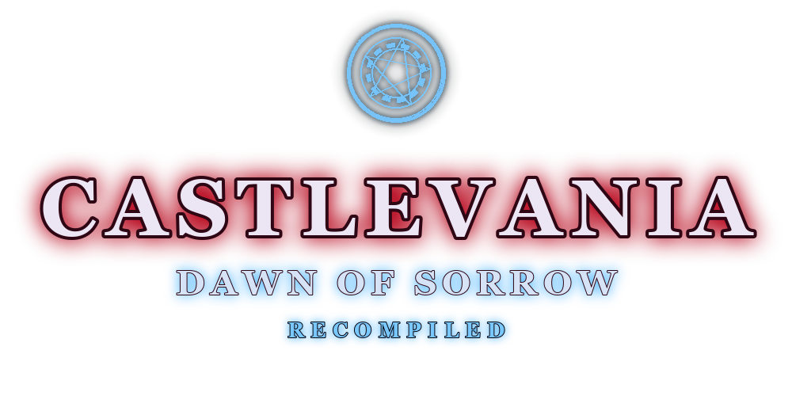
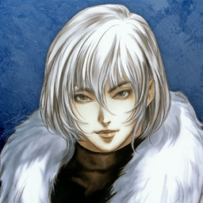
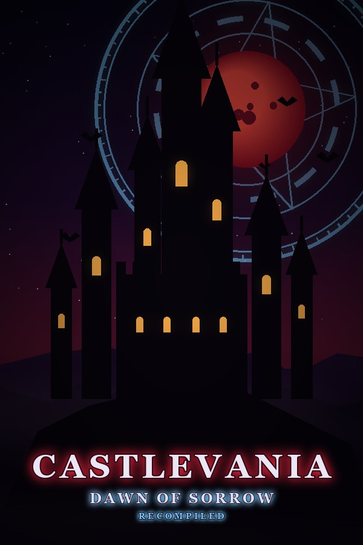
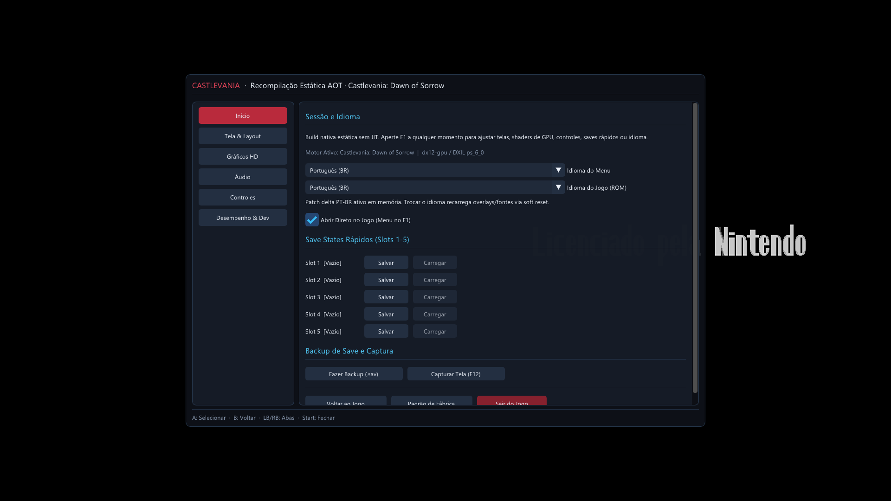
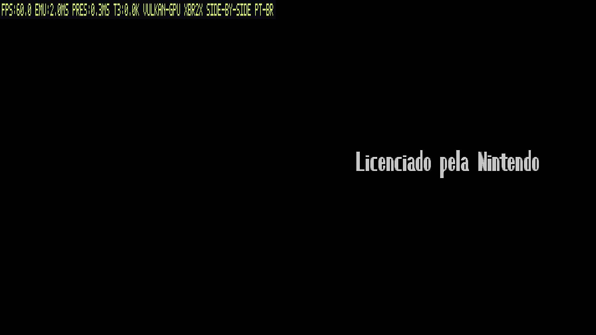

# Castlevania: Dawn of Sorrow: Recompiled

<p align="center">
  
</p>

<p align="center">
  
</p>

<p align="center">
  <a href="https://recomplauncher.com/game/cdos-nintendods-recomp"><picture><source media="(prefers-color-scheme: dark)" srcset="https://recomplauncher.com/assets/press/launcher/badge-light.svg"></picture></a>
  <a href="https://github.com/Neguchads/cdos-nintendods-recomp/releases/tag/v1.1.2"></a>
  <a href="https://github.com/Neguchads/cdos-nintendods-recomp/actions/workflows/ci.yml"></a>
</p>

**[English](#english) | [Português (BR)](#português-br)**

---

## English

Native PC port of *Castlevania: Dawn of Sorrow* (Nintendo DS, USA, game code `ACVE`) built on [`RetroPortingToolKit/ndsrecomp`](https://github.com/RetroPortingToolKit/ndsrecomp): the ARM9/ARM7 code is statically recompiled to C/C++ (no JIT, no Dynarmic). It adds GPU shaders for **Direct3D 12 (DXIL `ps_6_0`)** and **Vulkan 1.1 (SPIR-V)**, a bilingual **Dear ImGui** menu on `F1`, an optional **PT-BR translation applied in memory** and first-class **[RecompLauncher](https://recomplauncher.com)** support.

> **Legal notice:** this repository contains no ROMs, commercial BIOS or other copyrighted game data. You must provide your own legally dumped copy of `Castlevania - Dawn of Sorrow (USA).nds`: 64 MiB, CRC32 `135737f6`, SHA-1 `47530ff87e608f88105a314fdf36dc385f8dec94`. The PT-BR patch ([`mods/ptbr/dos-ptbr.dospatch`](mods/ptbr/dos-ptbr.dospatch)) is a binary delta, not a ROM; it only works on top of that exact USA dump.

### How to play

**Option A — RecompLauncher (recommended):**
1. Install **RecompLauncher** and add this recomp (or a release `.zip` that contains `recomplauncher.json`).
2. When Easy Setup asks for the game, pick your USA `.nds`. The launcher checks the game code (`ACVE`) and the dump (CRC32 `135737f6`) and shows the verified badge.
3. Press **Play**. The game starts in **English (`en`)** by default; press **`F1`** at any time to open the settings menu or switch the menu/game language to **Português (BR)** in memory (also configurable inside RecompLauncher).

Saves, settings, savestates and screenshots live in RecompLauncher's `{data}` folder (`recompdata/`), so they move, back up and uninstall with the game.

**Option B — Standalone Windows (`CastlevaniaDawnOfSorrow.exe`):**
1. Extract the release `.zip` and double-click **`CastlevaniaDawnOfSorrow.exe`** (with embedded Soma Cruz icon).
2. On first run, select your legal USA `.nds` file (`64 MiB`, `ACVE`, CRC32 `135737f6`). The launcher verifies it, installs a local copy inside `game/`, offers to create a **Desktop shortcut**, and launches the game.
3. On every subsequent run, double-clicking the Desktop shortcut or `CastlevaniaDawnOfSorrow.exe` opens the game directly with one click.

### Media kit (RecompLauncher artwork)

Every image RecompLauncher asks for is in [`assets/recomplauncher/`](assets/recomplauncher), validated by [`tools/prepare_media_assets.py`](tools/prepare_media_assets.py).

| Slot | File | Size | Preview |
|---|---|---|---|
| Icon | [`icon.png`](assets/recomplauncher/icon.png), [`icon.ico`](assets/recomplauncher/icon.ico) | 256 x 256 (ICO: 256, 64, 48, 32, 16) |  |
| Cover | [`cover.jpg`](assets/recomplauncher/cover.jpg), [`cover.png`](assets/recomplauncher/cover.png) | 600 x 900 (2:3) |  |
| Hero / background | [`hero.jpg`](assets/recomplauncher/hero.jpg), [`hero.png`](assets/recomplauncher/hero.png) | 1920 x 620 |  |
| Logo (transparent) | [`logo.png`](assets/recomplauncher/logo.png) | 1000 x 500 (RGBA) |  |
| Wallpaper | [`wallpaper.png`](assets/recomplauncher/wallpaper.png) | 1920 x 1080 (16:9) |  |
| Key artwork (DS cartridge) | [`artwork.png`](assets/recomplauncher/artwork.png) | 1024 x 1024 |  |
| Catalog entry | [`catalog-entry.json`](assets/recomplauncher/catalog-entry.json) | `media_design` kind `ds` | n/a |

How to apply: [`docs/RECOMPLAUNCHER.md`](docs/RECOMPLAUNCHER.md).

### In-engine screenshots

Real captures from `nds_runner.exe` (1920 x 1080), in [`assets/screenshots/`](assets/screenshots).

| Direct3D 12, xBR 2x, picture-in-picture | `F1` menu over the two real screens | Vulkan SPIR-V, side-by-side, PT-BR |
|---|---|---|
|  |  |  |

### Highlights

- **Static AOT execution at about 60 FPS:** `34` promoted banks (`49,059` functions) plus `dos_arm9` / `dos_arm7` banks built with `--validate-live-bytes`, so code changed by a translation falls back safely. Clean PT-BR measurement in a visible DX12 window: **59.86 FPS** (`emu=3.72 ms`, `pres=0.78 ms`, `readback=0.00 ms`, `underruns=0`). Vulkan SPIR-V was checked visually at 60.0 FPS.
- **`F1` menu (Dear ImGui v1.92.9b, also `Esc` / controller `Guide`):** 7 tabs (Home, Screen & Layout, HD Graphics, Audio, Controls, Mods & Campaigns, Performance & Dev), **English (`en`) default** with **Português (BR)** selectable live, drawn over the two real screens (the old "third screen" bug is fixed). Live brightness, contrast, saturation and vignette, PiP size (`20..50%`), VSync, stick deadzone, mouse/keyboard/gamepad remapping with per-key **`X`** clear, **Clear All Mappings**, and **Restore Default Controls**, pause/mute when unfocused, 5 savestate slots, `.sav` backup, `F12` screenshot.
- **PT-BR translation & Definitive Edition in memory:** [`mods/ptbr/dos-ptbr.dospatch`](mods/ptbr/dos-ptbr.dospatch) (*romsportugues.com* T1.0) plus the composed Definitive deltas [`mods/definitive/dos-definitive-en.dospatch`](mods/definitive/dos-definitive-en.dospatch) and [`mods/definitive/dos-definitive-ptbr.dospatch`](mods/definitive/dos-definitive-ptbr.dospatch) (*Dawn of Dignity* portraits, *Fixed Luck*, *No Required Touch Screen*, Gergoth/Death/Abaddon 100% souls fix, Black Panther behind Throne Room, Alucard Sword) integrated as the default baseline, with **Original USA** available as an advanced compatibility mode inside `F1 -> Mods & Campaigns`.
- **Campaigns, Character Packs & Randomizer (`F1 -> Mods & Campaigns`):** declarative [`mods/registry.json`](mods/registry.json) + 3-state `ConflictEngine` (`Verified` / `Unverified` / `Incompatible`), isolated saves/savestates by `profile + version + modset_hash`, power-of-two cartridge padding for expanded ROMs (*Eternity of Sorrow 1.2* measured at `59.98 FPS`, `emu_ms=2.37 ms`, `0` dispatch misses), mutually exclusive Julius Mode packs (*Albus Mode*, *Model ZX*, *Model Omega* via `python tools/fetch_community_mods.py`), manual-import slots (*Alucard's Requiem SOTN/CV3*, *Dracula's Curse*, *Definitive+*), an offline **Native C++ Seed Mutator** (`--seed`, `--seed-preset casual|standard|hard`, non-progression regular enemy stats/drops only with atomic spoiler log), and a local **DSVania Randomizer (`dsvrandom`)** importer (`python tools/import_dsvrandom.py`).
- **Native Opening Video Player (Windows Media Foundation + SDL3):** drop or import the AI-upscaled opening (`python tools/import_mod_bundle.py --source "<folder-or-zip>"` -> `mods/intro/opening.mp4`) to play the enhanced 640x480 H.264/AAC intro natively on launch (zero FFmpeg/external DLLs, skippable with any key/click/button, toggleable and replayable in `F1`).
- **Custom Music Support (`.wav` / `.mp3` / `.ogg`, Issue #16):** drop audio files with **any filename** into `{data}/mods/music/`, or double-click **`mods/music/Configurar_Musica.bat`** to pick files via Windows Explorer and assign them automatically. Inside **`F1 -> Audio`**, you can map any file to any of the 30 game stages (**Per-Stage Visual Track Mapper**), or enable **Global Jukebox / Playlist Mode** (mutes all 30 DS BGMs and plays your selected song(s) continuously with Shuffle/Prev/Next) while keeping **100% of original DS sound effects and voices** (see [`mods/music/README.md`](mods/music/README.md) and `python tools/list_bgm_tracks.py`).
- **2D Widescreen & Anti-Shimmer Scaling (Issue #7):** adds **Widescreen Theatre** (`342×192` 16:9 canvas with distortion-free 4:3 gameplay + docked Map/Status sidebar, *Dominus Collection* style), **16:9 Smart Crop** (1:1 square pixels filling 16:9 with `-24..+24 px` vertical crop offset and accurate touch mapping), **16:10 Balanced Widescreen**, an opt-in **True 2D Widescreen `16:9` (`342×192`, Experimental)** mode in `F1 -> Screen & Layout` (true wider camera/viewport in multi-screen rooms with automatic `256×192` pillarbox for menus & 1-screen rooms), plus upgraded **Sharp Bilinear** (automatic integer prescale) and **Bandlimited Pixel** (C2 quintic anti-shimmer) GPU shaders in `F1 -> HD Graphics` for crisp non-integer/stretched scaling on any aspect ratio.
- **Full Mod Author Credits:** every community mod author (*Thirteen 1355*, *Masked Dedede*, *DevAnj*, *ShadowOne333*, *acediez*, *JohannGralog*, *Justin3009*, *DarkSamus993*, *LagoLunatic*, *Joedu22256*, *WetBandAid*, *Oersted*, *DeadSkullzJr*, *DarkPrinceAlucard*, *Drameloch*, *I am Me*, *Fat T-800*, *romsportugues.com*) is credited in [`docs/CREDITS.md`](docs/CREDITS.md) and [`mods/catalog.json`](mods/catalog.json).
- **RecompLauncher SDK & Standalone `.exe`:** [`recomplauncher.json`](recomplauncher.json) with named `inputs`, verified `dumps`, `{install}`/`{data}` path resolution, `35` INI settings (`config.new` defaults), `looks`, `actions`, `system` and `exit_codes`, plus [`CastlevaniaDawnOfSorrow.exe`](launcher/launcher_win32.cpp) with embedded icon for one-click standalone play.
- **Multiplatform:** [`CMakePresets.json`](CMakePresets.json), [`tools/build_linux.sh`](tools/build_linux.sh) and an Android ARM64 skeleton in [`android/`](android). Only Windows is built and tested here; see [`docs/MULTIPLATFORM.md`](docs/MULTIPLATFORM.md).

### `v1.1.0` Feature Status (Verified vs. Experimental)

| Feature | Status | Notes |
|---|---|---|
| Definitive Edition (EN & PT-BR) & Original USA (EN & PT-BR) | **Verified** | Default in-memory baseline at ~60 FPS with isolated saves |
| Custom Music (`.wav`/`.mp3`/`.ogg`, F1 Mapper, Global Jukebox, Explorer Wizard) | **Verified** | Live-verified selective BGM mute (`DS BGM = 0`, `DS SFX = 100%`) |
| 2D Widescreen Presentation (`Theatre`, `Smart Crop 16:9`, `Balanced 16:10`) + Sharp/Bandlimited Scaling | **Verified** | Distortion-free 16:9/16:10 modes + DXIL/SPIR-V anti-shimmer scaling at any aspect ratio |
| True 2D Widescreen `16:9` (`342×192`) | **Experimental (Opt-in)** | Live-verified in multi-screen gameplay, pause menu, prologue, and 1-screen Save Rooms (`F1 -> Screen & Layout`, off by default) |
| Native Opening Video Player (`mods/intro/opening.mp4`) | **Verified (Opt-in)** | Local user-supplied video only; never bundled in clean-room releases |
| *Eternity of Sorrow 1.2* Campaign | **Experimental (`unverified`)** | Boots at ~60 FPS (`0` dispatch misses) with isolated save; full playthrough pending |
| *Albus Mode* (Julius Mode Pack) | **Experimental (`unverified`)** | Known inverted movement bug tracked in [Issue #19](https://github.com/Neguchads/cdos-nintendods-recomp/issues/19) |
| *Model ZX* / *Model Omega* (Julius Mode Packs) | **Experimental (`unverified`)** | Boot-tested with isolated saves; full playthrough pending |
| Native C++ Seed Mutator (Offline Randomizer) | **Experimental (`unverified`)** | Non-progression regular enemy stats/drops only; full logic randomizer via `tools/import_dsvrandom.py` |

### Controls and hotkeys

| DS action | Key / Mouse 1 (Default) | Key / Mouse 2 (Alt) | Controller (Xbox / PS) |
|---|---|---|---|
| Move | `W` `A` `S` `D` | Arrow keys | Left stick / D-pad |
| **Jump (`B`)** | **`Space`** | **`Space`** | **`A` / Cross** |
| **Primary Attack (`Y`)** | **`Mouse Left`** | `J` | `X` / Square |
| **Special Attack / Confirm (`A`)** | **`Mouse Right`** | `E` | `B` / Circle |
| **Dash / Backdash (`L`)** | **`Q`** | **`Mouse Middle` (Wheel Click)** | `LB` / `L1` |
| **Guardian Soul (`R`)** | **`R`** | `K` | `RB` / `R1` |
| Switch Set / Doppelganger (`X`) | `F` | `C` | `Y` / Triangle |
| Start / Select | `Enter` / `Tab` | `Enter` / `Backspace` | `Start` / `Back` |

Everything above is fully customizable in **`F1` -> Controls**: click any cell to bind a keyboard key or mouse button (`Left`, `Middle`, `Right`, `X1`, `X2`), click **`X`** next to any cell (or press `Delete` while binding) to clear a single mapping, or use **Clear All Mappings** / **Restore Default Controls**. Bottom-screen touch clicks (menus, items, Magic Seals, ice blocks) remain active alongside combat mouse buttons.

Global: `F1` or `Guide` opens the menu, `F2` cycles layouts, `F3` swaps main screen and thumbnail, `F4` toggles the HUD, `F5` / `F8` save / load slot 1, `F6` or `` ` `` toggles turbo, `F11` or `Alt+Enter` toggles full screen, `F12` takes a screenshot.

### Clone and dependencies

```powershell
git clone https://github.com/Neguchads/cdos-nintendods-recomp.git
cd cdos-nintendods-recomp
```

This repository expects two sibling folders in the same parent directory:

- `../ndsrecomp`: `RetroPortingToolKit/ndsrecomp` at commit `e4a7f419`, with [`patches/ndsrecomp-local.patch`](patches/ndsrecomp-local.patch) applied and Dear ImGui v1.92.9b in `runner/third_party/imgui/`.
- `../recomp-ui`: `RetroPortingToolKit/recomp-ui` at commit `f3f99a96`.

CI runs on GitHub Actions ([`ci.yml`](.github/workflows/ci.yml)); dependency updates come from Dependabot ([`dependabot.yml`](.github/dependabot.yml)).

### Build, run and package (Windows)

```powershell
python tools/setup_toolchains.py
python tools/build.py prepare
python tools/build.py banks
python tools/build.py promote
python tools/build.py ptbr-patch
python tools/build.py build
.\CastlevaniaDawnOfSorrow.exe
```

`python tools/build.py build` embeds [`assets/recomplauncher/icon.ico`](assets/recomplauncher/icon.ico) into both `runtime/nds_runner.exe` and the standalone root launcher `CastlevaniaDawnOfSorrow.exe`. On first run outside RecompLauncher, `CastlevaniaDawnOfSorrow.exe` validates your USA `.nds` dump (`64 MiB`, `ACVE`, CRC32 `135737f6`), installs it locally into `game/`, offers to create a Desktop shortcut with Soma Cruz's icon, and boots straight into the game with one click from then on. `.\play.bat` remains available as a console fallback.

Package a clean, ROM-free release for RecompLauncher into `dist/`:

```powershell
python tools/package_recomplauncher.py
```

### Verification

```powershell
ctest --test-dir generated/build-runner -R "screen_layout_test|frontend_config_test|dos_enhancements_test" --output-on-failure
python -m unittest discover -s tests -v
python tools/build.py smoke
python tools/prepare_media_assets.py --check-only
```

### Documentation

[`CHANGELOG.md`](CHANGELOG.md) | [`docs/CREDITS.md`](docs/CREDITS.md) | [`docs/RECOMPLAUNCHER.md`](docs/RECOMPLAUNCHER.md) | [`docs/RBS.md`](docs/RBS.md) | [`docs/CI_AUTOMATION.md`](docs/CI_AUTOMATION.md) | [`docs/BUILD_CACHE.md`](docs/BUILD_CACHE.md) | [`docs/MULTIPLATFORM.md`](docs/MULTIPLATFORM.md) | [`docs/DECISIONS.md`](docs/DECISIONS.md) | [`docs/rom-analysis.md`](docs/rom-analysis.md) | [`ROADMAP.md`](ROADMAP.md) | [`HANDOFF.md`](HANDOFF.md) | [`NOTAS.md`](NOTAS.md)

[Back to top / Voltar ao topo](#castlevania-dawn-of-sorrow-recompiled)

---

## Português (BR)

Port nativo para PC de *Castlevania: Dawn of Sorrow* (Nintendo DS, USA, código `ACVE`) baseado em [`RetroPortingToolKit/ndsrecomp`](https://github.com/RetroPortingToolKit/ndsrecomp): o código ARM9/ARM7 é recompilado estaticamente para C/C++ (sem JIT, sem Dynarmic). Traz shaders de GPU para **Direct3D 12 (DXIL `ps_6_0`)** e **Vulkan 1.1 (SPIR-V)**, menu bilíngue **Dear ImGui** no `F1`, **tradução PT-BR aplicada em memória** (opcional) e suporte completo ao **[RecompLauncher](https://recomplauncher.com)**.

> **Aviso legal:** este repositório não contém ROMs, BIOS comerciais nem outros dados protegidos do jogo. Use a sua própria cópia legal de `Castlevania - Dawn of Sorrow (USA).nds`: 64 MiB, CRC32 `135737f6`, SHA-1 `47530ff87e608f88105a314fdf36dc385f8dec94`. O patch PT-BR ([`mods/ptbr/dos-ptbr.dospatch`](mods/ptbr/dos-ptbr.dospatch)) é um delta binário, não uma ROM; só funciona sobre esse dump USA exato.

### Como jogar

**Opção A — RecompLauncher (recomendado):**
1. Instale o **RecompLauncher** e adicione este recomp (ou um `.zip` de release que contenha `recomplauncher.json`).
2. Quando o Easy Setup pedir o jogo, escolha o seu `.nds` USA. O launcher confere o código do jogo (`ACVE`) e o dump (CRC32 `135737f6`) e mostra o selo de verificado.
3. Aperte **Play**. O jogo e o menu **`F1`** começam em **Inglês (`en`)** por padrão; você pode alternar para **Português (BR)** em memória a qualquer momento pelo menu `F1` ou nas opções do RecompLauncher.

Saves, configurações, savestates e capturas ficam na pasta `{data}` do RecompLauncher (`recompdata/`), então acompanham o jogo ao mover, fazer backup e desinstalar.

**Opção B — Windows standalone (`CastlevaniaDawnOfSorrow.exe`):**
1. Extraia o `.zip` da release e dê duplo clique em **`CastlevaniaDawnOfSorrow.exe`** (com o ícone do Soma Cruz embutido).
2. Na primeira execução, selecione a sua cópia legal `.nds` USA (`64 MiB`, `ACVE`, CRC32 `135737f6`). O launcher valida a ROM, instala uma cópia local em `game/`, oferece criar o **atalho na Área de Trabalho** e já abre o jogo.
3. Nas próximas vezes, basta dar duplo clique no atalho da Área de Trabalho ou em `CastlevaniaDawnOfSorrow.exe` para abrir direto com 1 clique.

### Kit de mídia (artes do RecompLauncher)

Todas as imagens que o RecompLauncher pede estão em [`assets/recomplauncher/`](assets/recomplauncher), validadas por [`tools/prepare_media_assets.py`](tools/prepare_media_assets.py).

| Slot | Arquivo | Tamanho | Prévia |
|---|---|---|---|
| Ícone | [`icon.png`](assets/recomplauncher/icon.png), [`icon.ico`](assets/recomplauncher/icon.ico) | 256 x 256 (ICO: 256, 64, 48, 32, 16) |  |
| Capa | [`cover.jpg`](assets/recomplauncher/cover.jpg), [`cover.png`](assets/recomplauncher/cover.png) | 600 x 900 (2:3) |  |
| Hero / fundo | [`hero.jpg`](assets/recomplauncher/hero.jpg), [`hero.png`](assets/recomplauncher/hero.png) | 1920 x 620 |  |
| Logo (transparente) | [`logo.png`](assets/recomplauncher/logo.png) | 1000 x 500 (RGBA) |  |
| Wallpaper | [`wallpaper.png`](assets/recomplauncher/wallpaper.png) | 1920 x 1080 (16:9) |  |
| Artwork principal (cartucho DS) | [`artwork.png`](assets/recomplauncher/artwork.png) | 1024 x 1024 |  |
| Entrada de catálogo | [`catalog-entry.json`](assets/recomplauncher/catalog-entry.json) | `media_design` tipo `ds` | n/d |

Como aplicar: [`docs/RECOMPLAUNCHER.md`](docs/RECOMPLAUNCHER.md).

### Capturas do motor

Capturas reais do `nds_runner.exe` (1920 x 1080), em [`assets/screenshots/`](assets/screenshots).

| Direct3D 12, xBR 2x, picture-in-picture | Menu `F1` sobre as duas telas reais | Vulkan SPIR-V, lado a lado, PT-BR |
|---|---|---|
|  |  |  |

### Destaques

- **Execução estática AOT a cerca de 60 FPS:** `34` bancos promovidos (`49.059` funções) e bancos `dos_arm9` / `dos_arm7` gerados com `--validate-live-bytes`, para que código alterado por uma tradução caia em fallback seguro. Medição limpa em PT-BR, janela visível DX12: **59,86 FPS** (`emu=3,72 ms`, `pres=0,78 ms`, `readback=0,00 ms`, `underruns=0`). O Vulkan SPIR-V foi conferido visualmente a 60,0 FPS.
- **Menu `F1` (Dear ImGui v1.92.9b, também `Esc` / botão `Guide`):** 7 abas (Início, Tela & Layout, Gráficos HD, Áudio, Controles, Mods & Campanhas, Desempenho & Dev), **Inglês (`en`) como padrão** com **Português (BR)** selecionável ao vivo, desenhado sobre as duas telas reais (o bug da "terceira tela" foi corrigido). Brilho, contraste, saturação e vinheta ao vivo, tamanho do PiP (`20..50%`), VSync, zona morta do analógico, remapeamento de teclado/mouse/controle com **`X`** para limpar por tecla, **Limpar Mapeamento** e **Restaurar Padrão**, pausar/silenciar fora de foco, 5 slots de savestate, backup do `.sav`, captura `F12`.
- **Tradução PT-BR & Definitive Edition em memória:** [`mods/ptbr/dos-ptbr.dospatch`](mods/ptbr/dos-ptbr.dospatch) (*romsportugues.com* T1.0) mais os deltas compostos [`mods/definitive/dos-definitive-en.dospatch`](mods/definitive/dos-definitive-en.dospatch) e [`mods/definitive/dos-definitive-ptbr.dospatch`](mods/definitive/dos-definitive-ptbr.dospatch) (retratos *Dawn of Dignity*, *Fixed Luck*, *No Required Touch Screen*, almas 100% de Gergoth/Death/Abaddon, Black Panther na sala do trono e Alucard Sword) integrados como base padrão, mantendo **Original USA** como modo avançado de compatibilidade em `F1 -> Mods & Campanhas`.
- **Campanhas, Packs de Personagens & Randomizer (`F1 -> Mods & Campanhas`):** [`mods/registry.json`](mods/registry.json) declarativo + `ConflictEngine` de 3 estados (`Verificado` / `Não verificado` / `Incompatível`), saves/savestates isolados por `perfil + versão + modset_hash`, padding potência-de-2 para ROMs expandidas (*Eternity of Sorrow 1.2* medido a `59,98 FPS`, `emu_ms=2,37 ms`, `0` dispatch misses), packs mutuamente exclusivos de Julius Mode (*Albus Mode*, *Model ZX*, *Model Omega* via `python tools/fetch_community_mods.py`), slots de importação manual (*Alucard's Requiem SOTN/CV3*, *Dracula's Curse*, *Definitive+*), **Seed Mutator C++ Nativo** offline (`--seed`, `--seed-preset casual|standard|hard`, apenas stats/drops não-progressão de inimigos regulares com spoiler log atômico) e importador local de saídas do **DSVania Randomizer (`dsvrandom`)** (`python tools/import_dsvrandom.py`).
- **Player Nativo de Vídeo de Abertura (Windows Media Foundation + SDL3):** importe a abertura aprimorada (`python tools/import_mod_bundle.py --source "<pasta-ou-zip>"` -> `mods/intro/opening.mp4`) para reproduzir o vídeo 640x480 H.264/AAC nativamente ao abrir o jogo (sem FFmpeg nem DLLs extras, pulável com qualquer tecla/clique/botão, configurável e reproduzível sob demanda no `F1`).
- **Suporte a Música Customizada (`.wav` / `.mp3` / `.ogg`, Issue #16):** coloque arquivos de áudio com **qualquer nome** em `{data}/mods/music/`, ou dê duplo clique em **`mods/music/Configurar_Musica.bat`** para escolher pelo Windows Explorer e configurar automaticamente. No menu **`F1 -> Áudio`**, você escolhe qualquer arquivo para qualquer um dos 30 estágios (**Seletor Visual por Estágio**), ou ativa o **Modo Jukebox / Playlist Global** (muta todas as 30 BGMs do DS e toca só as suas músicas em sequência/aleatório com Anterior/Próxima) mantendo **100% dos efeitos sonoros e vozes originais do DS** (veja [`mods/music/README.md`](mods/music/README.md) e `python tools/list_bgm_tracks.py`).
- **Widescreen 2D & Escala Nítida Sem Cintilação (Issue #7):** adiciona **Widescreen Teatro** (canvas 16:9 `342×192` com gameplay 4:3 fiel sem esticar + lateral acoplada para Mapa/Status estilo *Dominus Collection*), **16:9 Smart Crop** (pixels 1:1 preenchendo 16:9 com ajuste vertical `-24..+24 px` e toque preciso), **16:10 Widescreen Equilibrado**, modo opt-in **Widescreen 2D Nativo `16:9` (`342×192`, Experimental)** em `F1 -> Tela & Layout` (câmera e viewport reais em 16:9 nas salas largas com pillarbox `256×192` automático em menus e salas de 1 tela), além dos shaders GPU **Sharp-Bilinear** (prescale inteiro automático) e **Bandlimited Pixel** (anti-cintilação quíntico C2) em `F1 -> Gráficos HD` para esticar sem borrar em qualquer formato.
- **Créditos Completos dos Autores:** todos os autores dos mods da comunidade (*Thirteen 1355*, *Masked Dedede*, *DevAnj*, *ShadowOne333*, *acediez*, *JohannGralog*, *Justin3009*, *DarkSamus993*, *LagoLunatic*, *Joedu22256*, *WetBandAid*, *Oersted*, *DeadSkullzJr*, *DarkPrinceAlucard*, *Drameloch*, *I am Me*, *Fat T-800*, *romsportugues.com*) estão creditados em [`docs/CREDITS.md`](docs/CREDITS.md) e [`mods/catalog.json`](mods/catalog.json).
- **SDK do RecompLauncher & `.exe` standalone:** [`recomplauncher.json`](recomplauncher.json) com `inputs` nomeados, `dumps` verificados, caminhos resolvidos via `{install}`/`{data}`, `35` chaves INI (defaults em `config.new`), `looks`, `actions`, `system` e `exit_codes`, mais o executável [`CastlevaniaDawnOfSorrow.exe`](launcher/launcher_win32.cpp) com ícone embutido para execução direta.
- **Multiplataforma:** [`CMakePresets.json`](CMakePresets.json), [`tools/build_linux.sh`](tools/build_linux.sh) e esqueleto Android ARM64 em [`android/`](android). Só o Windows é compilado e testado aqui; veja [`docs/MULTIPLATFORM.md`](docs/MULTIPLATFORM.md).

### Status dos Recursos na `v1.1.0` (Verificado vs. Experimental)

| Recurso | Status | Observações |
|---|---|---|
| Definitive Edition (EN e PT-BR) & Original USA (EN e PT-BR) | **Verificado** | Base padrão em memória a ~60 FPS com saves isolados |
| Música Customizada (`.wav`/`.mp3`/`.ogg`, Seletor F1, Jukebox Global, Assistente Explorer) | **Verificado** | Mute seletivo validado ao vivo (`BGM DS = 0`, `SFX DS = 100%`) |
| Apresentação Widescreen 2D (`Teatro`, `Smart Crop 16:9`, `16:10 Equilibrado`) + Shaders Sharp/Bandlimited | **Verificado** | Modos 16:9/16:10 sem distorção + escala nítida DXIL/SPIR-V para qualquer formato |
| Widescreen 2D Nativo `16:9` (`342×192`) | **Experimental (Opt-in)** | Validado ao vivo em gameplay multi-tela, menu de pausa, prólogo e Save Room (`F1 -> Tela & Layout`, desligado por padrão) |
| Player Nativo de Abertura (`mods/intro/opening.mp4`) | **Verificado (Opt-in)** | Apenas vídeo fornecido localmente pelo usuário; nunca incluso no ZIP público |
| Campanha *Eternity of Sorrow 1.2* | **Experimental (`unverified`)** | Boot e ~60 FPS validados (`0` dispatch misses) com save isolado; campanha completa pendente |
| *Albus Mode* (Pack Julius Mode) | **Experimental (`unverified`)** | Bug conhecido de movimento invertido rastreado na [Issue #19](https://github.com/Neguchads/cdos-nintendods-recomp/issues/19) |
| *Model ZX* / *Model Omega* (Packs Julius Mode) | **Experimental (`unverified`)** | Boot testado com saves isolados; campanha completa pendente |
| Mutador Nativo por Seed C++ (Randomizer Offline) | **Experimental (`unverified`)** | Apenas stats/drops fora da progressão; randomizer completo com lógica via `tools/import_dsvrandom.py` |

### Controles e atalhos

| Ação (DS) | Tecla / Mouse 1 (Padrão) | Tecla / Mouse 2 (Alt.) | Controle (Xbox / PS) |
|---|---|---|---|
| Mover | `W` `A` `S` `D` | Setas | Analógico esq. / D-Pad |
| **Pular (`B`)** | **`Espaço`** | **`Espaço`** | **`A` / Cruz** |
| **Ataque Padrão (`Y`)** | **`Clique Esquerdo`** | `J` | `X` / Quadrado |
| **Ataque Especial / Confirmar (`A`)** | **`Clique Direito`** | `E` | `B` / Círculo |
| **Dash / Esquiva (`L`)** | **`Q`** | **`Clique da Roda` (Mouse Meio)** | `LB` / `L1` |
| **Alma Guardiã (`R`)** | **`R`** | `K` | `RB` / `R1` |
| Trocar Set / Doppelganger (`X`) | `F` | `C` | `Y` / Triângulo |
| Start / Select | `Enter` / `Tab` | `Enter` / `Backspace` | `Start` / `Back` |

Tudo pode ser personalizado em **`F1` -> Controles**: clique na célula para mapear qualquer tecla ou botão do mouse (`Esquerdo`, `Meio`, `Direito`, `X1`, `X2`), clique no **`X`** ao lado da célula (ou aperte `Delete` durante a captura) para limpar só aquela tecla, ou use **Limpar Mapeamento** / **Restaurar Padrão**. Os cliques na tela inferior (itens, menus, selos mágicos e blocos de gelo) continuam funcionando normalmente junto com os botões do mouse em combate.

Globais: `F1` ou `Guide` abre o menu, `F2` alterna o layout, `F3` troca tela principal e miniatura, `F4` liga/desliga o HUD, `F5` / `F8` salva / carrega o slot 1, `F6` ou `` ` `` alterna o turbo, `F11` ou `Alt+Enter` alterna tela cheia, `F12` captura a tela.

### Clone e dependências

```powershell
git clone https://github.com/Neguchads/cdos-nintendods-recomp.git
cd cdos-nintendods-recomp
```

Este repositório espera duas pastas irmãs no mesmo diretório pai:

- `../ndsrecomp`: `RetroPortingToolKit/ndsrecomp` no commit `e4a7f419`, com [`patches/ndsrecomp-local.patch`](patches/ndsrecomp-local.patch) aplicado e Dear ImGui v1.92.9b em `runner/third_party/imgui/`.
- `../recomp-ui`: `RetroPortingToolKit/recomp-ui` no commit `f3f99a96`.

A CI roda no GitHub Actions ([`ci.yml`](.github/workflows/ci.yml)); as atualizações de dependências vêm do Dependabot ([`dependabot.yml`](.github/dependabot.yml)).

### Compilar, rodar e empacotar (Windows)

```powershell
python tools/setup_toolchains.py
python tools/build.py prepare
python tools/build.py banks
python tools/build.py promote
python tools/build.py ptbr-patch
python tools/build.py build
.\CastlevaniaDawnOfSorrow.exe
```

`python tools/build.py build` embute [`assets/recomplauncher/icon.ico`](assets/recomplauncher/icon.ico) tanto em `runtime/nds_runner.exe` quanto no executável standalone `CastlevaniaDawnOfSorrow.exe` na raiz. Na primeira execução fora do RecompLauncher, o `CastlevaniaDawnOfSorrow.exe` valida a sua ROM USA `.nds` (`64 MiB`, `ACVE`, CRC32 `135737f6`), instala a cópia localmente em `game/`, oferece criar o atalho na Área de Trabalho com o ícone do Soma Cruz e a partir daí abre direto no jogo com 1 clique. `.\play.bat` continua disponível como alternativa de console.

Gere um pacote limpo, sem ROM, para o RecompLauncher em `dist/`:

```powershell
python tools/package_recomplauncher.py
```

### Verificação

```powershell
ctest --test-dir generated/build-runner -R "screen_layout_test|frontend_config_test|dos_enhancements_test" --output-on-failure
python -m unittest discover -s tests -v
python tools/build.py smoke
python tools/prepare_media_assets.py --check-only
```

### Documentação

[`CHANGELOG.md`](CHANGELOG.md) | [`docs/CREDITS.md`](docs/CREDITS.md) | [`docs/RECOMPLAUNCHER.md`](docs/RECOMPLAUNCHER.md) | [`docs/RBS.md`](docs/RBS.md) | [`docs/CI_AUTOMATION.md`](docs/CI_AUTOMATION.md) | [`docs/BUILD_CACHE.md`](docs/BUILD_CACHE.md) | [`docs/MULTIPLATFORM.md`](docs/MULTIPLATFORM.md) | [`docs/DECISIONS.md`](docs/DECISIONS.md) | [`docs/rom-analysis.md`](docs/rom-analysis.md) | [`ROADMAP.md`](ROADMAP.md) | [`HANDOFF.md`](HANDOFF.md) | [`NOTAS.md`](NOTAS.md)

### Automação de CI, RBS e Cache de Build

- Pipeline incremental local (`Build.ps1`, `tools/rbs*.py`) e validação de pacotes: [`docs/RBS.md`](docs/RBS.md).
- Verificações de segurança, SPDX e proveniência: [`docs/CI_AUTOMATION.md`](docs/CI_AUTOMATION.md) e [`docs/LICENSE_REVIEW.md`](docs/LICENSE_REVIEW.md).
- Sccache local opcional (PowerShell): `$env:NDS_SCCACHE = "1"` — veja [`docs/BUILD_CACHE.md`](docs/BUILD_CACHE.md).

[Voltar ao topo / Back to top](#castlevania-dawn-of-sorrow-recompiled)
