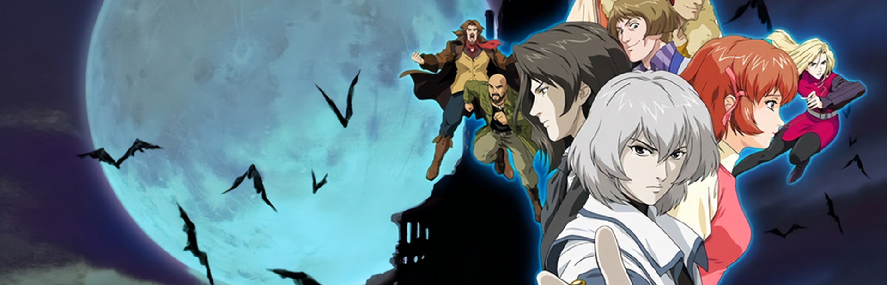
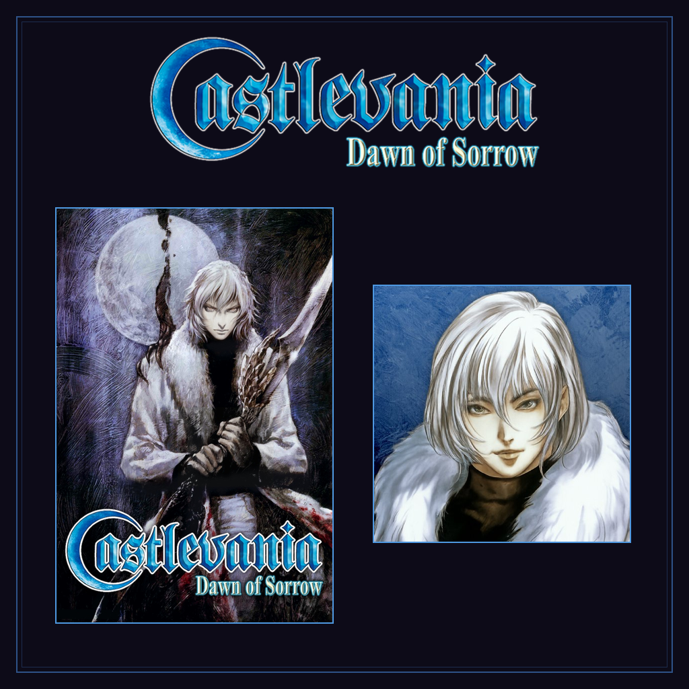
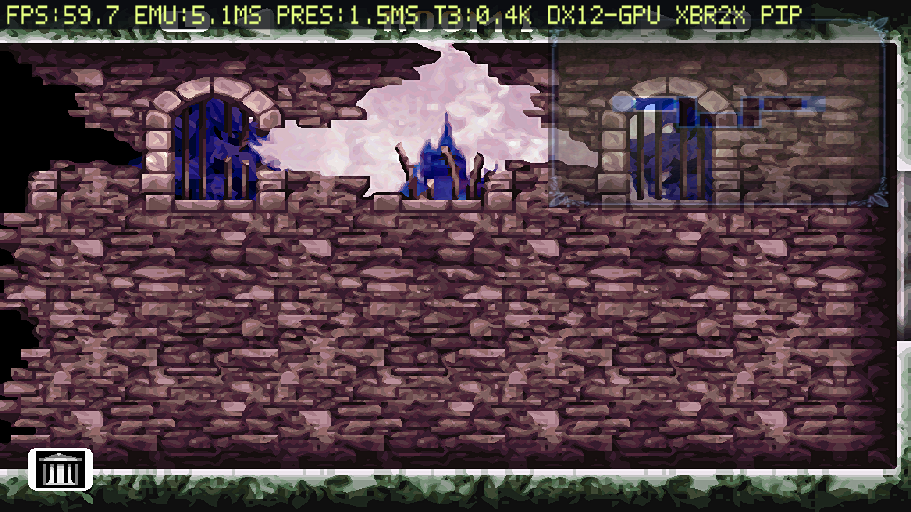

# Castlevania: Dawn of Sorrow: Recompiled

<p align="center">
  
</p>

<p align="center">
  
</p>

<p align="center">
  <a href="https://recomplauncher.com"><picture><source media="(prefers-color-scheme: dark)" srcset="https://recomplauncher.com/assets/press/launcher/badge-light.svg"></picture></a>
  <a href="https://github.com/Neguchads/cdos-nintendods-recomp/actions/workflows/ci.yml"></a>
</p>

**[English](#english) | [Português (BR)](#português-br)**

---

## English

Native PC port of *Castlevania: Dawn of Sorrow* (Nintendo DS, USA, game code `ACVE`) built on [`RetroPortingToolKit/ndsrecomp`](https://github.com/RetroPortingToolKit/ndsrecomp): the ARM9/ARM7 code is statically recompiled to C/C++ (no JIT, no Dynarmic). It adds GPU shaders for **Direct3D 12 (DXIL `ps_6_0`)** and **Vulkan 1.1 (SPIR-V)**, a bilingual **Dear ImGui** menu on `F1`, an optional **PT-BR translation applied in memory** and first-class **[RecompLauncher](https://recomplauncher.com)** support.

> **Legal notice:** this repository contains no ROMs, commercial BIOS or other copyrighted game data. You must provide your own legally dumped copy of `Castlevania - Dawn of Sorrow (USA).nds`: 64 MiB, CRC32 `135737f6`, SHA-1 `47530ff87e608f88105a314fdf36dc385f8dec94`. The PT-BR patch ([`mods/ptbr/dos-ptbr.dospatch`](mods/ptbr/dos-ptbr.dospatch)) is a binary delta, not a ROM; it only works on top of that exact USA dump.

### How to play (RecompLauncher)

1. Install **RecompLauncher** and add this recomp (or a release `.zip` that contains `recomplauncher.json`).
2. When Easy Setup asks for the game, pick your USA `.nds`. The launcher checks the game code (`ACVE`) and the dump (CRC32 `135737f6`) and shows the verified badge.
3. Press **Play**. The game opens full screen; press **`F1`** at any time for the settings menu. Menu language and game language (EN / PT-BR) are available both in RecompLauncher and in `F1`.

Saves, settings, savestates and screenshots live in RecompLauncher's `{data}` folder (`recompdata/`), so they move, back up and uninstall with the game.

### Media kit (RecompLauncher artwork)

Every image RecompLauncher asks for is in [`assets/recomplauncher/`](assets/recomplauncher), validated by [`tools/prepare_media_assets.py`](tools/prepare_media_assets.py).

| Slot | File | Size | Preview |
|---|---|---|---|
| Icon | [`icon.png`](assets/recomplauncher/icon.png), [`icon.ico`](assets/recomplauncher/icon.ico) | 256 x 256 (ICO: 256, 64, 48, 32, 16) |  |
| Cover | [`cover.jpg`](assets/recomplauncher/cover.jpg), [`cover.png`](assets/recomplauncher/cover.png) | 600 x 900 (2:3) |  |
| Hero / background | [`hero.jpg`](assets/recomplauncher/hero.jpg), [`hero.png`](assets/recomplauncher/hero.png) | 1920 x 620 |  |
| Logo (transparent) | [`logo.png`](assets/recomplauncher/logo.png) | 1000 x 500 (RGBA) |  |
| Wallpaper | [`wallpaper.png`](assets/recomplauncher/wallpaper.png) | 1920 x 1080 (16:9) |  |
| Key artwork (DS cartridge) | [`artwork.png`](assets/recomplauncher/artwork.png) | 1024 x 1024 |  |
| Catalog entry | [`catalog-entry.json`](assets/recomplauncher/catalog-entry.json) | `media_design` kind `ds` | n/a |

How to apply: [`docs/RECOMPLAUNCHER.md`](docs/RECOMPLAUNCHER.md).

### In-engine screenshots

Real captures from `nds_runner.exe` (1920 x 1080), in [`assets/screenshots/`](assets/screenshots).

| Direct3D 12, xBR 2x, picture-in-picture | `F1` menu over the two real screens | Vulkan SPIR-V, side-by-side, PT-BR |
|---|---|---|
|  |  |  |

### Highlights

- **Static AOT execution at about 60 FPS:** `34` promoted banks (`49,059` functions) plus `dos_arm9` / `dos_arm7` banks built with `--validate-live-bytes`, so code changed by a translation falls back safely. Clean PT-BR measurement in a visible DX12 window: **59.86 FPS** (`emu=3.72 ms`, `pres=0.78 ms`, `readback=0.00 ms`, `underruns=0`). Vulkan SPIR-V was checked visually at 60.0 FPS.
- **`F1` menu (Dear ImGui v1.92.9b, also `Esc` / controller `Guide`):** 6 tabs (Home, Screen & Layout, HD Graphics, Audio, Controls, Performance & Dev), full PT-BR / EN, drawn over the two real screens (the old "third screen" bug is fixed). Live brightness, contrast, saturation and vignette, PiP size (`20..50%`), VSync, stick deadzone, pause/mute when unfocused, 5 savestate slots, `.sav` backup, `F12` screenshot.
- **PT-BR translation in memory:** [`mods/ptbr/dos-ptbr.dospatch`](mods/ptbr/dos-ptbr.dospatch) (`DOSPATCH`, SHA-1 + CRC32 checked), based on the *romsportugues.com* T1.0 translation. Switch EN / PT-BR from the menu without touching your `.nds`.
- **RecompLauncher SDK:** [`recomplauncher.json`](recomplauncher.json) with named `inputs`, verified `dumps`, 30 settings (`config.new` defaults), `looks`, `actions`, `system` and `exit_codes`, plus the media kit above.
- **Multiplatform:** [`CMakePresets.json`](CMakePresets.json), [`tools/build_linux.sh`](tools/build_linux.sh) and an Android ARM64 skeleton in [`android/`](android). Only Windows is built and tested here; see [`docs/MULTIPLATFORM.md`](docs/MULTIPLATFORM.md).

### Controls and hotkeys

| DS action | Keyboard (WASD) | Keyboard (alt) | Controller (Xbox / PS) |
|---|---|---|---|
| Move | `W` `A` `S` `D` | Arrow keys | Left stick / D-pad |
| **Jump (`B`)** | **`Space`** | **`Space`** | **`A` / Cross** |
| Attack (`Y`) | `J` | `Z` | `X` / Square |
| Dodge (`L`) | `Left Shift` | `X` | `LB` / `L1` |
| Guardian Soul (`R`) | `K` | `C` | `RB` / `R1` |
| Action / Confirm (`A`) | `E` | `V` | `B` / Circle |
| Switch soul (`X`) | `Q` | `F` | `Y` / Triangle |
| Start / Select | `Enter` / `Tab` | `Enter` / `Backspace` | `Start` / `Back` |

Global: `F1` or `Guide` opens the menu, `F2` cycles layouts, `F3` swaps main screen and thumbnail, `F4` toggles the HUD, `F5` / `F8` save / load slot 1, `F6` or `` ` `` toggles turbo, `F11` or `Alt+Enter` toggles full screen, `F12` takes a screenshot. The mouse works on the bottom (touch) screen.

### Clone and dependencies

```powershell
git clone https://github.com/Neguchads/cdos-nintendods-recomp.git
cd cdos-nintendods-recomp
```

This repository expects two sibling folders in the same parent directory:

- `../ndsrecomp`: `RetroPortingToolKit/ndsrecomp` at commit `e4a7f419`, with [`patches/ndsrecomp-local.patch`](patches/ndsrecomp-local.patch) applied and Dear ImGui v1.92.9b in `runner/third_party/imgui/`.
- `../recomp-ui`: `RetroPortingToolKit/recomp-ui` at commit `f3f99a96`.

CI runs on GitHub Actions ([`ci.yml`](.github/workflows/ci.yml)); dependency updates come from Dependabot ([`dependabot.yml`](.github/dependabot.yml)).

### Build, run and package (Windows)

```powershell
python tools/setup_toolchains.py
python tools/build.py prepare
python tools/build.py banks
python tools/build.py promote
python tools/build.py ptbr-patch
python tools/build.py build
.\CastlevaniaDawnOfSorrow.exe
```

`python tools/build.py build` embeds [`assets/recomplauncher/icon.ico`](assets/recomplauncher/icon.ico) into both `runtime/nds_runner.exe` and the standalone root launcher `CastlevaniaDawnOfSorrow.exe`. On first run outside RecompLauncher, `CastlevaniaDawnOfSorrow.exe` validates your USA `.nds` dump (`64 MiB`, `ACVE`, CRC32 `135737f6`), installs it locally into `game/`, offers to create a Desktop shortcut with Soma Cruz's icon, and boots straight into the game with one click from then on. `.\play.bat` remains available as a console fallback.

Package a clean, ROM-free release for RecompLauncher into `dist/`:

```powershell
python tools/package_recomplauncher.py
```

### Verification

```powershell
ctest --test-dir generated/build-runner -R "screen_layout_test|frontend_config_test|dos_enhancements_test" --output-on-failure
python -m unittest discover -s tests -v
python tools/build.py smoke
python tools/prepare_media_assets.py --check-only
```

### Documentation

[`docs/RECOMPLAUNCHER.md`](docs/RECOMPLAUNCHER.md) | [`docs/MULTIPLATFORM.md`](docs/MULTIPLATFORM.md) | [`docs/DECISIONS.md`](docs/DECISIONS.md) | [`docs/rom-analysis.md`](docs/rom-analysis.md) | [`ROADMAP.md`](ROADMAP.md) | [`HANDOFF.md`](HANDOFF.md) | [`NOTAS.md`](NOTAS.md)

[Back to top / Voltar ao topo](#castlevania-dawn-of-sorrow-recompiled)

---

## Português (BR)

Port nativo para PC de *Castlevania: Dawn of Sorrow* (Nintendo DS, USA, código `ACVE`) baseado em [`RetroPortingToolKit/ndsrecomp`](https://github.com/RetroPortingToolKit/ndsrecomp): o código ARM9/ARM7 é recompilado estaticamente para C/C++ (sem JIT, sem Dynarmic). Traz shaders de GPU para **Direct3D 12 (DXIL `ps_6_0`)** e **Vulkan 1.1 (SPIR-V)**, menu bilíngue **Dear ImGui** no `F1`, **tradução PT-BR aplicada em memória** (opcional) e suporte completo ao **[RecompLauncher](https://recomplauncher.com)**.

> **Aviso legal:** este repositório não contém ROMs, BIOS comerciais nem outros dados protegidos do jogo. Use a sua própria cópia legal de `Castlevania - Dawn of Sorrow (USA).nds`: 64 MiB, CRC32 `135737f6`, SHA-1 `47530ff87e608f88105a314fdf36dc385f8dec94`. O patch PT-BR ([`mods/ptbr/dos-ptbr.dospatch`](mods/ptbr/dos-ptbr.dospatch)) é um delta binário, não uma ROM; só funciona sobre esse dump USA exato.

### Como jogar (RecompLauncher)

1. Instale o **RecompLauncher** e adicione este recomp (ou um `.zip` de release que contenha `recomplauncher.json`).
2. Quando o Easy Setup pedir o jogo, escolha o seu `.nds` USA. O launcher confere o código do jogo (`ACVE`) e o dump (CRC32 `135737f6`) e mostra o selo de verificado.
3. Aperte **Play**. O jogo abre em tela cheia; aperte **`F1`** a qualquer momento para o menu de opções. O idioma do menu e o idioma do jogo (EN / PT-BR) ficam tanto no RecompLauncher quanto no `F1`.

Saves, configurações, savestates e capturas ficam na pasta `{data}` do RecompLauncher (`recompdata/`), então acompanham o jogo ao mover, fazer backup e desinstalar.

### Kit de mídia (artes do RecompLauncher)

Todas as imagens que o RecompLauncher pede estão em [`assets/recomplauncher/`](assets/recomplauncher), validadas por [`tools/prepare_media_assets.py`](tools/prepare_media_assets.py).

| Slot | Arquivo | Tamanho | Prévia |
|---|---|---|---|
| Ícone | [`icon.png`](assets/recomplauncher/icon.png), [`icon.ico`](assets/recomplauncher/icon.ico) | 256 x 256 (ICO: 256, 64, 48, 32, 16) |  |
| Capa | [`cover.jpg`](assets/recomplauncher/cover.jpg), [`cover.png`](assets/recomplauncher/cover.png) | 600 x 900 (2:3) |  |
| Hero / fundo | [`hero.jpg`](assets/recomplauncher/hero.jpg), [`hero.png`](assets/recomplauncher/hero.png) | 1920 x 620 |  |
| Logo (transparente) | [`logo.png`](assets/recomplauncher/logo.png) | 1000 x 500 (RGBA) |  |
| Wallpaper | [`wallpaper.png`](assets/recomplauncher/wallpaper.png) | 1920 x 1080 (16:9) |  |
| Artwork principal (cartucho DS) | [`artwork.png`](assets/recomplauncher/artwork.png) | 1024 x 1024 |  |
| Entrada de catálogo | [`catalog-entry.json`](assets/recomplauncher/catalog-entry.json) | `media_design` tipo `ds` | n/d |

Como aplicar: [`docs/RECOMPLAUNCHER.md`](docs/RECOMPLAUNCHER.md).

### Capturas do motor

Capturas reais do `nds_runner.exe` (1920 x 1080), em [`assets/screenshots/`](assets/screenshots).

| Direct3D 12, xBR 2x, picture-in-picture | Menu `F1` sobre as duas telas reais | Vulkan SPIR-V, lado a lado, PT-BR |
|---|---|---|
|  |  |  |

### Destaques

- **Execução estática AOT a cerca de 60 FPS:** `34` bancos promovidos (`49.059` funções) e bancos `dos_arm9` / `dos_arm7` gerados com `--validate-live-bytes`, para que código alterado por uma tradução caia em fallback seguro. Medição limpa em PT-BR, janela visível DX12: **59,86 FPS** (`emu=3,72 ms`, `pres=0,78 ms`, `readback=0,00 ms`, `underruns=0`). O Vulkan SPIR-V foi conferido visualmente a 60,0 FPS.
- **Menu `F1` (Dear ImGui v1.92.9b, também `Esc` / botão `Guide`):** 6 abas (Início, Tela & Layout, Gráficos HD, Áudio, Controles, Desempenho & Dev), PT-BR / EN completo, desenhado sobre as duas telas reais (o bug da "terceira tela" foi corrigido). Brilho, contraste, saturação e vinheta ao vivo, tamanho do PiP (`20..50%`), VSync, zona morta do analógico, pausar/silenciar fora de foco, 5 slots de savestate, backup do `.sav`, captura `F12`.
- **Tradução PT-BR em memória:** [`mods/ptbr/dos-ptbr.dospatch`](mods/ptbr/dos-ptbr.dospatch) (`DOSPATCH`, SHA-1 + CRC32 verificados), baseada na tradução T1.0 do *romsportugues.com*. Troque EN / PT-BR pelo menu sem tocar no seu `.nds`.
- **SDK do RecompLauncher:** [`recomplauncher.json`](recomplauncher.json) com `inputs` nomeados, `dumps` verificados, 30 opções (defaults em `config.new`), `looks`, `actions`, `system` e `exit_codes`, mais o kit de mídia acima.
- **Multiplataforma:** [`CMakePresets.json`](CMakePresets.json), [`tools/build_linux.sh`](tools/build_linux.sh) e esqueleto Android ARM64 em [`android/`](android). Só o Windows é compilado e testado aqui; veja [`docs/MULTIPLATFORM.md`](docs/MULTIPLATFORM.md).

### Controles e atalhos

| Ação (DS) | Teclado (WASD) | Teclado (alt.) | Controle (Xbox / PS) |
|---|---|---|---|
| Mover | `W` `A` `S` `D` | Setas | Analógico esq. / D-Pad |
| **Pular (`B`)** | **`Espaço`** | **`Espaço`** | **`A` / Cruz** |
| Atacar (`Y`) | `J` | `Z` | `X` / Quadrado |
| Esquiva (`L`) | `Shift Esq.` | `X` | `LB` / `L1` |
| Alma Guardiã (`R`) | `K` | `C` | `RB` / `R1` |
| Ação / Confirmar (`A`) | `E` | `V` | `B` / Círculo |
| Trocar alma (`X`) | `Q` | `F` | `Y` / Triângulo |
| Start / Select | `Enter` / `Tab` | `Enter` / `Backspace` | `Start` / `Back` |

Globais: `F1` ou `Guide` abre o menu, `F2` alterna o layout, `F3` troca tela principal e miniatura, `F4` liga/desliga o HUD, `F5` / `F8` salva / carrega o slot 1, `F6` ou `` ` `` alterna o turbo, `F11` ou `Alt+Enter` alterna tela cheia, `F12` captura a tela. O mouse funciona na tela inferior (toque).

### Clone e dependências

```powershell
git clone https://github.com/Neguchads/cdos-nintendods-recomp.git
cd cdos-nintendods-recomp
```

Este repositório espera duas pastas irmãs no mesmo diretório pai:

- `../ndsrecomp`: `RetroPortingToolKit/ndsrecomp` no commit `e4a7f419`, com [`patches/ndsrecomp-local.patch`](patches/ndsrecomp-local.patch) aplicado e Dear ImGui v1.92.9b em `runner/third_party/imgui/`.
- `../recomp-ui`: `RetroPortingToolKit/recomp-ui` no commit `f3f99a96`.

A CI roda no GitHub Actions ([`ci.yml`](.github/workflows/ci.yml)); as atualizações de dependências vêm do Dependabot ([`dependabot.yml`](.github/dependabot.yml)).

### Compilar, rodar e empacotar (Windows)

```powershell
python tools/setup_toolchains.py
python tools/build.py prepare
python tools/build.py banks
python tools/build.py promote
python tools/build.py ptbr-patch
python tools/build.py build
.\CastlevaniaDawnOfSorrow.exe
```

`python tools/build.py build` embute [`assets/recomplauncher/icon.ico`](assets/recomplauncher/icon.ico) tanto em `runtime/nds_runner.exe` quanto no executável standalone `CastlevaniaDawnOfSorrow.exe` na raiz. Na primeira execução fora do RecompLauncher, o `CastlevaniaDawnOfSorrow.exe` valida a sua ROM USA `.nds` (`64 MiB`, `ACVE`, CRC32 `135737f6`), instala a cópia localmente em `game/`, oferece criar o atalho na Área de Trabalho com o ícone do Soma Cruz e a partir daí abre direto no jogo com 1 clique. `.\play.bat` continua disponível como alternativa de console.

Gere um pacote limpo, sem ROM, para o RecompLauncher em `dist/`:

```powershell
python tools/package_recomplauncher.py
```

### Verificação

```powershell
ctest --test-dir generated/build-runner -R "screen_layout_test|frontend_config_test|dos_enhancements_test" --output-on-failure
python -m unittest discover -s tests -v
python tools/build.py smoke
python tools/prepare_media_assets.py --check-only
```

### Documentação

[`docs/RECOMPLAUNCHER.md`](docs/RECOMPLAUNCHER.md) | [`docs/MULTIPLATFORM.md`](docs/MULTIPLATFORM.md) | [`docs/DECISIONS.md`](docs/DECISIONS.md) | [`docs/rom-analysis.md`](docs/rom-analysis.md) | [`ROADMAP.md`](ROADMAP.md) | [`HANDOFF.md`](HANDOFF.md) | [`NOTAS.md`](NOTAS.md)

[Voltar ao topo / Back to top](#castlevania-dawn-of-sorrow-recompiled)
