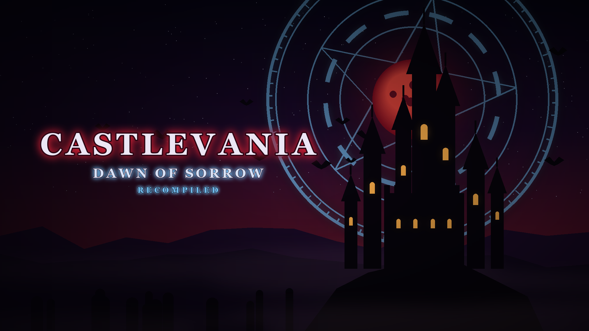

# Castlevania: Dawn of Sorrow: Recompiled

<p align="center">
  
</p>

<p align="center">
  
</p>

<p align="center">
  <a href="https://recomplauncher.com/game/cdos-nintendods-recomp"><picture><source media="(prefers-color-scheme: dark)" srcset="https://recomplauncher.com/assets/press/launcher/badge-light.svg"></picture></a>
  <a href="https://github.com/Neguchads/cdos-nintendods-recomp/releases/tag/v1.3.0"></a>
  <a href="https://github.com/Neguchads/cdos-nintendods-recomp/actions/workflows/ci.yml"></a>
  <a href="https://discord.gg/s7CWbpZJ"></a>
</p>

**[English](#english) | [Português (BR)](#português-br)**

---

## English

Native PC port of *Castlevania: Dawn of Sorrow* (Nintendo DS, USA, game code `ACVE`) built on [`RetroPortingToolKit/ndsrecomp`](https://github.com/RetroPortingToolKit/ndsrecomp): the ARM9/ARM7 code is statically recompiled to C/C++ (no JIT, no Dynarmic). Ships with **Direct3D 12 (`DXIL ps_6_0`)** and **Vulkan 1.1 (`SPIR-V`)** HD-2D shaders, a bilingual **Dear ImGui (`F1`)** menu, **modular stackable in-memory mod support** (combine **Tradução PT-BR v1.1** with **Dawn of Dignity**, **No Magic Seals**, **Fixed Luck**, **Voice Restore**, or any `.xdelta` / `.ips` / `.dospatch` locally), **Minimap HUD (Samus Returns 16:9)**, **Exact 60 Hz Pitch-Preserving VSync**, **GBA Slot-2 *Aria of Sorrow* Bonus**, **Custom Music**, and first-class **[RecompLauncher](https://recomplauncher.com/game/cdos-nintendods-recomp)** support.

> **Legal & creator-respect notice:** this repository contains **no ROMs, no commercial BIOS, no copyrighted game data, and no bundled third-party mods or translations**. You must provide your own legally dumped copy of `Castlevania - Dawn of Sorrow (USA).nds`: 64 MiB, CRC32 `135737f6`, SHA-1 `47530ff87e608f88105a314fdf36dc385f8dec94`. Community patches and translations obtained directly from their authors are loaded locally in memory via `F1 -> Mods` (`{data}/mods/profiles/`) without ever modifying your ROM.


### Development progress / Status dashboard

<a href="docs/FEATURE_STATUS.md">
<picture>
  <source media="(prefers-color-scheme: dark)" srcset="assets/dashboard/project-status-dark.svg">
  <source media="(prefers-color-scheme: light)" srcset="assets/dashboard/project-status.svg">
  
</picture>
</a>

<details>
<summary>View progress cards for all 21 subsystems</summary>

<picture>
  <source media="(prefers-color-scheme: dark)" srcset="assets/dashboard/subsystems-dark.svg">
  <source media="(prefers-color-scheme: light)" srcset="assets/dashboard/subsystems.svg">
  
</picture>

</details>

[Full feature audit](docs/FEATURE_STATUS.md) · [Quality methodology and platform matrix](docs/FEATURE_ASSURANCE.md) · [Machine-readable metrics](quality/progress.json)

Percentages are catalog-based implementation and historical documented verification, not overall release readiness or newly executed tests.

### Key Features at a Glance

- **Modular Stackable Mods & Authorized PT-BR v1.1 (`F1 -> Mods`):** freely combine **Tradução PT-BR v1.1** (authorized by `@leomontenegro6` in `cdos-traducao-ptbr#1`) with **Dawn of Dignity**, **No Magic Seals**, **Fixed Luck**, and **Voice Restore Project** via checkboxes using our **3-way in-memory byte-diff merger** + automatic NDS header CRC-16 recomputation (inspired by `cdos-patcher-tool`). Includes per-mod **`Patch...`**, **`Official Page`**, and **`Info`** preview cards, bundled **`xdelta3.exe`** (Apache-2.0) for DJW/LZMA `.xdelta` patches out of the box, isolated saves per stack, and zero bundled third-party files.
- **Minimap HUD (Samus Returns 16:9) & True 2D Widescreen:** compact translucent `24%` top-right map overlay + **1-Click 16:9 Metroidvania HUD** preset, **Widescreen Theatre**, **16:9 Smart Crop**, **21:9 Ultrawide**, and opt-in **True 2D Widescreen `342×192`** (Beta) with seamless `BG2` sky wrap and automatic `256×192` pillarbox on menus.
- **Multi-Pass HD-2D Upscalers & Exact `60.0 Hz` Sync:** 8 curated GPU scalers (`Pixellate`, `Pixel-AA`, `Bandlimited`, `MMPX 2×`, `OmniScale`, `ScaleFX-Hybrid 3×`), `GDAPT` Anti-Dither, 5-pass Dual Kawase Bloom, 6 one-click Visual Profiles, and **Exact `60.0 Hz` Pitch-Preserving VSync (`sync60`)** via real-time WSOLA audio splicing (stutter-free on 60 Hz monitors with zero pitch shift).
- **GBA Slot-2 *Aria of Sorrow* Bonus & Custom Music:** toggleable clean-room 192-byte GBA Slot-2 header (`A2CE`) unlocking **Rare Ring** + **Mina's Doll** without a GBA ROM, plus native **`.wav` / `.mp3` / `.ogg` Custom Music** with Per-Stage Mapper & Global Jukebox while keeping 100% of original DS sound effects and voices.
- **Community & Support:** join our **[Discord Server](https://discord.gg/s7CWbpZJ)** for setup help, testing, and mod compatibility discussion.

### Community contributions welcome

This is a community-driven open-source project. **All help is welcome!** Whether you are a developer, tester, player, modder or simply interested in the project, your contributions matter.

- Pull requests, code reviews, bug fixes, performance improvements and refactoring.
- Testing, reproducible bug reports, compatibility feedback and technical support for other users.
- New features, ideas, documentation, translations and accessibility improvements.

You can [open an issue](https://github.com/Neguchads/cdos-nintendods-recomp/issues), [submit a pull request](https://github.com/Neguchads/cdos-nintendods-recomp/pulls), [start a discussion](https://github.com/Neguchads/cdos-nintendods-recomp/discussions) or join our [Discord community](https://discord.gg/s7CWbpZJ). Contributions of any size are appreciated. Please keep submissions respectful, reproducible and consistent with the project's clean-room and creator-permission policies.

**Before opening an issue:** please search both open and closed issues and existing pull requests, check the [feature status and audit](docs/FEATURE_STATUS.md), [roadmap](ROADMAP.md), [release notes](https://github.com/Neguchads/cdos-nintendods-recomp/releases) and current game settings (F1). Confirm whether the feature or idea already exists, is planned, or has been reported. If a matching issue exists, add useful information there instead of creating a duplicate. If the existing feature is incomplete or broken, explain the missing behavior and include the version you tested. New ideas and genuine regressions are always welcome.

See [CONTRIBUTING.md](CONTRIBUTING.md) for practical guidelines.

### Help us expand the Castlevania recompilation ecosystem

We are looking for community support, technical ideas and collaborators to explore future Castlevania recompilation projects beyond Dawn of Sorrow:

- **Dominus Collection / Nintendo DS trilogy:** explore independent native ports and shared technology for Dawn of Sorrow, Portrait of Ruin and Order of Ecclesia, as well as possible compatibility with legally obtained Dominus Collection assets where technically and legally feasible.
- **Game Boy Advance trilogy:** explore native recompilation of Circle of the Moon, Harmony of Dissonance and Aria of Sorrow from legally dumped original ROMs.

Developers, reverse engineers, tooling maintainers, testers, modders and players are invited to share research, open-source tools, technical proposals, code reviews and pull requests. We welcome ideas for reusable recompilation pipelines, rendering, audio, controls, modding and cross-platform support.

These are exploratory community goals, not announced releases or commitments. Please share ideas in [Discussions](https://github.com/Neguchads/cdos-nintendods-recomp/discussions) or [Discord](https://discord.gg/s7CWbpZJ) and review existing work before opening new issues. This is an unofficial, independent effort; do not submit commercial ROMs, BIOS, proprietary game assets or unauthorized third-party content. Dawn of Sorrow remains the current repository's primary focus.

### How to play

**Option A — RecompLauncher (recommended):**
1. Install **RecompLauncher** and add this recomp (or a release `.zip` that contains `recomplauncher.json`).
2. When Easy Setup asks for the game, pick your USA `.nds`. The launcher checks the game code (`ACVE`) and the dump (CRC32 `135737f6`) and shows the verified badge.
3. Press **Play**. The game starts in **English (`en`)** by default; press **`F1`** at any time to open the settings menu or switch the menu/game language to **Português (BR)** in memory (also configurable inside RecompLauncher).

Saves, settings, savestates and screenshots live in RecompLauncher's `{data}` folder (`recompdata/`), so they move, back up and uninstall with the game.

**Option B — Standalone Windows (`CastlevaniaDawnOfSorrow.exe`):**
1. Extract the release `.zip` and double-click **`CastlevaniaDawnOfSorrow.exe`** (with embedded Soma Cruz icon).
2. On first run, select your legal USA `.nds` file (`64 MiB`, `ACVE`, CRC32 `135737f6`). The launcher verifies it, installs a local copy inside `game/`, offers to create a **Desktop shortcut**, and launches the game.
3. On every subsequent run, double-clicking the Desktop shortcut or `CastlevaniaDawnOfSorrow.exe` opens the game directly with one click.

### Media kit (RecompLauncher artwork)

Every image RecompLauncher asks for is in [`assets/recomplauncher/`](assets/recomplauncher), validated by [`tools/prepare_media_assets.py`](tools/prepare_media_assets.py).

| Slot | File | Size | Preview |
|---|---|---|---|
| Icon | [`icon.png`](assets/recomplauncher/icon.png), [`icon.ico`](assets/recomplauncher/icon.ico) | 256 x 256 (ICO: 256, 64, 48, 32, 16) |  |
| Cover | [`cover.jpg`](assets/recomplauncher/cover.jpg), [`cover.png`](assets/recomplauncher/cover.png) | 600 x 900 (2:3) |  |
| Hero / background | [`hero.jpg`](assets/recomplauncher/hero.jpg), [`hero.png`](assets/recomplauncher/hero.png) | 1920 x 620 |  |
| Logo (transparent) | [`logo.png`](assets/recomplauncher/logo.png) | 1000 x 500 (RGBA) |  |
| Wallpaper | [`wallpaper.png`](assets/recomplauncher/wallpaper.png) | 1920 x 1080 (16:9) |  |
| Key artwork (DS cartridge) | [`artwork.png`](assets/recomplauncher/artwork.png) | 1024 x 1024 |  |
| Catalog entry | [`catalog-entry.json`](assets/recomplauncher/catalog-entry.json) | `media_design` kind `ds` | n/a |

How to apply: [`docs/RECOMPLAUNCHER.md`](docs/RECOMPLAUNCHER.md).

### In-engine screenshots

Real captures from `nds_runner.exe` (1920 x 1080), in [`assets/screenshots/`](assets/screenshots).

| Direct3D 12, HD GPU shader, picture-in-picture | `F1` menu over the two real screens | Vulkan SPIR-V, side-by-side, PT-BR |
|---|---|---|
|  |  |  |

### Highlights

- **Static AOT execution at about 60 FPS:** `34` promoted banks (`49,059` functions) plus `dos_arm9` / `dos_arm7` banks built with `--validate-live-bytes`, so code changed by a translation falls back safely. Clean PT-BR measurement in a visible DX12 window: **59.86 FPS** (`emu=3.72 ms`, `pres=0.78 ms`, `readback=0.00 ms`, `underruns=0`). Vulkan SPIR-V was checked visually at 60.0 FPS.
- **`F1` menu (Dear ImGui v1.92.9b, also `Esc` / controller `Guide`):** 7 tabs (Home, Screen & Layout, HD Graphics, Audio, Controls, Mods & Campaigns, Performance & Dev), **English (`en`) default** with **Português (BR)** selectable live, drawn over the two real screens (the old "third screen" bug is fixed). Live brightness, contrast, saturation and vignette, PiP size (`20..50%`), VSync, stick deadzone, mouse/keyboard/gamepad remapping with per-key **`X`** clear, **Clear All Mappings**, and **Restore Default Controls**, pause/mute when unfocused, 5 savestate slots, `.sav` backup, `F12` screenshot.
- **Generic Local Mod Support & Pre-Wired Manual-Import Slots (`F1 -> Mods & Campaigns`, zero third-party mods bundled):** clean [`mods/registry.json`](mods/registry.json) shipping only the retail **Original USA** baseline plus attributed `manual_import` slots (**Tradução PT-BR v1.1 Vanilla & Definitive Edition** by Hyllian, Solid One/`@leomontenegro6`, Neko Belmont, Mysterioso, denim, djmatheusito, victoriemini — ref. [João13 Traduções](https://joao13traducoes.com/2018/02/nds-castlevania-dawn-of-sorrow-varios-autores/), **Definitive Edition+**, **Eternity of Sorrow** authorized by `@Wet-Band-Aid` in #44, **Alucard's Requiem**, and **Dracula's Curse** — zero files bundled or downloaded). Every slot has inline **`Patch...`** (targeted 1-click `.xdelta`/`.ips`/`.dospatch` importer) and **`Official Page`** buttons inside `F1 -> Mods`, alongside generic **`Import Patch...`** and **`Open Mods Folder`** backed by native C++ **`.xdelta` / `.vcdiff` (RFC 3284, with automatic `xdelta3.exe` fallback for DJW/LZMA), `.ips`, and `.dospatch`** loaders in `{data}/mods/profiles/`, 3-state `ConflictEngine`, isolated saves/savestates, power-of-two cartridge padding, offline **Native C++ Seed Mutator**, and `tools/import_dsvrandom.py`. See [`docs/CREDITS.md`](docs/CREDITS.md) and [`docs/CREATOR_OUTREACH.md`](docs/CREATOR_OUTREACH.md).
- **Native Opening Video Player (Windows Media Foundation + SDL3):** optionally place a user-supplied H.264/AAC MP4 at `{data}/mods/intro/opening.mp4` to play a custom opening video natively on launch (zero FFmpeg/external DLLs, skippable with any key/click/button, toggleable and replayable in `F1`).
- **Custom Music Support (`.wav` / `.mp3` / `.ogg`, Issue #16):** drop audio files with **any filename** into `{data}/mods/music/`, or double-click **`mods/music/Configurar_Musica.bat`** to pick files via Windows Explorer and assign them automatically. Inside **`F1 -> Audio`**, you can map any file to any of the 30 game stages (**Per-Stage Visual Track Mapper**), or enable **Global Jukebox / Playlist Mode** (mutes all 30 DS BGMs and plays your selected song(s) continuously with Shuffle/Prev/Next) while keeping **100% of original DS sound effects and voices** (see [`mods/music/README.md`](mods/music/README.md) and `python tools/list_bgm_tracks.py`).
- **Multi-Pass GPU Upscalers & HD-2D Display Suite (`F1 -> HD Graphics` & `Screen & Layout`, DXIL `ps_6_0` + Vulkan 1.1 SPIR-V):**
  - **8 curated 2D pixel-art & modern scalers (`<= 0.8 ms` GPU time):** linear-sRGB **`Pixellate`** (crisp shimmerless default), **`Pixel-AA`**, **`Bandlimited Pixel`** (TheMaister cosine integral), **`MMPX 2×`** (NVIDIA detail-preserving 2× offscreen pass), **`OmniScale`** (smooth perceptual diagonals), **`ScaleFX-Hybrid 3×`** (vector-clean curves + subtle interior reverse-AA), plus `Nearest` and `Bilinear`.
  - **Selective Anti-Dither (`GDAPT`) & 5-Pass Dual Kawase HD-2D Bloom:** smoothly blends 1px checkerboard/stripe fog in linear light without blurring outlines or text, paired with wide cinematic bloom aligned to CRT curvature, bezel, and vignette, moiré-free analytical `Scanlines`/`CRT`/`NDS LCD Grid`, live Gamma/Color Temperature/Contrast/Saturation, **6 one-click Visual Profiles** (*Modern HD Crisp*, *HD-2D Remaster*, *Vector HD ScaleFX*, *Pixel Purist*, *Classic CRT*, *DS Handheld*), multi-monitor SDL3 selector, `2x..6x` windowed scale presets, `21:9 Ultrawide Cinema`, `0..10%` Display Safe Zone, 4-mode VSync (`Off`/`On`/`Adaptive`/`60Hz Exact Sync` with pitch-preserving WSOLA audio pacing — Issue #39), live `120 Hz` Frame Interpolation, and persistent 3D MSAA (`Off/2x/4x/8x`).
- **Seamless 2D Widescreen & Samus Returns Minimap HUD (Issue #7):** includes **Minimap HUD (Samus Returns 16:9)** (compact translucent `24%` top-right map overlay + **1-Click 16:9 Metroidvania HUD** preset in `F1 -> Screen & Layout`), **Widescreen Theatre** (`342×192` 16:9 canvas with 4:3 gameplay + docked Map/Status sidebar, *Dominus Collection* style), **16:9 Smart Crop** (1:1 square pixels with `-24..+24 px` vertical offset and exact touch mapping), **16:10 Balanced**, **21:9 Ultrawide**, and opt-in **True 2D Widescreen `16:9` (`342×192`)** with `Edge-Anchored` vs `Centered 4:3` HUD, seamless `1×N` hardware `BG2` sky/castle wrapping and wide 3D atmospheric fog expansion (zero black bands or `x = 271` seam on Lost Village Bridge & Plaza), plus automatic `256×192` pillarbox on menus, prologues, and single-screen rooms.
- **Open-Source Attribution & Creator Policy:** engine and library credits plus our creator-permission policy (no third-party mods bundled or auto-fetched without explicit author permission) are documented in [`docs/CREDITS.md`](docs/CREDITS.md).
- **RecompLauncher SDK & Native MSVC Standalone `.exe`:** [`recomplauncher.json`](recomplauncher.json) with named `inputs`, verified `dumps`, `{install}`/`{data}` path resolution, `49` INI settings (`config.new` defaults), `looks`, `actions`, `system` and `exit_codes`, plus native MSVC 2022 [`CastlevaniaDawnOfSorrow.exe`](launcher/launcher_win32.cpp) (`443 KB`, embedded icon & UTF-8 `asInvoker` manifest) and strict `runtime/` packaging allowlist.
- **Multiplatform:** [`CMakePresets.json`](CMakePresets.json), [`tools/build_linux.sh`](tools/build_linux.sh) and an Android ARM64 skeleton in [`android/`](android). Only Windows is built and tested here; see [`docs/MULTIPLATFORM.md`](docs/MULTIPLATFORM.md).

### Feature Status (Verified vs. Experimental)

| Feature | Status | Notes |
|---|---|---|
| Original USA (`ACVE`) Clean Baseline | **Verified** | Default clean-room execution at ~60 FPS (`emu ~3.7 ms`, `0` audio underruns) |
| Modular Stackable Add-Ons & Local Mod Loader (`.xdelta`/`.ips`/`.dospatch`, bundled `xdelta3.exe`) | **Verified** | 3-way in-memory byte-diff merger (combine PT-BR v1.1 + *Dawn of Dignity*, *No Magic Seals*, *Fixed Luck*, *Voice Restore*) + per-mod `Patch...` / `Official Page` / `Info` cards + isolated saves; zero bundled third-party mods |
| GBA Slot-2 Bonus: *Aria of Sorrow* (`dos_gba_slot2_aria`) | **Verified** | Clean-room 192-byte `A2CE` header toggleable in `F1 -> Mods` & `recomplauncher.json` (unlocks **Rare Ring** + **Mina's Doll**) |
| Exact `60.0 Hz` Pitch-Preserving VSync (`sync60`) | **Verified** | Real-time Hann-windowed WSOLA audio splicer (`0` crackles, `0.00%` pitch shift) for stutter-free 60 Hz LCD playback |
| Custom Music (`.wav`/`.mp3`/`.ogg`, F1 Mapper, Global Jukebox, Explorer Wizard) | **Verified** | Live-verified selective BGM mute (`DS BGM = 0`, `DS SFX = 100%`) |
| Multi-Pass GPU Upscalers (`Pixellate`, `Pixel-AA`, `Bandlimited`, `MMPX 2×`, `OmniScale`, `ScaleFX-Hybrid 3×`), Anti-Dither & Dual Kawase HD-2D Bloom | **Verified** | Live-verified on DX12 (`DXIL ps_6_0`) & Vulkan (`SPIR-V`), `<= 0.8 ms` GPU time |
| Expanded Display Suite (Multi-Monitor, `2x..6x`, `21:9`, Safe Zone, 4-Mode VSync, 120 Hz Interpolation, 6 Visual Profiles) | **Verified** | Full SDL3 & 80-byte GPU shader controls persisted in INI and `recomplauncher.json` |
| 2D Widescreen & Minimap HUD (`Minimap HUD 16:9`, `Theatre`, `Smart Crop 16:9`, `Balanced 16:10`, `Ultrawide 21:9`) | **Verified** | Samus Returns-style `24%` top-right map overlay + 1-click Metroidvania 16:9 HUD preset + distortion-free touch mapping |
| True 2D Widescreen `16:9` (`342×192`) | **Opt-in (Beta)** | Seamless `BG2` sky wrap + atmospheric quad expansion verified on Lost Village Bridge/Plaza (`F1 -> Screen & Layout`, off by default; full-campaign audit ongoing) |
| Native Opening Video Player (`{data}/mods/intro/opening.mp4`) | **Verified (Opt-in)** | Local user-supplied video only; never bundled in clean-room releases |
| Native C++ Seed Mutator (Offline Randomizer) | **Experimental (`unverified`)** | Non-progression regular enemy stats/drops only; local randomizer output importer via `tools/import_dsvrandom.py` |

### Controls and hotkeys

| DS action | Key / Mouse 1 (Default) | Key / Mouse 2 (Alt) | Controller (Xbox / PS) |
|---|---|---|---|
| Move | `W` `A` `S` `D` | Arrow keys | Left stick / D-pad |
| **Jump (`B`)** | **`Space`** | **`Space`** | **`A` / Cross** |
| **Primary Attack (`Y`)** | **`Mouse Left`** | `J` | `X` / Square |
| **Special Attack / Confirm (`A`)** | **`Mouse Right`** | `E` | `B` / Circle |
| **Dash / Backdash (`L`)** | **`Q`** | **`Mouse Middle` (Wheel Click)** | `LB` / `L1` |
| **Guardian Soul (`R`)** | **`R`** | `K` | `RB` / `R1` |
| Switch Set / Doppelganger (`X`) | `F` | `C` | `Y` / Triangle |
| Start / Select | `Enter` / `Tab` | `Enter` / `Backspace` | `Start` / `Back` |

Everything above is fully customizable in **`F1` -> Controls**: click any cell to bind a keyboard key or mouse button (`Left`, `Middle`, `Right`, `X1`, `X2`), click **`X`** next to any cell (or press `Delete` while binding) to clear a single mapping, or use **Clear All Mappings** / **Restore Default Controls**. Bottom-screen touch clicks (menus, items, Magic Seals, ice blocks) remain active alongside combat mouse buttons.

Global: `F1` or `Guide` opens the menu, `F2` cycles layouts, `F3` swaps main screen and thumbnail, `F4` toggles the HUD, `F5` / `F8` save / load slot 1, `F6` or `` ` `` toggles turbo, `F11` or `Alt+Enter` toggles full screen, `F12` takes a screenshot.

### Clone and dependencies

```powershell
git clone https://github.com/Neguchads/cdos-nintendods-recomp.git
cd cdos-nintendods-recomp
```

This repository expects two sibling folders in the same parent directory:

- `../ndsrecomp`: `RetroPortingToolKit/ndsrecomp` at commit `e4a7f419`, with [`patches/ndsrecomp-local.patch`](patches/ndsrecomp-local.patch) applied and Dear ImGui v1.92.9b in `runner/third_party/imgui/`.
- `../recomp-ui`: `RetroPortingToolKit/recomp-ui` at commit `f3f99a96`.

CI runs on GitHub Actions ([`ci.yml`](.github/workflows/ci.yml)); dependency updates come from Dependabot ([`dependabot.yml`](.github/dependabot.yml)).

### Build, run and package (Windows)

```powershell
python tools/setup_toolchains.py
python tools/build.py prepare
python tools/build.py banks
python tools/build.py promote
python tools/build.py ptbr-patch
python tools/build.py build
.\CastlevaniaDawnOfSorrow.exe
```

`python tools/build.py build` embeds [`assets/recomplauncher/icon.ico`](assets/recomplauncher/icon.ico) into both `runtime/nds_runner.exe` and the standalone root launcher `CastlevaniaDawnOfSorrow.exe`. On first run outside RecompLauncher, `CastlevaniaDawnOfSorrow.exe` validates your USA `.nds` dump (`64 MiB`, `ACVE`, CRC32 `135737f6`), installs it locally into `game/`, offers to create a Desktop shortcut with Soma Cruz's icon, and boots straight into the game with one click from then on. `.\play.bat` remains available as a console fallback.

Package a clean, ROM-free release for RecompLauncher into `dist/`:

```powershell
python tools/package_recomplauncher.py
```

### Verification

```powershell
ctest --test-dir generated/build-runner -R "screen_layout_test|frontend_config_test|dos_enhancements_test" --output-on-failure
python -m unittest discover -s tests -v
python tools/build.py smoke
python tools/prepare_media_assets.py --check-only
```

### Special Thanks & Authorized Community Modders

Thank you to the creators who explicitly authorized compatibility slots and helped shape the mod architecture of this project (zero third-party patches are bundled — download directly from each creator's official page):

- **[@Wet-Band-Aid](https://github.com/Wet-Band-Aid)** — creator of **[Castlevania: Eternity of Sorrow](https://github.com/Wet-Band-Aid/Castlevania---Eternity-of-Sorrow)**, who authorized the `Eternity of Sorrow` slot and inspired the in-game **Mod Info & Preview Card** ([Issue #44](https://github.com/Neguchads/cdos-nintendods-recomp/issues/44)).
- **[@leomontenegro6](https://github.com/leomontenegro6) (Solid One)** & the **Tradução PT-BR v1.1 Team** (**Hyllian, Solid One, Neko Belmont, Mysterioso, denim, djmatheusito, victoriemini** — **[cdos-traducao-ptbr](https://github.com/leomontenegro6/cdos-traducao-ptbr)**, **[cdos-patcher-tool](https://github.com/leomontenegro6/cdos-patcher-tool)**, [João13 Traduções](https://joao13traducoes.com/2018/02/nds-castlevania-dawn-of-sorrow-varios-autores/)) — who authorized the PT-BR v1.1 slot and inspired our **modular stackable patch composition** ([cdos-traducao-ptbr#1](https://github.com/leomontenegro6/cdos-traducao-ptbr/issues/1)).

For full open-source library attributions and all community mod authors, see [`docs/CREDITS.md`](docs/CREDITS.md).

### Documentation

[`CHANGELOG.md`](CHANGELOG.md) | [`docs/CREDITS.md`](docs/CREDITS.md) | [`docs/RECOMPLAUNCHER.md`](docs/RECOMPLAUNCHER.md) | [`docs/RBS.md`](docs/RBS.md) | [`docs/CI_AUTOMATION.md`](docs/CI_AUTOMATION.md) | [`docs/BUILD_CACHE.md`](docs/BUILD_CACHE.md) | [`docs/MULTIPLATFORM.md`](docs/MULTIPLATFORM.md) | [`docs/DECISIONS.md`](docs/DECISIONS.md) | [`docs/rom-analysis.md`](docs/rom-analysis.md) | [`ROADMAP.md`](ROADMAP.md) | [`HANDOFF.md`](HANDOFF.md) | [`NOTAS.md`](NOTAS.md)

[Back to top / Voltar ao topo](#castlevania-dawn-of-sorrow-recompiled)

---

## Português (BR)

Port nativo para PC de *Castlevania: Dawn of Sorrow* (Nintendo DS, USA, código `ACVE`) baseado em [`RetroPortingToolKit/ndsrecomp`](https://github.com/RetroPortingToolKit/ndsrecomp): o código ARM9/ARM7 é recompilado estaticamente para C/C++ (sem JIT, sem Dynarmic). Traz shaders HD-2D para **Direct3D 12 (`DXIL ps_6_0`)** e **Vulkan 1.1 (`SPIR-V`)**, menu bilíngue **Dear ImGui (`F1`)**, **suporte modular e combinável a mods locais em memória** (combine **Tradução PT-BR v1.1** com **Dawn of Dignity**, **No Magic Seals**, **Fixed Luck**, **Voice Restore** ou qualquer `.xdelta` / `.ips` / `.dospatch`), **Minimap HUD (Samus Returns 16:9)**, **VSync Exato 60 Hz sem alterar o tom**, **Bônus Slot-2 GBA *Aria of Sorrow***, **Música Customizada** e suporte completo ao **[RecompLauncher](https://recomplauncher.com/game/cdos-nintendods-recomp)**.

> **Aviso legal e de respeito aos criadores:** este repositório **não contém ROMs, BIOS comerciais, dados protegidos do jogo nem mods/traduções de terceiros embutidos**. Use a sua própria cópia legal de `Castlevania - Dawn of Sorrow (USA).nds`: 64 MiB, CRC32 `135737f6`, SHA-1 `47530ff87e608f88105a314fdf36dc385f8dec94`. Patches e traduções da comunidade obtidos diretamente com seus autores são carregados localmente em memória pelo menu `F1 -> Mods` (`{data}/mods/profiles/`) sem nunca alterar sua ROM.


### Progresso de desenvolvimento / Dashboard

<a href="docs/FEATURE_STATUS.md">
<picture>
  <source media="(prefers-color-scheme: dark)" srcset="assets/dashboard/project-status-dark.svg">
  <source media="(prefers-color-scheme: light)" srcset="assets/dashboard/project-status.svg">
  
</picture>
</a>

<details>
<summary>Ver cards dos 21 subsistemas</summary>

<picture>
  <source media="(prefers-color-scheme: dark)" srcset="assets/dashboard/subsystems-dark.svg">
  <source media="(prefers-color-scheme: light)" srcset="assets/dashboard/subsystems.svg">
  
</picture>

</details>

[Auditoria completa](docs/FEATURE_STATUS.md) · [Metodologia e matriz de plataformas](docs/FEATURE_ASSURANCE.md) · [Métricas JSON](quality/progress.json)

Percentuais calculados a partir dos requisitos catalogados; verificação documental não equivale a novos testes em execução nem à prontidão de release.

### Principais Recursos em Destaque

- **Mods Modulares Combináveis & Tradução PT-BR v1.1 Autorizada (`F1 -> Mods`):** combine livremente a **Tradução PT-BR v1.1** (autorizada por `@leomontenegro6` em `cdos-traducao-ptbr#1`) com **Dawn of Dignity**, **No Magic Seals**, **Fixed Luck** e **Voice Restore Project** marcando caixas de seleção, via **merger 3-way byte-diff em memória** + recálculo automático de CRC-16 do cabeçalho NDS (inspirado no `cdos-patcher-tool`). Inclui botões **`Aplicar Patch...`**, **`Site Oficial`** e painel **`Detalhes`** por mod, **`xdelta3.exe`** (Apache-2.0) incluso para patches `.xdelta` DJW/LZMA prontos para uso, saves isolados por combinação e zero arquivos de terceiros embutidos.
- **Minimap HUD (Samus Returns 16:9) & Widescreen 2D Nativo:** minimapa translúcido compacto (`24%`) no canto superior direito + preset **1 Clique: HUD Metroidvania 16:9**, **Widescreen Teatro**, **16:9 Smart Crop**, **21:9 Ultrawide** e modo opt-in **Widescreen 2D Nativo `342×192`** (Beta) com wrap sem corte de céu `BG2` e pillarbox `256×192` automático em menus.
- **Escaladores HD-2D Multi-Passe & Sincronia Exata `60,0 Hz`:** 8 filtros de GPU curados (`Pixellate`, `Pixel-AA`, `Bandlimited`, `MMPX 2×`, `OmniScale`, `ScaleFX-Hybrid 3×`), Anti-Dither `GDAPT`, Bloom Dual Kawase em 5 passes, 6 Perfis Visuais de 1 clique e **VSync Exato `60,0 Hz` (`sync60`)** com micro-splicer WSOLA (zero engasgos em monitores 60 Hz e zero mudança de tom).
- **Bônus Slot-2 GBA *Aria of Sorrow* & Música Customizada:** cabeçalho GBA clean-room de 192 bytes (`A2CE`) alternável no `F1 -> Mods` para liberar **Rare Ring** + **Mina's Doll** sem precisar de ROM de GBA, além de **Música Customizada `.wav` / `.mp3` / `.ogg`** com Seletor por Estágio e Jukebox Global mantendo 100% dos efeitos sonoros e vozes originais do DS.
- **Comunidade & Suporte:** entre no nosso **[Servidor do Discord](https://discord.gg/s7CWbpZJ)** para ajuda na instalação, testes e compatibilidade de mods.

### Contribuições da comunidade são bem-vindas

Este é um projeto de código aberto que valoriza a participação da comunidade. **Toda ajuda é bem-vinda!** Seja você desenvolvedor, testador, jogador, modder ou apenas interessado no projeto, sua contribuição é importante.

- Pull requests, revisão de código, correções, melhorias de desempenho e refatoração.
- Testes, relatos de bugs reproduzíveis, feedback de compatibilidade e suporte técnico a outros usuários.
- Novas funcionalidades, ideias, documentação, traduções e melhorias de acessibilidade.

Você pode [abrir uma issue](https://github.com/Neguchads/cdos-nintendods-recomp/issues), [enviar um pull request](https://github.com/Neguchads/cdos-nintendods-recomp/pulls), [iniciar uma discussão](https://github.com/Neguchads/cdos-nintendods-recomp/discussions) ou participar da [comunidade no Discord](https://discord.gg/s7CWbpZJ). Contribuições de qualquer tamanho são valorizadas. Respeite as pessoas, forneça informações reproduzíveis e siga as políticas de clean-room e de autorização dos criadores.

**Antes de abrir uma issue:** pesquise as issues abertas e fechadas e os pull requests existentes, consulte a [auditoria de funcionalidades](docs/FEATURE_STATUS.md), o [roadmap](ROADMAP.md), as [notas das versões](https://github.com/Neguchads/cdos-nintendods-recomp/releases) e as configurações atuais do jogo (F1). Verifique se a funcionalidade ou ideia já existe, está planejada ou foi relatada. Se houver uma issue correspondente, acrescente informações úteis nela em vez de criar uma duplicata. Se a funcionalidade existente estiver incompleta ou apresentar falhas, explique o que falta e informe a versão testada. Novas ideias e regressões reais são sempre bem-vindas.

Consulte [CONTRIBUTING.md](CONTRIBUTING.md) para orientações práticas.

### Ajude-nos a expandir o ecossistema de recompilação de Castlevania

Buscamos apoio da comunidade, ideias técnicas e colaboradores para explorar futuros projetos de recompilação de Castlevania além de Dawn of Sorrow:

- **Dominus Collection / trilogia Nintendo DS:** explorar ports nativos independentes e tecnologias compartilhadas para Dawn of Sorrow, Portrait of Ruin e Order of Ecclesia, além de possível compatibilidade com recursos da Dominus Collection obtidos legalmente, quando técnica e juridicamente viável.
- **Trilogia Game Boy Advance:** explorar recompilações nativas de Circle of the Moon, Harmony of Dissonance e Aria of Sorrow a partir de ROMs originais extraídas legalmente.

Convidamos desenvolvedores, especialistas em engenharia reversa, mantenedores de ferramentas, testadores, modders e jogadores a compartilhar pesquisas, ferramentas open source, propostas técnicas, revisões de código e pull requests. São bem-vindas ideias para pipelines reutilizáveis, renderização, áudio, controles, modding e suporte multiplataforma.

São objetivos exploratórios da comunidade, não lançamentos anunciados ou compromissos de entrega. Compartilhe ideias nas [Discussões](https://github.com/Neguchads/cdos-nintendods-recomp/discussions) ou no [Discord](https://discord.gg/s7CWbpZJ) e verifique os trabalhos existentes antes de abrir novas issues. Esta é uma iniciativa independente e não oficial; não envie ROMs comerciais, BIOS, recursos proprietários dos jogos ou conteúdo de terceiros sem autorização. Dawn of Sorrow permanece o foco principal deste repositório.

### Como jogar

**Opção A — RecompLauncher (recomendado):**
1. Instale o **RecompLauncher** e adicione este recomp (ou um `.zip` de release que contenha `recomplauncher.json`).
2. Quando o Easy Setup pedir o jogo, escolha o seu `.nds` USA. O launcher confere o código do jogo (`ACVE`) e o dump (CRC32 `135737f6`) e mostra o selo de verificado.
3. Aperte **Play**. O jogo e o menu **`F1`** começam em **Inglês (`en`)** por padrão; você pode alternar para **Português (BR)** em memória a qualquer momento pelo menu `F1` ou nas opções do RecompLauncher.

Saves, configurações, savestates e capturas ficam na pasta `{data}` do RecompLauncher (`recompdata/`), então acompanham o jogo ao mover, fazer backup e desinstalar.

**Opção B — Windows standalone (`CastlevaniaDawnOfSorrow.exe`):**
1. Extraia o `.zip` da release e dê duplo clique em **`CastlevaniaDawnOfSorrow.exe`** (com o ícone do Soma Cruz embutido).
2. Na primeira execução, selecione a sua cópia legal `.nds` USA (`64 MiB`, `ACVE`, CRC32 `135737f6`). O launcher valida a ROM, instala uma cópia local em `game/`, oferece criar o **atalho na Área de Trabalho** e já abre o jogo.
3. Nas próximas vezes, basta dar duplo clique no atalho da Área de Trabalho ou em `CastlevaniaDawnOfSorrow.exe` para abrir direto com 1 clique.

### Kit de mídia (artes do RecompLauncher)

Todas as imagens que o RecompLauncher pede estão em [`assets/recomplauncher/`](assets/recomplauncher), validadas por [`tools/prepare_media_assets.py`](tools/prepare_media_assets.py).

| Slot | Arquivo | Tamanho | Prévia |
|---|---|---|---|
| Ícone | [`icon.png`](assets/recomplauncher/icon.png), [`icon.ico`](assets/recomplauncher/icon.ico) | 256 x 256 (ICO: 256, 64, 48, 32, 16) |  |
| Capa | [`cover.jpg`](assets/recomplauncher/cover.jpg), [`cover.png`](assets/recomplauncher/cover.png) | 600 x 900 (2:3) |  |
| Hero / fundo | [`hero.jpg`](assets/recomplauncher/hero.jpg), [`hero.png`](assets/recomplauncher/hero.png) | 1920 x 620 |  |
| Logo (transparente) | [`logo.png`](assets/recomplauncher/logo.png) | 1000 x 500 (RGBA) |  |
| Wallpaper | [`wallpaper.png`](assets/recomplauncher/wallpaper.png) | 1920 x 1080 (16:9) |  |
| Artwork principal (cartucho DS) | [`artwork.png`](assets/recomplauncher/artwork.png) | 1024 x 1024 |  |
| Entrada de catálogo | [`catalog-entry.json`](assets/recomplauncher/catalog-entry.json) | `media_design` tipo `ds` | n/d |

Como aplicar: [`docs/RECOMPLAUNCHER.md`](docs/RECOMPLAUNCHER.md).

### Capturas do motor

Capturas reais do `nds_runner.exe` (1920 x 1080), em [`assets/screenshots/`](assets/screenshots).

| Direct3D 12, shader HD em GPU, picture-in-picture | Menu `F1` sobre as duas telas reais | Vulkan SPIR-V, lado a lado, PT-BR |
|---|---|---|
|  |  |  |

### Destaques

- **Execução estática AOT a cerca de 60 FPS:** `34` bancos promovidos (`49.059` funções) e bancos `dos_arm9` / `dos_arm7` gerados com `--validate-live-bytes`, para que código alterado por uma tradução caia em fallback seguro. Medição limpa em PT-BR, janela visível DX12: **59,86 FPS** (`emu=3,72 ms`, `pres=0,78 ms`, `readback=0,00 ms`, `underruns=0`). O Vulkan SPIR-V foi conferido visualmente a 60,0 FPS.
- **Menu `F1` (Dear ImGui v1.92.9b, também `Esc` / botão `Guide`):** 7 abas (Início, Tela & Layout, Gráficos HD, Áudio, Controles, Mods & Campanhas, Desempenho & Dev), **Inglês (`en`) como padrão** com **Português (BR)** selecionável ao vivo, desenhado sobre as duas telas reais (o bug da "terceira tela" foi corrigido). Brilho, contraste, saturação e vinheta ao vivo, tamanho do PiP (`20..50%`), VSync, zona morta do analógico, remapeamento de teclado/mouse/controle com **`X`** para limpar por tecla, **Limpar Mapeamento** e **Restaurar Padrão**, pausar/silenciar fora de foco, 5 slots de savestate, backup do `.sav`, captura `F12`.
- **Suporte Genérico a Mods Locais & Slots Pré-Configurados (`F1 -> Mods & Campanhas`, zero mods de terceiros embutidos):** [`mods/registry.json`](mods/registry.json) limpo com a base oficial **Original USA** mais slots `manual_import` creditados (**Tradução PT-BR v1.1 Vanilla & Definitive Edition** por Hyllian, Solid One/`@leomontenegro6`, Neko Belmont, Mysterioso, denim, djmatheusito, victoriemini — ref. [João13 Traduções](https://joao13traducoes.com/2018/02/nds-castlevania-dawn-of-sorrow-varios-autores/), **Definitive Edition+**, **Eternity of Sorrow** autorizado por `@Wet-Band-Aid` na #44, **Alucard's Requiem** e **Dracula's Curse** — zero arquivos embutidos ou baixados). Cada slot traz botões rápidos **`Aplicar Patch...`** (importa direto o `.xdelta`/`.ips`/`.dospatch` para aquele mod) e **`Site Oficial`** dentro do `F1 -> Mods`, além de **`Importar Patch...`** genérico e **`Abrir Pasta de Mods`** com decodificadores C++ nativos para **`.xdelta` / `.vcdiff` (RFC 3284 + fallback `xdelta3.exe`), `.ips` e `.dospatch`** em `{data}/mods/profiles/`, `ConflictEngine` de 3 estados, saves isolados, padding potência-de-2, **Seed Mutator C++ Nativo** e `tools/import_dsvrandom.py`. Veja [`docs/CREDITS.md`](docs/CREDITS.md) e [`docs/CREATOR_OUTREACH.md`](docs/CREATOR_OUTREACH.md).
- **Player Nativo de Vídeo de Abertura (Windows Media Foundation + SDL3):** coloque opcionalmente um vídeo H.264/AAC próprio em `{data}/mods/intro/opening.mp4` para reproduzir na abertura sem FFmpeg nem DLLs extras (pulável com qualquer tecla/clique/botão e configurável no `F1`).
- **Suporte a Música Customizada (`.wav` / `.mp3` / `.ogg`, Issue #16):** coloque arquivos de áudio com **qualquer nome** em `{data}/mods/music/`, ou dê duplo clique em **`mods/music/Configurar_Musica.bat`** para escolher pelo Windows Explorer e configurar automaticamente. No menu **`F1 -> Áudio`**, você escolhe qualquer arquivo para qualquer um dos 30 estágios (**Seletor Visual por Estágio**), ou ativa o **Modo Jukebox / Playlist Global** (muta todas as 30 BGMs do DS e toca só as suas músicas em sequência/aleatório com Anterior/Próxima) mantendo **100% dos efeitos sonoros e vozes originais do DS** (veja [`mods/music/README.md`](mods/music/README.md) e `python tools/list_bgm_tracks.py`).
- **Escaladores 2D Multi-Passe & Suíte Gráfica HD-2D (`F1 -> Gráficos HD` & `Tela & Layout`, DXIL `ps_6_0` + Vulkan 1.1 SPIR-V):**
  - **8 filtros 2D curados (`<= 0,8 ms` na GPU):** **`Pixellate`** (padrão nítido sem cintilação em sRGB linear), **`Pixel-AA`**, **`Bandlimited Pixel`** (integral de cosseno TheMaister), **`MMPX 2×`** (NVIDIA — amplia 2× preservando olhos e detalhes de 1 px), **`OmniScale`** (bordas suaves limpas), **`ScaleFX-Hybrid 3×`** (curvas vetoriais + preservação interna), além de `Nearest` e `Bilinear`.
  - **Anti-Dither Seletivo (`GDAPT`) & Bloom HD-2D Dual Kawase (5 passes):** suaviza névoas e transparências quadriculadas em luz linear sem borrar contornos nem texto, combinado com bloom amplo alinhado à curvatura CRT, bezel e vinheta, máscaras analíticas sem moiré (`Scanlines`/`CRT`/`Grade LCD DS`), Gama/Temperatura/Contraste/Saturação ao vivo, **6 Perfis Visuais de 1 clique** (*HD Moderno Nítido*, *Remaster HD-2D*, *Vetor HD ScaleFX*, *Pixel Purista*, *CRT Clássico*, *Portátil DS*), seletor multi-monitor SDL3, escala em janela `2x..6x`, `21:9 Ultrawide Cinema`, margem segura `0..10%`, VSync 4 modos (`Desligado`/`Ligado`/`Adaptativo`/`Sincronia Exata 60Hz` com áudio WSOLA sem alterar o tom — Issue #39), Interpolação `120 Hz` ao vivo e 3D MSAA persistente (`Off/2x/4x/8x`).
- **Widescreen 2D Sem Cortes & Minimap HUD estilo Samus Returns (Issue #7):** inclui **Minimap HUD (Samus Returns 16:9)** (minimapa translúcido compacto `24%` no canto superior direito + preset **1 Clique: HUD Metroidvania 16:9** no `F1 -> Tela & Layout`), **Widescreen Teatro** (canvas 16:9 `342×192` com gameplay 4:3 + lateral de Mapa/Status estilo *Dominus Collection*), **16:9 Smart Crop** (pixels 1:1 com ajuste vertical `-24..+24 px` e toque exato), **16:10 Equilibrado**, **21:9 Ultrawide**, e modo opt-in **Widescreen 2D Nativo `16:9` (`342×192`)** com alinhamento de HUD (`Bordas 16:9` vs `Zona Segura 4:3`), wrap sem corte em fundos `BG2` `1×N` e expansão de quads atmosféricos 3D (zero faixas pretas e zero emenda em `x = 271` na Ponte/Praça da Lost Village), além de pillarbox `256×192` automático em menus, prólogo e salas de 1 tela.
- **Créditos Open Source & Política de Criadores:** créditos do motor e bibliotecas + política de respeito aos autores (zero mods de terceiros embutidos ou baixados sem permissão explícita) estão em [`docs/CREDITS.md`](docs/CREDITS.md).
- **SDK do RecompLauncher & `.exe` standalone MSVC nativo:** [`recomplauncher.json`](recomplauncher.json) com `inputs` nomeados, `dumps` verificados, caminhos resolvidos via `{install}`/`{data}`, `49` chaves INI (defaults em `config.new`), `looks`, `actions`, `system` e `exit_codes`, mais [`CastlevaniaDawnOfSorrow.exe`](launcher/launcher_win32.cpp) compilado em MSVC 2022 (`443 KB`, ícone e manifesto UTF-8 `asInvoker` embutidos) e allowlist estrita em `runtime/`.
- **Multiplataforma:** [`CMakePresets.json`](CMakePresets.json), [`tools/build_linux.sh`](tools/build_linux.sh) e esqueleto Android ARM64 em [`android/`](android). Só o Windows é compilado e testado aqui; veja [`docs/MULTIPLATFORM.md`](docs/MULTIPLATFORM.md).

### Status dos Recursos (Verificado vs. Experimental)

| Recurso | Status | Observações |
|---|---|---|
| Base Limpa Original USA (`ACVE`) | **Verificado** | Execução clean-room padrão a ~60 FPS (`emu ~3,7 ms`, `0` underruns de áudio) |
| Add-Ons Modulares Combináveis & Carregador Local (`.xdelta`/`.ips`/`.dospatch`, `xdelta3.exe` incluso) | **Verificado** | Merger 3-way byte-diff em memória (combine PT-BR v1.1 + *Dawn of Dignity*, *No Magic Seals*, *Fixed Luck*, *Voice Restore*) + botões `Aplicar Patch...` / `Site Oficial` / `Detalhes` + saves isolados; zero mods de terceiros embutidos |
| Bônus Slot-2 GBA: *Aria of Sorrow* (`dos_gba_slot2_aria`) | **Verificado** | Cabeçalho clean-room `A2CE` de 192 bytes alternável em `F1 -> Mods` e `recomplauncher.json` (libera **Rare Ring** + **Mina's Doll**) |
| VSync Exato `60,0 Hz` sem Alterar Tom (`sync60`) | **Verificado** | Micro-splicer WSOLA de janela Hann em tempo real (`0` crackles, `0,00%` mudança de tom) para monitores 60 Hz |
| Música Customizada (`.wav`/`.mp3`/`.ogg`, Seletor F1, Jukebox Global, Assistente Explorer) | **Verificado** | Mute seletivo validado ao vivo (`BGM DS = 0`, `SFX DS = 100%`) |
| Escaladores GPU Multi-Passe (`Pixellate`, `Pixel-AA`, `Bandlimited`, `MMPX 2×`, `OmniScale`, `ScaleFX-Hybrid 3×`), Anti-Dither & Bloom HD-2D Kawase | **Verificado** | Validado ao vivo em DX12 (`DXIL ps_6_0`) e Vulkan (`SPIR-V`), `<= 0,8 ms` na GPU |
| Suíte Expandida de Display (Multi-Monitor, `2x..6x`, `21:9`, Margem Segura, VSync 4 Modos, Interpolação 120 Hz, 6 Perfis Visuais) | **Verificado** | Controles SDL3 + shader de 80 bytes persistidos no INI e `recomplauncher.json` |
| Widescreen 2D & Minimap HUD (`Minimap HUD 16:9`, `Teatro`, `Smart Crop 16:9`, `16:10 Equilibrado`, `21:9 Ultrawide`) | **Verificado** | Minimapa estilo Samus Returns `24%` + preset 1-clique Metroidvania 16:9 + toque exato sem distorção |
| Widescreen 2D Nativo `16:9` (`342×192`) | **Opt-in (Beta)** | Wrap de céu `BG2` e expansão de névoa validados na Ponte/Praça da Lost Village (`F1 -> Tela & Layout`, desligado por padrão; validação de campanha completa em andamento) |
| Player Nativo de Abertura (`{data}/mods/intro/opening.mp4`) | **Verificado (Opt-in)** | Apenas vídeo fornecido localmente pelo usuário; nunca incluso no ZIP público |
| Mutador Nativo por Seed C++ (Randomizer Offline) | **Experimental (`unverified`)** | Apenas stats/drops fora da progressão; importador local de saídas de randomizer via `tools/import_dsvrandom.py` |

### Controles e atalhos

| Ação (DS) | Tecla / Mouse 1 (Padrão) | Tecla / Mouse 2 (Alt.) | Controle (Xbox / PS) |
|---|---|---|---|
| Mover | `W` `A` `S` `D` | Setas | Analógico esq. / D-Pad |
| **Pular (`B`)** | **`Espaço`** | **`Espaço`** | **`A` / Cruz** |
| **Ataque Padrão (`Y`)** | **`Clique Esquerdo`** | `J` | `X` / Quadrado |
| **Ataque Especial / Confirmar (`A`)** | **`Clique Direito`** | `E` | `B` / Círculo |
| **Dash / Esquiva (`L`)** | **`Q`** | **`Clique da Roda` (Mouse Meio)** | `LB` / `L1` |
| **Alma Guardiã (`R`)** | **`R`** | `K` | `RB` / `R1` |
| Trocar Set / Doppelganger (`X`) | `F` | `C` | `Y` / Triângulo |
| Start / Select | `Enter` / `Tab` | `Enter` / `Backspace` | `Start` / `Back` |

Tudo pode ser personalizado em **`F1` -> Controles**: clique na célula para mapear qualquer tecla ou botão do mouse (`Esquerdo`, `Meio`, `Direito`, `X1`, `X2`), clique no **`X`** ao lado da célula (ou aperte `Delete` durante a captura) para limpar só aquela tecla, ou use **Limpar Mapeamento** / **Restaurar Padrão**. Os cliques na tela inferior (itens, menus, selos mágicos e blocos de gelo) continuam funcionando normalmente junto com os botões do mouse em combate.

Globais: `F1` ou `Guide` abre o menu, `F2` alterna o layout, `F3` troca tela principal e miniatura, `F4` liga/desliga o HUD, `F5` / `F8` salva / carrega o slot 1, `F6` ou `` ` `` alterna o turbo, `F11` ou `Alt+Enter` alterna tela cheia, `F12` captura a tela.

### Clone e dependências

```powershell
git clone https://github.com/Neguchads/cdos-nintendods-recomp.git
cd cdos-nintendods-recomp
```

Este repositório espera duas pastas irmãs no mesmo diretório pai:

- `../ndsrecomp`: `RetroPortingToolKit/ndsrecomp` no commit `e4a7f419`, com [`patches/ndsrecomp-local.patch`](patches/ndsrecomp-local.patch) aplicado e Dear ImGui v1.92.9b em `runner/third_party/imgui/`.
- `../recomp-ui`: `RetroPortingToolKit/recomp-ui` no commit `f3f99a96`.

A CI roda no GitHub Actions ([`ci.yml`](.github/workflows/ci.yml)); as atualizações de dependências vêm do Dependabot ([`dependabot.yml`](.github/dependabot.yml)).

### Compilar, rodar e empacotar (Windows)

```powershell
python tools/setup_toolchains.py
python tools/build.py prepare
python tools/build.py banks
python tools/build.py promote
python tools/build.py ptbr-patch
python tools/build.py build
.\CastlevaniaDawnOfSorrow.exe
```

`python tools/build.py build` embute [`assets/recomplauncher/icon.ico`](assets/recomplauncher/icon.ico) tanto em `runtime/nds_runner.exe` quanto no executável standalone `CastlevaniaDawnOfSorrow.exe` na raiz. Na primeira execução fora do RecompLauncher, o `CastlevaniaDawnOfSorrow.exe` valida a sua ROM USA `.nds` (`64 MiB`, `ACVE`, CRC32 `135737f6`), instala a cópia localmente em `game/`, oferece criar o atalho na Área de Trabalho com o ícone do Soma Cruz e a partir daí abre direto no jogo com 1 clique. `.\play.bat` continua disponível como alternativa de console.

Gere um pacote limpo, sem ROM, para o RecompLauncher em `dist/`:

```powershell
python tools/package_recomplauncher.py
```

### Verificação

```powershell
ctest --test-dir generated/build-runner -R "screen_layout_test|frontend_config_test|dos_enhancements_test" --output-on-failure
python -m unittest discover -s tests -v
python tools/build.py smoke
python tools/prepare_media_assets.py --check-only
```

### Agradecimentos & Modders Autorizados

Nosso agradecimento aos criadores que autorizaram explicitamente os slots de compatibilidade e ajudaram a moldar a arquitetura de mods deste projeto (zero patches de terceiros são embutidos — baixe diretamente na página oficial de cada autor):

- **[@Wet-Band-Aid](https://github.com/Wet-Band-Aid)** — criador de **[Castlevania: Eternity of Sorrow](https://github.com/Wet-Band-Aid/Castlevania---Eternity-of-Sorrow)**, que autorizou o slot de *Eternity of Sorrow* e inspirou o painel de **Detalhes e Prévia de Mods** dentro do `F1` ([Issue #44](https://github.com/Neguchads/cdos-nintendods-recomp/issues/44)).
- **[@leomontenegro6](https://github.com/leomontenegro6) (Solid One)** & equipe da **Tradução PT-BR v1.1** (**Hyllian, Solid One, Neko Belmont, Mysterioso, denim, djmatheusito, victoriemini** — **[cdos-traducao-ptbr](https://github.com/leomontenegro6/cdos-traducao-ptbr)**, **[cdos-patcher-tool](https://github.com/leomontenegro6/cdos-patcher-tool)**, [João13 Traduções](https://joao13traducoes.com/2018/02/nds-castlevania-dawn-of-sorrow-varios-autores/)) — que autorizou o slot da tradução PT-BR v1.1 e inspirou a **composição modular empilhável de patches** ([cdos-traducao-ptbr#1](https://github.com/leomontenegro6/cdos-traducao-ptbr/issues/1)).

Para os créditos completos das bibliotecas open source e demais autores da comunidade, veja [`docs/CREDITS.md`](docs/CREDITS.md).

### Documentação

[`CHANGELOG.md`](CHANGELOG.md) | [`docs/CREDITS.md`](docs/CREDITS.md) | [`docs/RECOMPLAUNCHER.md`](docs/RECOMPLAUNCHER.md) | [`docs/RBS.md`](docs/RBS.md) | [`docs/CI_AUTOMATION.md`](docs/CI_AUTOMATION.md) | [`docs/BUILD_CACHE.md`](docs/BUILD_CACHE.md) | [`docs/MULTIPLATFORM.md`](docs/MULTIPLATFORM.md) | [`docs/DECISIONS.md`](docs/DECISIONS.md) | [`docs/rom-analysis.md`](docs/rom-analysis.md) | [`ROADMAP.md`](ROADMAP.md) | [`HANDOFF.md`](HANDOFF.md) | [`NOTAS.md`](NOTAS.md)

### Automação de CI, RBS e Cache de Build

- Pipeline incremental local (`Build.ps1`, `tools/rbs*.py`) e validação de pacotes: [`docs/RBS.md`](docs/RBS.md).
- Verificações de segurança, SPDX e proveniência: [`docs/CI_AUTOMATION.md`](docs/CI_AUTOMATION.md) e [`docs/LICENSE_REVIEW.md`](docs/LICENSE_REVIEW.md).
- Sccache local opcional (PowerShell): `$env:NDS_SCCACHE = "1"` — veja [`docs/BUILD_CACHE.md`](docs/BUILD_CACHE.md).

[Voltar ao topo / Back to top](#castlevania-dawn-of-sorrow-recompiled)
