# Castlevania: Dawn of Sorrow: Recompiled — Português (BR)

<p align="center">
  
</p>

<p align="center">
  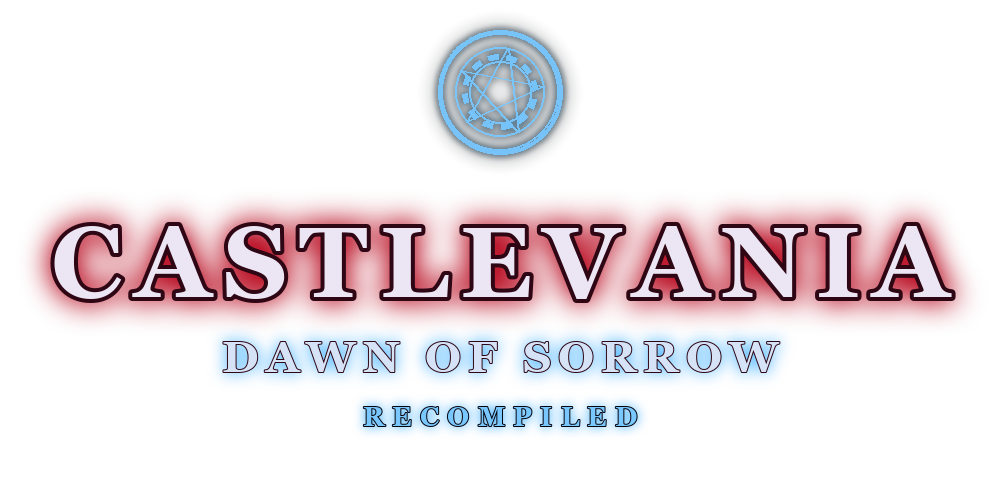
</p>

<p align="center">
  <a href="https://recomplauncher.com/game/cdos-nintendods-recomp"><picture><source media="(prefers-color-scheme: dark)" srcset="https://recomplauncher.com/assets/press/launcher/badge-light.svg"></picture></a>
  <a href="https://github.com/Neguchads/cdos-nintendods-recomp/releases/tag/v1.3.0"></a>
  <a href="https://github.com/Neguchads/cdos-nintendods-recomp/actions/workflows/ci.yml"></a>
  <a href="https://discord.gg/s7CWbpZJ"></a>
</p>

[](README.md) [](README.pt-BR.md)

---


## Português (BR)

Port nativo para PC de *Castlevania: Dawn of Sorrow* (Nintendo DS, USA, código `ACVE`) baseado em [`RetroPortingToolKit/ndsrecomp`](https://github.com/RetroPortingToolKit/ndsrecomp): o código ARM9/ARM7 é recompilado estaticamente para C/C++ (sem JIT, sem Dynarmic). Traz shaders HD-2D para **Direct3D 12 (`DXIL ps_6_0`)** e **Vulkan 1.1 (`SPIR-V`)**, menu bilíngue **Dear ImGui (`F1`)**, **suporte modular e combinável a mods locais em memória** (combine **Tradução PT-BR v1.1** com **Dawn of Dignity**, **No Magic Seals**, **Fixed Luck**, **Voice Restore** ou qualquer `.xdelta` / `.ips` / `.dospatch`), **Minimap HUD (Samus Returns 16:9)**, **VSync Exato 60 Hz sem alterar o tom**, **Bônus Slot-2 GBA *Aria of Sorrow***, **Música Customizada** e suporte completo ao **[RecompLauncher](https://recomplauncher.com/game/cdos-nintendods-recomp)**.

> **Aviso legal e de respeito aos criadores:** este repositório **não contém ROMs, BIOS comerciais, dados protegidos do jogo nem mods/traduções de terceiros embutidos**. Use a sua própria cópia legal de `Castlevania - Dawn of Sorrow (USA).nds`: 64 MiB, CRC32 `135737f6`, SHA-1 `47530ff87e608f88105a314fdf36dc385f8dec94`. Patches e traduções da comunidade obtidos diretamente com seus autores são carregados localmente em memória pelo menu `F1 -> Mods` (`{data}/mods/profiles/`) sem nunca alterar sua ROM.


### Progresso de desenvolvimento / Dashboard

<a href="docs/FEATURE_STATUS.md">
<picture>
  <source media="(prefers-color-scheme: dark)" srcset="assets/dashboard/project-status-dark.svg">
  <source media="(prefers-color-scheme: light)" srcset="assets/dashboard/project-status.svg">
  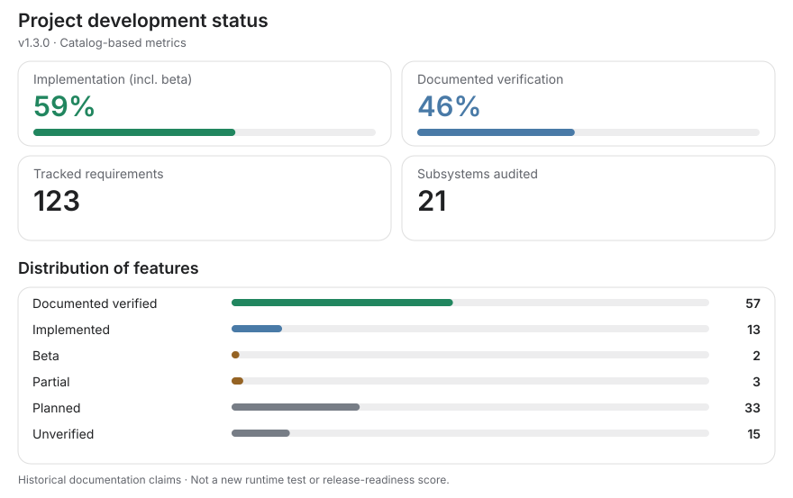
</picture>
</a>

<details>
<summary>Ver cards dos 21 subsistemas</summary>

<picture>
  <source media="(prefers-color-scheme: dark)" srcset="assets/dashboard/subsystems-dark.svg">
  <source media="(prefers-color-scheme: light)" srcset="assets/dashboard/subsystems.svg">
  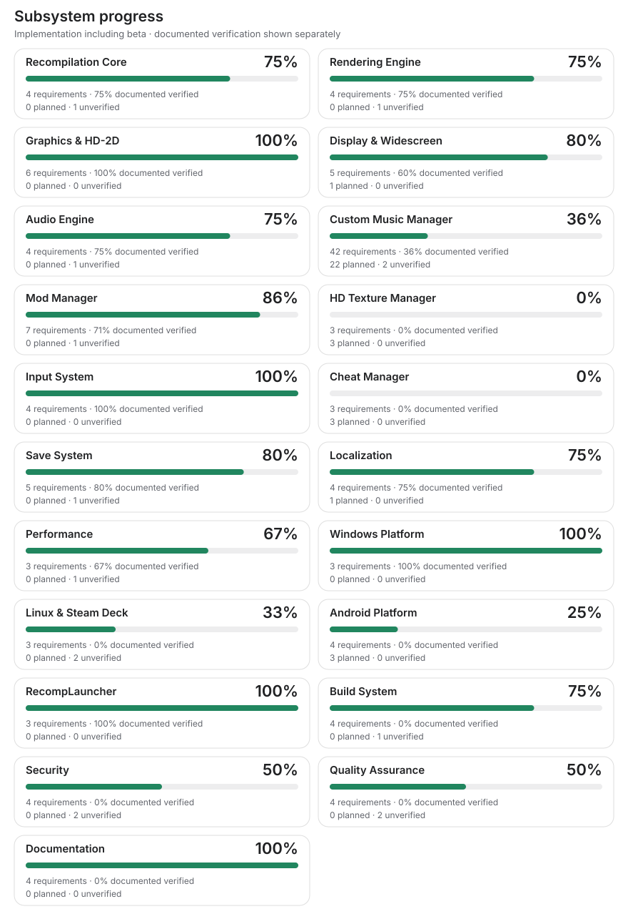
</picture>

</details>

[Auditoria completa](docs/FEATURE_STATUS.md) · [Metodologia e matriz de plataformas](docs/FEATURE_ASSURANCE.md) · [Métricas JSON](quality/progress.json)

Percentuais calculados a partir dos requisitos catalogados; verificação documental não equivale a novos testes em execução nem à prontidão de release.

### Principais Recursos em Destaque

- **Mods Modulares Combináveis & Tradução PT-BR v1.1 Autorizada (`F1 -> Mods`):** combine livremente a **Tradução PT-BR v1.1** (autorizada por `@leomontenegro6` em `cdos-traducao-ptbr#1`) com **Dawn of Dignity**, **No Magic Seals**, **Fixed Luck** e **Voice Restore Project** marcando caixas de seleção, via **merger 3-way byte-diff em memória** + recálculo automático de CRC-16 do cabeçalho NDS (inspirado no `cdos-patcher-tool`). Inclui botões **`Aplicar Patch...`**, **`Site Oficial`** e painel **`Detalhes`** por mod, **`xdelta3.exe`** (Apache-2.0) incluso para patches `.xdelta` DJW/LZMA prontos para uso, saves isolados por combinação e zero arquivos de terceiros embutidos.
- **Minimap HUD (Samus Returns 16:9) & Widescreen 2D Nativo:** minimapa translúcido compacto (`24%`) no canto superior direito + preset **1 Clique: HUD Metroidvania 16:9**, **Widescreen Teatro**, **16:9 Smart Crop**, **21:9 Ultrawide** e modo opt-in **Widescreen 2D Nativo `342×192`** (Beta) com wrap sem corte de céu `BG2` e pillarbox `256×192` automático em menus.
- **Escaladores HD-2D Multi-Passe & Sincronia Exata `60,0 Hz`:** 8 filtros de GPU curados (`Pixellate`, `Pixel-AA`, `Bandlimited`, `MMPX 2×`, `OmniScale`, `ScaleFX-Hybrid 3×`), Anti-Dither `GDAPT`, Bloom Dual Kawase em 5 passes, 6 Perfis Visuais de 1 clique e **VSync Exato `60,0 Hz` (`sync60`)** com micro-splicer WSOLA (zero engasgos em monitores 60 Hz e zero mudança de tom).
- **Bônus Slot-2 GBA *Aria of Sorrow* & Música Customizada:** cabeçalho GBA clean-room de 192 bytes (`A2CE`) alternável no `F1 -> Mods` para liberar **Rare Ring** + **Mina's Doll** sem precisar de ROM de GBA, além de **Música Customizada `.wav` / `.mp3` / `.ogg`** com Seletor por Estágio e Jukebox Global mantendo 100% dos efeitos sonoros e vozes originais do DS.
- **Comunidade & Suporte:** entre no nosso **[Servidor do Discord](https://discord.gg/s7CWbpZJ)** para ajuda na instalação, testes e compatibilidade de mods.

### Contribuições da comunidade são bem-vindas

Este é um projeto de código aberto que valoriza a participação da comunidade. **Toda ajuda é bem-vinda!** Seja você desenvolvedor, testador, jogador, modder ou apenas interessado no projeto, sua contribuição é importante.

- Pull requests, revisão de código, correções, melhorias de desempenho e refatoração.
- Testes, relatos de bugs reproduzíveis, feedback de compatibilidade e suporte técnico a outros usuários.
- Novas funcionalidades, ideias, documentação, traduções e melhorias de acessibilidade.

Você pode [abrir uma issue](https://github.com/Neguchads/cdos-nintendods-recomp/issues), [enviar um pull request](https://github.com/Neguchads/cdos-nintendods-recomp/pulls), [iniciar uma discussão](https://github.com/Neguchads/cdos-nintendods-recomp/discussions) ou participar da [comunidade no Discord](https://discord.gg/s7CWbpZJ). Contribuições de qualquer tamanho são valorizadas. Respeite as pessoas, forneça informações reproduzíveis e siga as políticas de clean-room e de autorização dos criadores.

**Antes de abrir uma issue:** pesquise as issues abertas e fechadas e os pull requests existentes, consulte a [auditoria de funcionalidades](docs/FEATURE_STATUS.md), o [roadmap](ROADMAP.md), as [notas das versões](https://github.com/Neguchads/cdos-nintendods-recomp/releases) e as configurações atuais do jogo (F1). Verifique se a funcionalidade ou ideia já existe, está planejada ou foi relatada. Se houver uma issue correspondente, acrescente informações úteis nela em vez de criar uma duplicata. Se a funcionalidade existente estiver incompleta ou apresentar falhas, explique o que falta e informe a versão testada. Novas ideias e regressões reais são sempre bem-vindas.

Consulte [CONTRIBUTING.md](CONTRIBUTING.md) para orientações práticas.

### Ajude-nos a expandir o ecossistema de recompilação de Castlevania

Buscamos apoio da comunidade, ideias técnicas e colaboradores para explorar futuros projetos de recompilação de Castlevania além de Dawn of Sorrow:

- **Dominus Collection / trilogia Nintendo DS:** explorar ports nativos independentes e tecnologias compartilhadas para Dawn of Sorrow, Portrait of Ruin e Order of Ecclesia, além de possível compatibilidade com recursos da Dominus Collection obtidos legalmente, quando técnica e juridicamente viável.
- **Trilogia Game Boy Advance:** explorar recompilações nativas de Circle of the Moon, Harmony of Dissonance e Aria of Sorrow a partir de ROMs originais extraídas legalmente.

Convidamos desenvolvedores, especialistas em engenharia reversa, mantenedores de ferramentas, testadores, modders e jogadores a compartilhar pesquisas, ferramentas open source, propostas técnicas, revisões de código e pull requests. São bem-vindas ideias para pipelines reutilizáveis, renderização, áudio, controles, modding e suporte multiplataforma.

São objetivos exploratórios da comunidade, não lançamentos anunciados ou compromissos de entrega. Compartilhe ideias nas [Discussões](https://github.com/Neguchads/cdos-nintendods-recomp/discussions) ou no [Discord](https://discord.gg/s7CWbpZJ) e verifique os trabalhos existentes antes de abrir novas issues. Esta é uma iniciativa independente e não oficial; não envie ROMs comerciais, BIOS, recursos proprietários dos jogos ou conteúdo de terceiros sem autorização. Dawn of Sorrow permanece o foco principal deste repositório.

### Como jogar

**Opção A — RecompLauncher (recomendado):**
1. Instale o **RecompLauncher** e adicione este recomp (ou um `.zip` de release que contenha `recomplauncher.json`).
2. Quando o Easy Setup pedir o jogo, escolha o seu `.nds` USA. O launcher confere o código do jogo (`ACVE`) e o dump (CRC32 `135737f6`) e mostra o selo de verificado.
3. Aperte **Play**. O jogo e o menu **`F1`** começam em **Inglês (`en`)** por padrão; você pode alternar para **Português (BR)** em memória a qualquer momento pelo menu `F1` ou nas opções do RecompLauncher.

Saves, configurações, savestates e capturas ficam na pasta `{data}` do RecompLauncher (`recompdata/`), então acompanham o jogo ao mover, fazer backup e desinstalar.

**Opção B — Windows standalone (`CastlevaniaDawnOfSorrow.exe`):**
1. Extraia o `.zip` da release e dê duplo clique em **`CastlevaniaDawnOfSorrow.exe`** (com o ícone do Soma Cruz embutido).
2. Na primeira execução, selecione a sua cópia legal `.nds` USA (`64 MiB`, `ACVE`, CRC32 `135737f6`). O launcher valida a ROM, instala uma cópia local em `game/`, oferece criar o **atalho na Área de Trabalho** e já abre o jogo.
3. Nas próximas vezes, basta dar duplo clique no atalho da Área de Trabalho ou em `CastlevaniaDawnOfSorrow.exe` para abrir direto com 1 clique.

### Kit de mídia (artes do RecompLauncher)

Todas as imagens que o RecompLauncher pede estão em [`assets/recomplauncher/`](assets/recomplauncher), validadas por [`tools/prepare_media_assets.py`](tools/prepare_media_assets.py).

| Slot | Arquivo | Tamanho | Prévia |
|---|---|---|---|
| Ícone | [`icon.png`](assets/recomplauncher/icon.png), [`icon.ico`](assets/recomplauncher/icon.ico) | 256 x 256 (ICO: 256, 64, 48, 32, 16) | 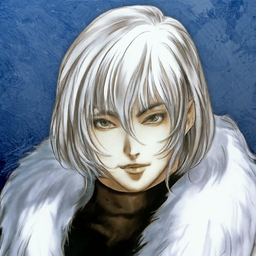 |
| Capa | [`cover.jpg`](assets/recomplauncher/cover.jpg), [`cover.png`](assets/recomplauncher/cover.png) | 600 x 900 (2:3) | 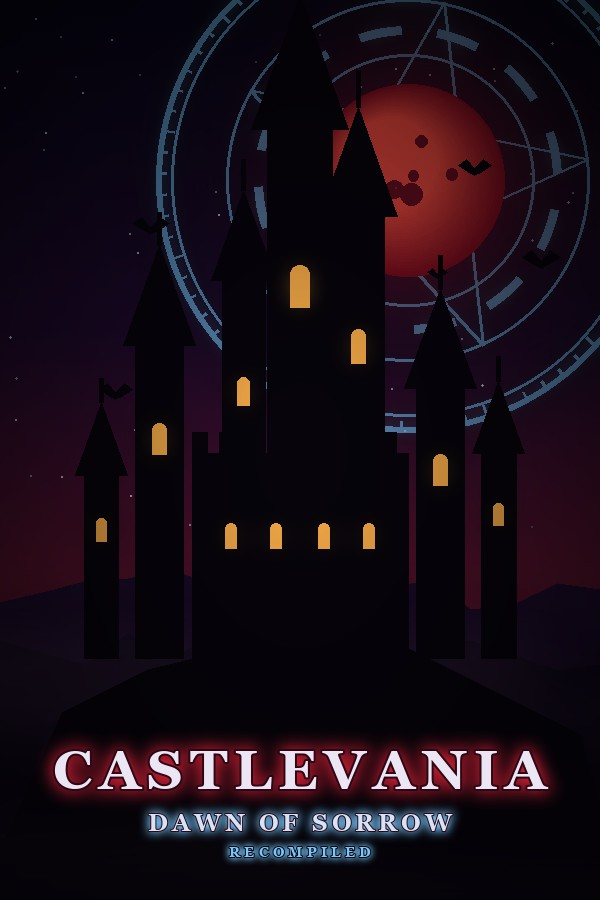 |
| Hero / fundo | [`hero.jpg`](assets/recomplauncher/hero.jpg), [`hero.png`](assets/recomplauncher/hero.png) | 1920 x 620 | 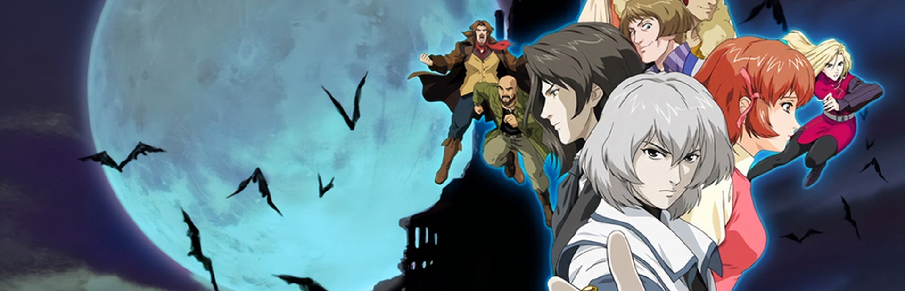 |
| Logo (transparente) | [`logo.png`](assets/recomplauncher/logo.png) | 1000 x 500 (RGBA) |  |
| Wallpaper | [`wallpaper.png`](assets/recomplauncher/wallpaper.png) | 1920 x 1080 (16:9) | 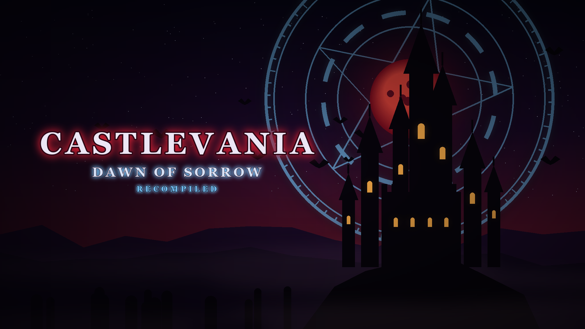 |
| Artwork principal (cartucho DS) | [`artwork.png`](assets/recomplauncher/artwork.png) | 1024 x 1024 | 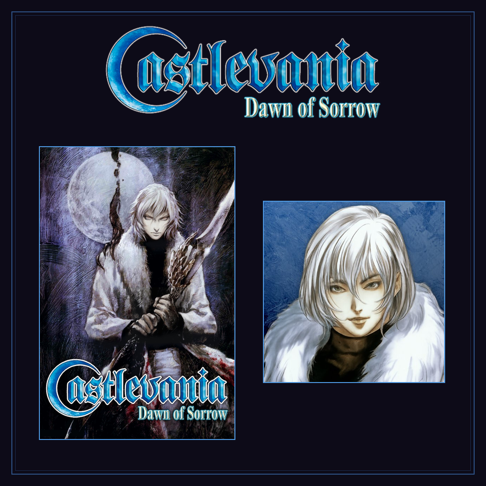 |
| Entrada de catálogo | [`catalog-entry.json`](assets/recomplauncher/catalog-entry.json) | `media_design` tipo `ds` | n/d |

Como aplicar: [`docs/RECOMPLAUNCHER.md`](docs/RECOMPLAUNCHER.md).

### Capturas do motor

Capturas reais do `nds_runner.exe` (1920 x 1080), em [`assets/screenshots/`](assets/screenshots).

| Direct3D 12, shader HD em GPU, picture-in-picture | Menu `F1` sobre as duas telas reais | Vulkan SPIR-V, lado a lado, PT-BR |
|---|---|---|
| 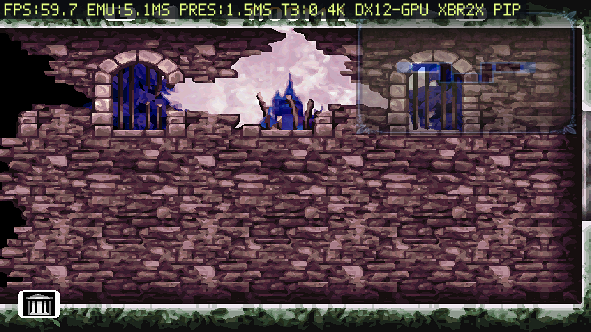 | 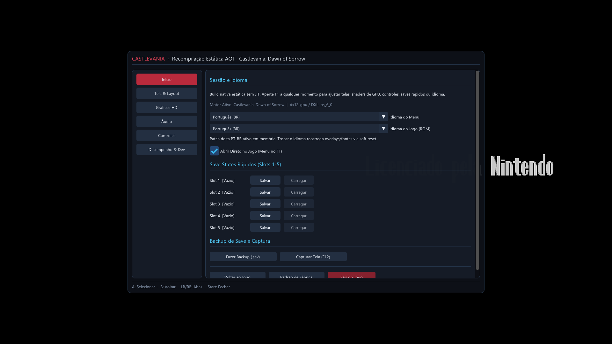 | 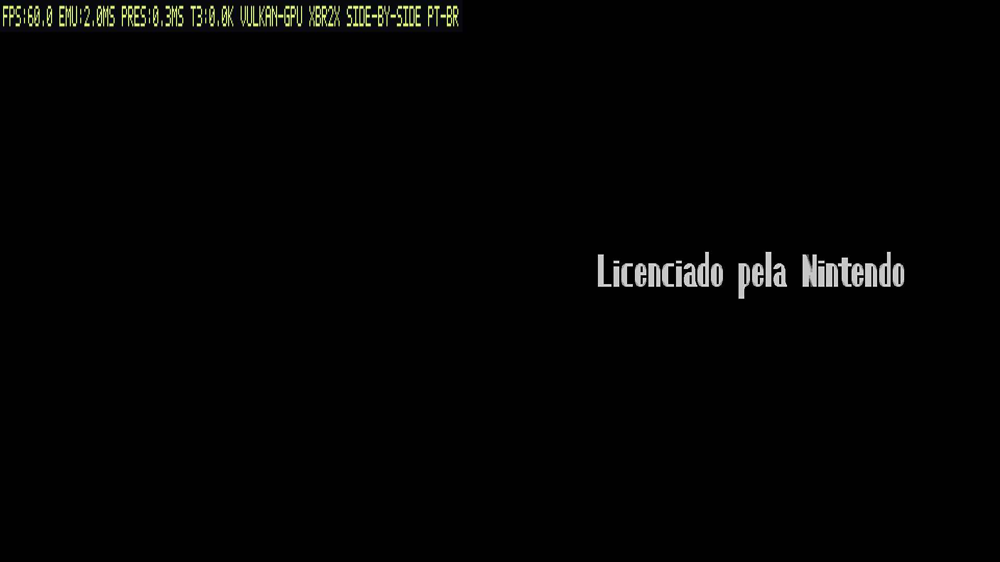 |

### Destaques

- **Execução estática AOT a cerca de 60 FPS:** `34` bancos promovidos (`49.059` funções) e bancos `dos_arm9` / `dos_arm7` gerados com `--validate-live-bytes`, para que código alterado por uma tradução caia em fallback seguro. Medição limpa em PT-BR, janela visível DX12: **59,86 FPS** (`emu=3,72 ms`, `pres=0,78 ms`, `readback=0,00 ms`, `underruns=0`). O Vulkan SPIR-V foi conferido visualmente a 60,0 FPS.
- **Menu `F1` (Dear ImGui v1.92.9b, também `Esc` / botão `Guide`):** 7 abas (Início, Tela & Layout, Gráficos HD, Áudio, Controles, Mods & Campanhas, Desempenho & Dev), **Inglês (`en`) como padrão** com **Português (BR)** selecionável ao vivo, desenhado sobre as duas telas reais (o bug da "terceira tela" foi corrigido). Brilho, contraste, saturação e vinheta ao vivo, tamanho do PiP (`20..50%`), VSync, zona morta do analógico, remapeamento de teclado/mouse/controle com **`X`** para limpar por tecla, **Limpar Mapeamento** e **Restaurar Padrão**, pausar/silenciar fora de foco, 5 slots de savestate, backup do `.sav`, captura `F12`.
- **Suporte Genérico a Mods Locais & Slots Pré-Configurados (`F1 -> Mods & Campanhas`, zero mods de terceiros embutidos):** [`mods/registry.json`](mods/registry.json) limpo com a base oficial **Original USA** mais slots `manual_import` creditados (**Tradução PT-BR v1.1 Vanilla & Definitive Edition** por Hyllian, Solid One/`@leomontenegro6`, Neko Belmont, Mysterioso, denim, djmatheusito, victoriemini — ref. [João13 Traduções](https://joao13traducoes.com/2018/02/nds-castlevania-dawn-of-sorrow-varios-autores/), **Definitive Edition+**, **Eternity of Sorrow** autorizado por `@Wet-Band-Aid` na #44, **Alucard's Requiem** e **Dracula's Curse** — zero arquivos embutidos ou baixados). Cada slot traz botões rápidos **`Aplicar Patch...`** (importa direto o `.xdelta`/`.ips`/`.dospatch` para aquele mod) e **`Site Oficial`** dentro do `F1 -> Mods`, além de **`Importar Patch...`** genérico e **`Abrir Pasta de Mods`** com decodificadores C++ nativos para **`.xdelta` / `.vcdiff` (RFC 3284 + fallback `xdelta3.exe`), `.ips` e `.dospatch`** em `{data}/mods/profiles/`, `ConflictEngine` de 3 estados, saves isolados, padding potência-de-2, **Seed Mutator C++ Nativo** e `tools/import_dsvrandom.py`. Veja [`docs/CREDITS.md`](docs/CREDITS.md) e [`docs/CREATOR_OUTREACH.md`](docs/CREATOR_OUTREACH.md).
- **Player Nativo de Vídeo de Abertura (Windows Media Foundation + SDL3):** coloque opcionalmente um vídeo H.264/AAC próprio em `{data}/mods/intro/opening.mp4` para reproduzir na abertura sem FFmpeg nem DLLs extras (pulável com qualquer tecla/clique/botão e configurável no `F1`).
- **Suporte a Música Customizada (`.wav` / `.mp3` / `.ogg`, Issue #16):** coloque arquivos de áudio com **qualquer nome** em `{data}/mods/music/`, ou dê duplo clique em **`mods/music/Configurar_Musica.bat`** para escolher pelo Windows Explorer e configurar automaticamente. No menu **`F1 -> Áudio`**, você escolhe qualquer arquivo para qualquer um dos 30 estágios (**Seletor Visual por Estágio**), ou ativa o **Modo Jukebox / Playlist Global** (muta todas as 30 BGMs do DS e toca só as suas músicas em sequência/aleatório com Anterior/Próxima) mantendo **100% dos efeitos sonoros e vozes originais do DS** (veja [`mods/music/README.md`](mods/music/README.md) e `python tools/list_bgm_tracks.py`).
- **Escaladores 2D Multi-Passe & Suíte Gráfica HD-2D (`F1 -> Gráficos HD` & `Tela & Layout`, DXIL `ps_6_0` + Vulkan 1.1 SPIR-V):**
  - **8 filtros 2D curados (`<= 0,8 ms` na GPU):** **`Pixellate`** (padrão nítido sem cintilação em sRGB linear), **`Pixel-AA`**, **`Bandlimited Pixel`** (integral de cosseno TheMaister), **`MMPX 2×`** (NVIDIA — amplia 2× preservando olhos e detalhes de 1 px), **`OmniScale`** (bordas suaves limpas), **`ScaleFX-Hybrid 3×`** (curvas vetoriais + preservação interna), além de `Nearest` e `Bilinear`.
  - **Anti-Dither Seletivo (`GDAPT`) & Bloom HD-2D Dual Kawase (5 passes):** suaviza névoas e transparências quadriculadas em luz linear sem borrar contornos nem texto, combinado com bloom amplo alinhado à curvatura CRT, bezel e vinheta, máscaras analíticas sem moiré (`Scanlines`/`CRT`/`Grade LCD DS`), Gama/Temperatura/Contraste/Saturação ao vivo, **6 Perfis Visuais de 1 clique** (*HD Moderno Nítido*, *Remaster HD-2D*, *Vetor HD ScaleFX*, *Pixel Purista*, *CRT Clássico*, *Portátil DS*), seletor multi-monitor SDL3, escala em janela `2x..6x`, `21:9 Ultrawide Cinema`, margem segura `0..10%`, VSync 4 modos (`Desligado`/`Ligado`/`Adaptativo`/`Sincronia Exata 60Hz` com áudio WSOLA sem alterar o tom — Issue #39), Interpolação `120 Hz` ao vivo e 3D MSAA persistente (`Off/2x/4x/8x`).
- **Widescreen 2D Sem Cortes & Minimap HUD estilo Samus Returns (Issue #7):** inclui **Minimap HUD (Samus Returns 16:9)** (minimapa translúcido compacto `24%` no canto superior direito + preset **1 Clique: HUD Metroidvania 16:9** no `F1 -> Tela & Layout`), **Widescreen Teatro** (canvas 16:9 `342×192` com gameplay 4:3 + lateral de Mapa/Status estilo *Dominus Collection*), **16:9 Smart Crop** (pixels 1:1 com ajuste vertical `-24..+24 px` e toque exato), **16:10 Equilibrado**, **21:9 Ultrawide**, e modo opt-in **Widescreen 2D Nativo `16:9` (`342×192`)** com alinhamento de HUD (`Bordas 16:9` vs `Zona Segura 4:3`), wrap sem corte em fundos `BG2` `1×N` e expansão de quads atmosféricos 3D (zero faixas pretas e zero emenda em `x = 271` na Ponte/Praça da Lost Village), além de pillarbox `256×192` automático em menus, prólogo e salas de 1 tela.
- **Créditos Open Source & Política de Criadores:** créditos do motor e bibliotecas + política de respeito aos autores (zero mods de terceiros embutidos ou baixados sem permissão explícita) estão em [`docs/CREDITS.md`](docs/CREDITS.md).
- **SDK do RecompLauncher & `.exe` standalone MSVC nativo:** [`recomplauncher.json`](recomplauncher.json) com `inputs` nomeados, `dumps` verificados, caminhos resolvidos via `{install}`/`{data}`, `49` chaves INI (defaults em `config.new`), `looks`, `actions`, `system` e `exit_codes`, mais [`CastlevaniaDawnOfSorrow.exe`](launcher/launcher_win32.cpp) compilado em MSVC 2022 (`443 KB`, ícone e manifesto UTF-8 `asInvoker` embutidos) e allowlist estrita em `runtime/`.
- **Multiplataforma:** [`CMakePresets.json`](CMakePresets.json), [`tools/build_linux.sh`](tools/build_linux.sh) e esqueleto Android ARM64 em [`android/`](android). Só o Windows é compilado e testado aqui; veja [`docs/MULTIPLATFORM.md`](docs/MULTIPLATFORM.md).

### Status dos Recursos (Verificado vs. Experimental)

| Recurso | Status | Observações |
|---|---|---|
| Base Limpa Original USA (`ACVE`) | **Verificado** | Execução clean-room padrão a ~60 FPS (`emu ~3,7 ms`, `0` underruns de áudio) |
| Add-Ons Modulares Combináveis & Carregador Local (`.xdelta`/`.ips`/`.dospatch`, `xdelta3.exe` incluso) | **Verificado** | Merger 3-way byte-diff em memória (combine PT-BR v1.1 + *Dawn of Dignity*, *No Magic Seals*, *Fixed Luck*, *Voice Restore*) + botões `Aplicar Patch...` / `Site Oficial` / `Detalhes` + saves isolados; zero mods de terceiros embutidos |
| Bônus Slot-2 GBA: *Aria of Sorrow* (`dos_gba_slot2_aria`) | **Verificado** | Cabeçalho clean-room `A2CE` de 192 bytes alternável em `F1 -> Mods` e `recomplauncher.json` (libera **Rare Ring** + **Mina's Doll**) |
| VSync Exato `60,0 Hz` sem Alterar Tom (`sync60`) | **Verificado** | Micro-splicer WSOLA de janela Hann em tempo real (`0` crackles, `0,00%` mudança de tom) para monitores 60 Hz |
| Música Customizada (`.wav`/`.mp3`/`.ogg`, Seletor F1, Jukebox Global, Assistente Explorer) | **Verificado** | Mute seletivo validado ao vivo (`BGM DS = 0`, `SFX DS = 100%`) |
| Escaladores GPU Multi-Passe (`Pixellate`, `Pixel-AA`, `Bandlimited`, `MMPX 2×`, `OmniScale`, `ScaleFX-Hybrid 3×`), Anti-Dither & Bloom HD-2D Kawase | **Verificado** | Validado ao vivo em DX12 (`DXIL ps_6_0`) e Vulkan (`SPIR-V`), `<= 0,8 ms` na GPU |
| Suíte Expandida de Display (Multi-Monitor, `2x..6x`, `21:9`, Margem Segura, VSync 4 Modos, Interpolação 120 Hz, 6 Perfis Visuais) | **Verificado** | Controles SDL3 + shader de 80 bytes persistidos no INI e `recomplauncher.json` |
| Widescreen 2D & Minimap HUD (`Minimap HUD 16:9`, `Teatro`, `Smart Crop 16:9`, `16:10 Equilibrado`, `21:9 Ultrawide`) | **Verificado** | Minimapa estilo Samus Returns `24%` + preset 1-clique Metroidvania 16:9 + toque exato sem distorção |
| Widescreen 2D Nativo `16:9` (`342×192`) | **Opt-in (Beta)** | Wrap de céu `BG2` e expansão de névoa validados na Ponte/Praça da Lost Village (`F1 -> Tela & Layout`, desligado por padrão; validação de campanha completa em andamento) |
| Player Nativo de Abertura (`{data}/mods/intro/opening.mp4`) | **Verificado (Opt-in)** | Apenas vídeo fornecido localmente pelo usuário; nunca incluso no ZIP público |
| Mutador Nativo por Seed C++ (Randomizer Offline) | **Experimental (`unverified`)** | Apenas stats/drops fora da progressão; importador local de saídas de randomizer via `tools/import_dsvrandom.py` |

### Controles e atalhos

| Ação (DS) | Tecla / Mouse 1 (Padrão) | Tecla / Mouse 2 (Alt.) | Controle (Xbox / PS) |
|---|---|---|---|
| Mover | `W` `A` `S` `D` | Setas | Analógico esq. / D-Pad |
| **Pular (`B`)** | **`Espaço`** | **`Espaço`** | **`A` / Cruz** |
| **Ataque Padrão (`Y`)** | **`Clique Esquerdo`** | `J` | `X` / Quadrado |
| **Ataque Especial / Confirmar (`A`)** | **`Clique Direito`** | `E` | `B` / Círculo |
| **Dash / Esquiva (`L`)** | **`Q`** | **`Clique da Roda` (Mouse Meio)** | `LB` / `L1` |
| **Alma Guardiã (`R`)** | **`R`** | `K` | `RB` / `R1` |
| Trocar Set / Doppelganger (`X`) | `F` | `C` | `Y` / Triângulo |
| Start / Select | `Enter` / `Tab` | `Enter` / `Backspace` | `Start` / `Back` |

Tudo pode ser personalizado em **`F1` -> Controles**: clique na célula para mapear qualquer tecla ou botão do mouse (`Esquerdo`, `Meio`, `Direito`, `X1`, `X2`), clique no **`X`** ao lado da célula (ou aperte `Delete` durante a captura) para limpar só aquela tecla, ou use **Limpar Mapeamento** / **Restaurar Padrão**. Os cliques na tela inferior (itens, menus, selos mágicos e blocos de gelo) continuam funcionando normalmente junto com os botões do mouse em combate.

Globais: `F1` ou `Guide` abre o menu, `F2` alterna o layout, `F3` troca tela principal e miniatura, `F4` liga/desliga o HUD, `F5` / `F8` salva / carrega o slot 1, `F6` ou `` ` `` alterna o turbo, `F11` ou `Alt+Enter` alterna tela cheia, `F12` captura a tela.

### Clone e dependências

```powershell
git clone https://github.com/Neguchads/cdos-nintendods-recomp.git
cd cdos-nintendods-recomp
```

Este repositório espera duas pastas irmãs no mesmo diretório pai:

- `../ndsrecomp`: `RetroPortingToolKit/ndsrecomp` no commit `e4a7f419`, com [`patches/ndsrecomp-local.patch`](patches/ndsrecomp-local.patch) aplicado e Dear ImGui v1.92.9b em `runner/third_party/imgui/`.
- `../recomp-ui`: `RetroPortingToolKit/recomp-ui` no commit `f3f99a96`.

A CI roda no GitHub Actions ([`ci.yml`](.github/workflows/ci.yml)); as atualizações de dependências vêm do Dependabot ([`dependabot.yml`](.github/dependabot.yml)).

### Compilar, rodar e empacotar (Windows)

```powershell
python tools/setup_toolchains.py
python tools/build.py prepare
python tools/build.py banks
python tools/build.py promote
python tools/build.py ptbr-patch
python tools/build.py build
.\CastlevaniaDawnOfSorrow.exe
```

`python tools/build.py build` embute [`assets/recomplauncher/icon.ico`](assets/recomplauncher/icon.ico) tanto em `runtime/nds_runner.exe` quanto no executável standalone `CastlevaniaDawnOfSorrow.exe` na raiz. Na primeira execução fora do RecompLauncher, o `CastlevaniaDawnOfSorrow.exe` valida a sua ROM USA `.nds` (`64 MiB`, `ACVE`, CRC32 `135737f6`), instala a cópia localmente em `game/`, oferece criar o atalho na Área de Trabalho com o ícone do Soma Cruz e a partir daí abre direto no jogo com 1 clique. `.\play.bat` continua disponível como alternativa de console.

Gere um pacote limpo, sem ROM, para o RecompLauncher em `dist/`:

```powershell
python tools/package_recomplauncher.py
```

### Verificação

```powershell
ctest --test-dir generated/build-runner -R "screen_layout_test|frontend_config_test|dos_enhancements_test" --output-on-failure
python -m unittest discover -s tests -v
python tools/build.py smoke
python tools/prepare_media_assets.py --check-only
```

### Agradecimentos & Modders Autorizados

Nosso agradecimento aos criadores que autorizaram explicitamente os slots de compatibilidade e ajudaram a moldar a arquitetura de mods deste projeto (zero patches de terceiros são embutidos — baixe diretamente na página oficial de cada autor):

- **[@Wet-Band-Aid](https://github.com/Wet-Band-Aid)** — criador de **[Castlevania: Eternity of Sorrow](https://github.com/Wet-Band-Aid/Castlevania---Eternity-of-Sorrow)**, que autorizou o slot de *Eternity of Sorrow* e inspirou o painel de **Detalhes e Prévia de Mods** dentro do `F1` ([Issue #44](https://github.com/Neguchads/cdos-nintendods-recomp/issues/44)).
- **[@leomontenegro6](https://github.com/leomontenegro6) (Solid One)** & equipe da **Tradução PT-BR v1.1** (**Hyllian, Solid One, Neko Belmont, Mysterioso, denim, djmatheusito, victoriemini** — **[cdos-traducao-ptbr](https://github.com/leomontenegro6/cdos-traducao-ptbr)**, **[cdos-patcher-tool](https://github.com/leomontenegro6/cdos-patcher-tool)**, [João13 Traduções](https://joao13traducoes.com/2018/02/nds-castlevania-dawn-of-sorrow-varios-autores/)) — que autorizou o slot da tradução PT-BR v1.1 e inspirou a **composição modular empilhável de patches** ([cdos-traducao-ptbr#1](https://github.com/leomontenegro6/cdos-traducao-ptbr/issues/1)).

Para os créditos completos das bibliotecas open source e demais autores da comunidade, veja [`docs/CREDITS.md`](docs/CREDITS.md).

### Documentação

[`CHANGELOG.md`](CHANGELOG.md) | [`docs/CREDITS.md`](docs/CREDITS.md) | [`docs/RECOMPLAUNCHER.md`](docs/RECOMPLAUNCHER.md) | [`docs/RBS.md`](docs/RBS.md) | [`docs/CI_AUTOMATION.md`](docs/CI_AUTOMATION.md) | [`docs/BUILD_CACHE.md`](docs/BUILD_CACHE.md) | [`docs/MULTIPLATFORM.md`](docs/MULTIPLATFORM.md) | [`docs/DECISIONS.md`](docs/DECISIONS.md) | [`docs/rom-analysis.md`](docs/rom-analysis.md) | [`ROADMAP.md`](ROADMAP.md) | [`HANDOFF.md`](HANDOFF.md) | [`NOTAS.md`](NOTAS.md)

### Automação de CI, RBS e Cache de Build

- Pipeline incremental local (`Build.ps1`, `tools/rbs*.py`) e validação de pacotes: [`docs/RBS.md`](docs/RBS.md).
- Verificações de segurança, SPDX e proveniência: [`docs/CI_AUTOMATION.md`](docs/CI_AUTOMATION.md) e [`docs/LICENSE_REVIEW.md`](docs/LICENSE_REVIEW.md).
- Sccache local opcional (PowerShell): `$env:NDS_SCCACHE = "1"` — veja [`docs/BUILD_CACHE.md`](docs/BUILD_CACHE.md).

[Voltar ao topo](#castlevania-dawn-of-sorrow-recompiled--português-br)
