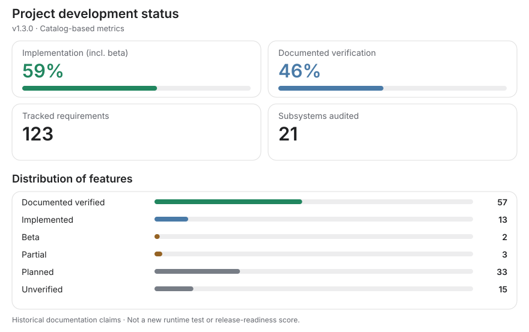

# Feature status & progress / Status e progresso

Generated from [quality/features.json](../quality/features.json). Do not edit this report directly.

Baseline: `v1.3.0` / `98cc5b1f4cffb44850701c01e2e4942394b878fb`. Documentary inventory; no new runtime or CI test results claimed. Equal weight per registered requirement, not estimated effort.

**Implementation coverage: 59% · Documented verification: 46% · Newly registered evidence: 0% · 123 requirements.**

Implementation = (documented verified + implemented + beta) / total; partial is not counted as complete. Documented verification is a historical documentation claim, not an independent re-test. New evidence coverage counts requirements with a recorded evidence reference; it does not measure pass rate. Percentages are rounded, depend on the catalog scope and do not represent effort or release readiness.

## Subsystem summary

| Subsystem | Requirements | Implemented incl. beta | Documented verified | Planned | Unverified |
|---|---:|---:|---:|---:|---:|
| Recompilation Core | 4 | 75% | 75% | 0 | 1 |
| Rendering Engine | 4 | 75% | 75% | 0 | 1 |
| Graphics & HD-2D | 6 | 100% | 100% | 0 | 0 |
| Display & Widescreen | 5 | 80% | 60% | 1 | 0 |
| Audio Engine | 4 | 75% | 75% | 0 | 1 |
| Custom Music Manager | 42 | 36% | 36% | 22 | 2 |
| Mod Manager | 7 | 86% | 71% | 0 | 1 |
| HD Texture Manager | 3 | 0% | 0% | 3 | 0 |
| Input System | 4 | 100% | 100% | 0 | 0 |
| Cheat Manager | 3 | 0% | 0% | 3 | 0 |
| Save System | 5 | 80% | 80% | 0 | 1 |
| Localization | 4 | 75% | 75% | 1 | 0 |
| Performance | 3 | 67% | 67% | 0 | 1 |
| Windows Platform | 3 | 100% | 100% | 0 | 0 |
| Linux & Steam Deck | 3 | 33% | 0% | 0 | 2 |
| Android Platform | 4 | 25% | 0% | 3 | 0 |
| RecompLauncher | 3 | 100% | 100% | 0 | 0 |
| Build System | 4 | 75% | 0% | 0 | 1 |
| Security | 4 | 50% | 0% | 0 | 2 |
| Quality Assurance | 4 | 50% | 0% | 0 | 2 |
| Documentation | 4 | 100% | 0% | 0 | 0 |

## Recompilation Core

| ID | Feature | Status | Source | Issue | Acceptance criterion | New evidence |
|---|---|---|---|---|---|---|
| CORE-001 | Static ARM9 and ARM7 AOT execution | Documented verified | [source](../README.md) | — | Demonstrate Static ARM9 and ARM7 AOT execution with a reproducible test or review appropriate to the subsystem. | 0 |
| CORE-002 | Promoted banks and live-byte fallback | Documented verified | [source](../README.md) | — | Demonstrate Promoted banks and live-byte fallback with a reproducible test or review appropriate to the subsystem. | 0 |
| CORE-003 | USA ACVE ROM validation | Documented verified | [source](../README.md) | — | Demonstrate USA ACVE ROM validation with a reproducible test or review appropriate to the subsystem. | 0 |
| CORE-004 | Full-campaign regression coverage | Unverified | [source](../README.md) | — | Demonstrate Full-campaign regression coverage with a reproducible test or review appropriate to the subsystem. | 0 |

## Rendering Engine

| ID | Feature | Status | Source | Issue | Acceptance criterion | New evidence |
|---|---|---|---|---|---|---|
| RENDER-001 | Direct3D 12 renderer | Documented verified | [source](../README.md) | — | Demonstrate Direct3D 12 renderer with a reproducible test or review appropriate to the subsystem. | 0 |
| RENDER-002 | Vulkan 1.1 renderer | Documented verified | [source](../README.md) | — | Demonstrate Vulkan 1.1 renderer with a reproducible test or review appropriate to the subsystem. | 0 |
| RENDER-003 | GPU shader pipeline | Documented verified | [source](../README.md) | — | Demonstrate GPU shader pipeline with a reproducible test or review appropriate to the subsystem. | 0 |
| RENDER-004 | Cross-platform rendering parity | Unverified | [source](../README.md) | — | Demonstrate Cross-platform rendering parity with a reproducible test or review appropriate to the subsystem. | 0 |

## Graphics & HD-2D

| ID | Feature | Status | Source | Issue | Acceptance criterion | New evidence |
|---|---|---|---|---|---|---|
| GRAPHICS-001 | Pixel-AA and Pixellate | Documented verified | [source](../README.md) | — | Demonstrate Pixel-AA and Pixellate with a reproducible test or review appropriate to the subsystem. | 0 |
| GRAPHICS-002 | ScaleFX and GPU upscalers | Documented verified | [source](../README.md) | — | Demonstrate ScaleFX and GPU upscalers with a reproducible test or review appropriate to the subsystem. | 0 |
| GRAPHICS-003 | GDAPT anti-dither | Documented verified | [source](../README.md) | — | Demonstrate GDAPT anti-dither with a reproducible test or review appropriate to the subsystem. | 0 |
| GRAPHICS-004 | Dual Kawase bloom | Documented verified | [source](../README.md) | — | Demonstrate Dual Kawase bloom with a reproducible test or review appropriate to the subsystem. | 0 |
| GRAPHICS-005 | Visual profiles | Documented verified | [source](../README.md) | — | Demonstrate Visual profiles with a reproducible test or review appropriate to the subsystem. | 0 |
| GRAPHICS-006 | Display color controls | Documented verified | [source](../README.md) | — | Demonstrate Display color controls with a reproducible test or review appropriate to the subsystem. | 0 |

## Display & Widescreen

| ID | Feature | Status | Source | Issue | Acceptance criterion | New evidence |
|---|---|---|---|---|---|---|
| DISPLAY-001 | Widescreen Theatre and Smart Crop | Documented verified | [source](../README.md) | — | Demonstrate Widescreen Theatre and Smart Crop with a reproducible test or review appropriate to the subsystem. | 0 |
| DISPLAY-002 | 16:10 and ultrawide layouts | Documented verified | [source](../README.md) | — | Demonstrate 16:10 and ultrawide layouts with a reproducible test or review appropriate to the subsystem. | 0 |
| DISPLAY-003 | Minimap HUD | Documented verified | [source](../README.md) | — | Demonstrate Minimap HUD with a reproducible test or review appropriate to the subsystem. | 0 |
| DISPLAY-004 | True 2D widescreen 342x192 | Beta | [source](../README.md) | — | Demonstrate True 2D widescreen 342x192 with a reproducible test or review appropriate to the subsystem. | 0 |
| DISPLAY-005 | Complete widescreen campaign audit | Planned | [source](../README.md) | — | Demonstrate Complete widescreen campaign audit with a reproducible test or review appropriate to the subsystem. | 0 |

## Audio Engine

| ID | Feature | Status | Source | Issue | Acceptance criterion | New evidence |
|---|---|---|---|---|---|---|
| AUDIO-001 | Original sound effects and voices | Documented verified | [source](../README.md) | — | Demonstrate Original sound effects and voices with a reproducible test or review appropriate to the subsystem. | 0 |
| AUDIO-002 | Exact 60 Hz pitch-preserving sync | Documented verified | [source](../README.md) | — | Demonstrate Exact 60 Hz pitch-preserving sync with a reproducible test or review appropriate to the subsystem. | 0 |
| AUDIO-003 | Independent audio volumes | Documented verified | [source](../README.md) | — | Demonstrate Independent audio volumes with a reproducible test or review appropriate to the subsystem. | 0 |
| AUDIO-004 | Full audio regression suite | Unverified | [source](../README.md) | — | Demonstrate Full audio regression suite with a reproducible test or review appropriate to the subsystem. | 0 |

## Custom Music Manager

| ID | Feature | Status | Source | Issue | Acceptance criterion | New evidence |
|---|---|---|---|---|---|---|
| MUSIC-001 | WAV decoding | Documented verified | [source](../mods/music/README.md) | [#38](https://github.com/Neguchads/cdos-nintendods-recomp/issues/38) | Demonstrate WAV decoding with a reproducible test or review appropriate to the subsystem. | 0 |
| MUSIC-002 | MP3 decoding | Documented verified | [source](../mods/music/README.md) | [#38](https://github.com/Neguchads/cdos-nintendods-recomp/issues/38) | Demonstrate MP3 decoding with a reproducible test or review appropriate to the subsystem. | 0 |
| MUSIC-003 | OGG decoding | Documented verified | [source](../mods/music/README.md) | [#38](https://github.com/Neguchads/cdos-nintendods-recomp/issues/38) | Demonstrate OGG decoding with a reproducible test or review appropriate to the subsystem. | 0 |
| MUSIC-004 | Original voice preservation | Documented verified | [source](../mods/music/README.md) | [#38](https://github.com/Neguchads/cdos-nintendods-recomp/issues/38) | Demonstrate Original voice preservation with a reproducible test or review appropriate to the subsystem. | 0 |
| MUSIC-005 | Original SFX preservation | Documented verified | [source](../mods/music/README.md) | [#38](https://github.com/Neguchads/cdos-nintendods-recomp/issues/38) | Demonstrate Original SFX preservation with a reproducible test or review appropriate to the subsystem. | 0 |
| MUSIC-006 | Independent volume | Documented verified | [source](../mods/music/README.md) | [#38](https://github.com/Neguchads/cdos-nintendods-recomp/issues/38) | Demonstrate Independent volume with a reproducible test or review appropriate to the subsystem. | 0 |
| MUSIC-007 | 30 BGM mappings | Documented verified | [source](../mods/music/README.md) | [#38](https://github.com/Neguchads/cdos-nintendods-recomp/issues/38) | Demonstrate 30 BGM mappings with a reproducible test or review appropriate to the subsystem. | 0 |
| MUSIC-008 | Global Jukebox | Documented verified | [source](../mods/music/README.md) | [#38](https://github.com/Neguchads/cdos-nintendods-recomp/issues/38) | Demonstrate Global Jukebox with a reproducible test or review appropriate to the subsystem. | 0 |
| MUSIC-009 | Shuffle | Documented verified | [source](../mods/music/README.md) | [#38](https://github.com/Neguchads/cdos-nintendods-recomp/issues/38) | Demonstrate Shuffle with a reproducible test or review appropriate to the subsystem. | 0 |
| MUSIC-010 | Previous and next | Documented verified | [source](../mods/music/README.md) | [#38](https://github.com/Neguchads/cdos-nintendods-recomp/issues/38) | Demonstrate Previous and next with a reproducible test or review appropriate to the subsystem. | 0 |
| MUSIC-011 | Multiple file import | Documented verified | [source](../mods/music/README.md) | [#38](https://github.com/Neguchads/cdos-nintendods-recomp/issues/38) | Demonstrate Multiple file import with a reproducible test or review appropriate to the subsystem. | 0 |
| MUSIC-012 | Configuration persistence | Documented verified | [source](../mods/music/README.md) | [#38](https://github.com/Neguchads/cdos-nintendods-recomp/issues/38) | Demonstrate Configuration persistence with a reproducible test or review appropriate to the subsystem. | 0 |
| MUSIC-013 | Custom loop points | Documented verified | [source](../mods/music/README.md) | [#38](https://github.com/Neguchads/cdos-nintendods-recomp/issues/38) | Demonstrate Custom loop points with a reproducible test or review appropriate to the subsystem. | 0 |
| MUSIC-014 | Boss BGM mappings | Documented verified | [source](../mods/music/README.md) | [#38](https://github.com/Neguchads/cdos-nintendods-recomp/issues/38) | Demonstrate Boss BGM mappings with a reproducible test or review appropriate to the subsystem. | 0 |
| MUSIC-015 | Ending and credits BGM mappings | Documented verified | [source](../mods/music/README.md) | [#38](https://github.com/Neguchads/cdos-nintendods-recomp/issues/38) | Demonstrate Ending and credits BGM mappings with a reproducible test or review appropriate to the subsystem. | 0 |
| MUSIC-016 | Special event mappings | Partial | [source](../mods/music/README.md) | [#38](https://github.com/Neguchads/cdos-nintendods-recomp/issues/38) | Demonstrate Special event mappings with a reproducible test or review appropriate to the subsystem. | 0 |
| MUSIC-017 | Audio file validation | Partial | [source](../mods/music/README.md) | [#38](https://github.com/Neguchads/cdos-nintendods-recomp/issues/38) | Demonstrate Audio file validation with a reproducible test or review appropriate to the subsystem. | 0 |
| MUSIC-018 | Import wizard in F1 | Partial | [source](../mods/music/README.md) | [#38](https://github.com/Neguchads/cdos-nintendods-recomp/issues/38) | Demonstrate Import wizard in F1 with a reproducible test or review appropriate to the subsystem. | 0 |
| MUSIC-019 | Room-specific mappings | Planned | [source](../mods/music/README.md) | [#38](https://github.com/Neguchads/cdos-nintendods-recomp/issues/38) | Demonstrate Room-specific mappings with a reproducible test or review appropriate to the subsystem. | 0 |
| MUSIC-020 | Independent soundtrack packs | Planned | [source](../mods/music/README.md) | [#38](https://github.com/Neguchads/cdos-nintendods-recomp/issues/38) | Demonstrate Independent soundtrack packs with a reproducible test or review appropriate to the subsystem. | 0 |
| MUSIC-021 | Multiple soundtrack profiles | Planned | [source](../mods/music/README.md) | [#38](https://github.com/Neguchads/cdos-nintendods-recomp/issues/38) | Demonstrate Multiple soundtrack profiles with a reproducible test or review appropriate to the subsystem. | 0 |
| MUSIC-022 | Multiple saved playlists | Planned | [source](../mods/music/README.md) | [#38](https://github.com/Neguchads/cdos-nintendods-recomp/issues/38) | Demonstrate Multiple saved playlists with a reproducible test or review appropriate to the subsystem. | 0 |
| MUSIC-023 | Configurable fades | Planned | [source](../mods/music/README.md) | [#38](https://github.com/Neguchads/cdos-nintendods-recomp/issues/38) | Demonstrate Configurable fades with a reproducible test or review appropriate to the subsystem. | 0 |
| MUSIC-024 | Crossfade | Planned | [source](../mods/music/README.md) | [#38](https://github.com/Neguchads/cdos-nintendods-recomp/issues/38) | Demonstrate Crossfade with a reproducible test or review appropriate to the subsystem. | 0 |
| MUSIC-025 | Track preview | Planned | [source](../mods/music/README.md) | [#38](https://github.com/Neguchads/cdos-nintendods-recomp/issues/38) | Demonstrate Track preview with a reproducible test or review appropriate to the subsystem. | 0 |
| MUSIC-026 | Library search | Unverified | [source](../mods/music/README.md) | [#38](https://github.com/Neguchads/cdos-nintendods-recomp/issues/38) | Demonstrate Library search with a reproducible test or review appropriate to the subsystem. | 0 |
| MUSIC-027 | Metadata and artwork | Planned | [source](../mods/music/README.md) | [#38](https://github.com/Neguchads/cdos-nintendods-recomp/issues/38) | Demonstrate Metadata and artwork with a reproducible test or review appropriate to the subsystem. | 0 |
| MUSIC-028 | Advanced event-aware transitions | Planned | [source](../mods/music/README.md) | [#38](https://github.com/Neguchads/cdos-nintendods-recomp/issues/38) | Demonstrate Advanced event-aware transitions with a reproducible test or review appropriate to the subsystem. | 0 |
| MUSIC-029 | Pack ZIP import and export | Planned | [source](../mods/music/README.md) | [#38](https://github.com/Neguchads/cdos-nintendods-recomp/issues/38) | Demonstrate Pack ZIP import and export with a reproducible test or review appropriate to the subsystem. | 0 |
| MUSIC-030 | Legacy config migration and regression tests | Planned | [source](../mods/music/README.md) | [#38](https://github.com/Neguchads/cdos-nintendods-recomp/issues/38) | Demonstrate Legacy config migration and regression tests with a reproducible test or review appropriate to the subsystem. | 0 |
| MUSIC-031 | Automatic original BGM fallback validation | Planned | [source](../mods/music/README.md) | [#38](https://github.com/Neguchads/cdos-nintendods-recomp/issues/38) | Demonstrate Automatic original BGM fallback validation with a reproducible test or review appropriate to the subsystem. | 0 |
| MUSIC-032 | Track loudness normalization | Planned | [source](../mods/music/README.md) | [#38](https://github.com/Neguchads/cdos-nintendods-recomp/issues/38) | Demonstrate Track loudness normalization with a reproducible test or review appropriate to the subsystem. | 0 |
| MUSIC-033 | Streaming memory optimization | Planned | [source](../mods/music/README.md) | [#38](https://github.com/Neguchads/cdos-nintendods-recomp/issues/38) | Demonstrate Streaming memory optimization with a reproducible test or review appropriate to the subsystem. | 0 |
| MUSIC-034 | Visual loop editor | Planned | [source](../mods/music/README.md) | [#38](https://github.com/Neguchads/cdos-nintendods-recomp/issues/38) | Demonstrate Visual loop editor with a reproducible test or review appropriate to the subsystem. | 0 |
| MUSIC-035 | FLAC support evaluation | Planned | [source](../mods/music/README.md) | [#38](https://github.com/Neguchads/cdos-nintendods-recomp/issues/38) | Demonstrate FLAC support evaluation with a reproducible test or review appropriate to the subsystem. | 0 |
| MUSIC-036 | ID3 metadata | Planned | [source](../mods/music/README.md) | [#38](https://github.com/Neguchads/cdos-nintendods-recomp/issues/38) | Demonstrate ID3 metadata with a reproducible test or review appropriate to the subsystem. | 0 |
| MUSIC-037 | Multiple tracks per area | Planned | [source](../mods/music/README.md) | [#38](https://github.com/Neguchads/cdos-nintendods-recomp/issues/38) | Demonstrate Multiple tracks per area with a reproducible test or review appropriate to the subsystem. | 0 |
| MUSIC-038 | Shuffle without immediate repeats | Planned | [source](../mods/music/README.md) | [#38](https://github.com/Neguchads/cdos-nintendods-recomp/issues/38) | Demonstrate Shuffle without immediate repeats with a reproducible test or review appropriate to the subsystem. | 0 |
| MUSIC-039 | Campaign and mod compatibility tests | Planned | [source](../mods/music/README.md) | [#38](https://github.com/Neguchads/cdos-nintendods-recomp/issues/38) | Demonstrate Campaign and mod compatibility tests with a reproducible test or review appropriate to the subsystem. | 0 |
| MUSIC-040 | Resume exploration after scripted events | Planned | [source](../mods/music/README.md) | [#38](https://github.com/Neguchads/cdos-nintendods-recomp/issues/38) | Demonstrate Resume exploration after scripted events with a reproducible test or review appropriate to the subsystem. | 0 |
| MUSIC-041 | Pack manifest validation | Planned | [source](../mods/music/README.md) | [#38](https://github.com/Neguchads/cdos-nintendods-recomp/issues/38) | Demonstrate Pack manifest validation with a reproducible test or review appropriate to the subsystem. | 0 |
| MUSIC-042 | Linux and Android music parity | Unverified | [source](../mods/music/README.md) | [#38](https://github.com/Neguchads/cdos-nintendods-recomp/issues/38) | Demonstrate Linux and Android music parity with a reproducible test or review appropriate to the subsystem. | 0 |

## Mod Manager

| ID | Feature | Status | Source | Issue | Acceptance criterion | New evidence |
|---|---|---|---|---|---|---|
| MODS-001 | IPS and XDelta local import | Documented verified | [source](../README.md) | — | Demonstrate IPS and XDelta local import with a reproducible test or review appropriate to the subsystem. | 0 |
| MODS-002 | Modular stackable add-ons | Documented verified | [source](../README.md) | — | Demonstrate Modular stackable add-ons with a reproducible test or review appropriate to the subsystem. | 0 |
| MODS-003 | Three-way byte merge | Documented verified | [source](../README.md) | — | Demonstrate Three-way byte merge with a reproducible test or review appropriate to the subsystem. | 0 |
| MODS-004 | Isolated mod saves | Documented verified | [source](../README.md) | — | Demonstrate Isolated mod saves with a reproducible test or review appropriate to the subsystem. | 0 |
| MODS-005 | Manual-import community mod slots | Documented verified | [source](../README.md) | — | Demonstrate Manual-import community mod slots with a reproducible test or review appropriate to the subsystem. | 0 |
| MODS-006 | Native offline seed mutator | Beta | [source](../README.md) | — | Demonstrate Native offline seed mutator with a reproducible test or review appropriate to the subsystem. | 0 |
| MODS-007 | Full campaign compatibility for every mod | Unverified | [source](../README.md) | — | Demonstrate Full campaign compatibility for every mod with a reproducible test or review appropriate to the subsystem. | 0 |

## HD Texture Manager

| ID | Feature | Status | Source | Issue | Acceptance criterion | New evidence |
|---|---|---|---|---|---|---|
| TEXTURE-001 | Texture dumping | Planned | [source](../ROADMAP.md) | [#36](https://github.com/Neguchads/cdos-nintendods-recomp/issues/36) | Demonstrate Texture dumping with a reproducible test or review appropriate to the subsystem. | 0 |
| TEXTURE-002 | Replacement packs | Planned | [source](../ROADMAP.md) | [#36](https://github.com/Neguchads/cdos-nintendods-recomp/issues/36) | Demonstrate Replacement packs with a reproducible test or review appropriate to the subsystem. | 0 |
| TEXTURE-003 | Texture cache and validation | Planned | [source](../ROADMAP.md) | [#36](https://github.com/Neguchads/cdos-nintendods-recomp/issues/36) | Demonstrate Texture cache and validation with a reproducible test or review appropriate to the subsystem. | 0 |

## Input System

| ID | Feature | Status | Source | Issue | Acceptance criterion | New evidence |
|---|---|---|---|---|---|---|
| INPUT-001 | Keyboard and mouse mapping | Documented verified | [source](../README.md) | — | Demonstrate Keyboard and mouse mapping with a reproducible test or review appropriate to the subsystem. | 0 |
| INPUT-002 | Gamepad mapping | Documented verified | [source](../README.md) | — | Demonstrate Gamepad mapping with a reproducible test or review appropriate to the subsystem. | 0 |
| INPUT-003 | Touch input and magic seals | Documented verified | [source](../README.md) | — | Demonstrate Touch input and magic seals with a reproducible test or review appropriate to the subsystem. | 0 |
| INPUT-004 | Remap and restore defaults | Documented verified | [source](../README.md) | — | Demonstrate Remap and restore defaults with a reproducible test or review appropriate to the subsystem. | 0 |

## Cheat Manager

| ID | Feature | Status | Source | Issue | Acceptance criterion | New evidence |
|---|---|---|---|---|---|---|
| CHEAT-001 | Cheat catalog and format validation | Planned | [source](../ROADMAP.md) | [#37](https://github.com/Neguchads/cdos-nintendods-recomp/issues/37) | Demonstrate Cheat catalog and format validation with a reproducible test or review appropriate to the subsystem. | 0 |
| CHEAT-002 | Enable and disable cheats | Planned | [source](../ROADMAP.md) | [#37](https://github.com/Neguchads/cdos-nintendods-recomp/issues/37) | Demonstrate Enable and disable cheats with a reproducible test or review appropriate to the subsystem. | 0 |
| CHEAT-003 | Persistence and safe gameplay tests | Planned | [source](../ROADMAP.md) | [#37](https://github.com/Neguchads/cdos-nintendods-recomp/issues/37) | Demonstrate Persistence and safe gameplay tests with a reproducible test or review appropriate to the subsystem. | 0 |

## Save System

| ID | Feature | Status | Source | Issue | Acceptance criterion | New evidence |
|---|---|---|---|---|---|---|
| SAVE-001 | Native saves | Documented verified | [source](../README.md) | — | Demonstrate Native saves with a reproducible test or review appropriate to the subsystem. | 0 |
| SAVE-002 | Savestate slots | Documented verified | [source](../README.md) | — | Demonstrate Savestate slots with a reproducible test or review appropriate to the subsystem. | 0 |
| SAVE-003 | Save backups | Documented verified | [source](../README.md) | — | Demonstrate Save backups with a reproducible test or review appropriate to the subsystem. | 0 |
| SAVE-004 | Mod-stack isolation | Documented verified | [source](../README.md) | — | Demonstrate Mod-stack isolation with a reproducible test or review appropriate to the subsystem. | 0 |
| SAVE-005 | Save migration regression coverage | Unverified | [source](../README.md) | — | Demonstrate Save migration regression coverage with a reproducible test or review appropriate to the subsystem. | 0 |

## Localization

| ID | Feature | Status | Source | Issue | Acceptance criterion | New evidence |
|---|---|---|---|---|---|---|
| LANG-001 | English interface | Documented verified | [source](../README.md) | — | Demonstrate English interface with a reproducible test or review appropriate to the subsystem. | 0 |
| LANG-002 | PT-BR interface | Documented verified | [source](../README.md) | — | Demonstrate PT-BR interface with a reproducible test or review appropriate to the subsystem. | 0 |
| LANG-003 | Authorized PT-BR patch loading | Documented verified | [source](../README.md) | — | Demonstrate Authorized PT-BR patch loading with a reproducible test or review appropriate to the subsystem. | 0 |
| LANG-004 | European multi-language support | Planned | [source](../README.md) | — | Demonstrate European multi-language support with a reproducible test or review appropriate to the subsystem. | 0 |

## Performance

| ID | Feature | Status | Source | Issue | Acceptance criterion | New evidence |
|---|---|---|---|---|---|---|
| PERF-001 | Documented Windows near-60 FPS benchmark | Documented verified | [source](../README.md) | — | Demonstrate Documented Windows near-60 FPS benchmark with a reproducible test or review appropriate to the subsystem. | 0 |
| PERF-002 | GPU upscaling performance | Documented verified | [source](../README.md) | — | Demonstrate GPU upscaling performance with a reproducible test or review appropriate to the subsystem. | 0 |
| PERF-003 | Repeatable full-campaign performance baseline | Unverified | [source](../README.md) | — | Demonstrate Repeatable full-campaign performance baseline with a reproducible test or review appropriate to the subsystem. | 0 |

## Windows Platform

| ID | Feature | Status | Source | Issue | Acceptance criterion | New evidence |
|---|---|---|---|---|---|---|
| WIN-001 | Standalone Windows launcher | Documented verified | [source](../README.md) | — | Demonstrate Standalone Windows launcher with a reproducible test or review appropriate to the subsystem. | 0 |
| WIN-002 | ROM verification and installation | Documented verified | [source](../README.md) | — | Demonstrate ROM verification and installation with a reproducible test or review appropriate to the subsystem. | 0 |
| WIN-003 | Portable Windows package | Documented verified | [source](../README.md) | — | Demonstrate Portable Windows package with a reproducible test or review appropriate to the subsystem. | 0 |

## Linux & Steam Deck

| ID | Feature | Status | Source | Issue | Acceptance criterion | New evidence |
|---|---|---|---|---|---|---|
| LINUX-001 | Linux build script | Implemented | [source](../docs/MULTIPLATFORM.md) | — | Demonstrate Linux build script with a reproducible test or review appropriate to the subsystem. | 0 |
| LINUX-002 | Native Linux runtime validation | Unverified | [source](../docs/MULTIPLATFORM.md) | — | Demonstrate Native Linux runtime validation with a reproducible test or review appropriate to the subsystem. | 0 |
| LINUX-003 | Steam Deck validation | Unverified | [source](../docs/MULTIPLATFORM.md) | — | Demonstrate Steam Deck validation with a reproducible test or review appropriate to the subsystem. | 0 |

## Android Platform

| ID | Feature | Status | Source | Issue | Acceptance criterion | New evidence |
|---|---|---|---|---|---|---|
| ANDROID-001 | ARM64 Gradle and NDK skeleton | Implemented | [source](../docs/MULTIPLATFORM.md) | [#52](https://github.com/Neguchads/cdos-nintendods-recomp/issues/52) | Demonstrate ARM64 Gradle and NDK skeleton with a reproducible test or review appropriate to the subsystem. | 0 |
| ANDROID-002 | Native Android build and boot | Planned | [source](../docs/MULTIPLATFORM.md) | [#52](https://github.com/Neguchads/cdos-nintendods-recomp/issues/52) | Demonstrate Native Android build and boot with a reproducible test or review appropriate to the subsystem. | 0 |
| ANDROID-003 | Touch and lifecycle validation | Planned | [source](../docs/MULTIPLATFORM.md) | [#52](https://github.com/Neguchads/cdos-nintendods-recomp/issues/52) | Demonstrate Touch and lifecycle validation with a reproducible test or review appropriate to the subsystem. | 0 |
| ANDROID-004 | Dual-screen device support | Planned | [source](../docs/MULTIPLATFORM.md) | [#52](https://github.com/Neguchads/cdos-nintendods-recomp/issues/52) | Demonstrate Dual-screen device support with a reproducible test or review appropriate to the subsystem. | 0 |

## RecompLauncher

| ID | Feature | Status | Source | Issue | Acceptance criterion | New evidence |
|---|---|---|---|---|---|---|
| LAUNCH-001 | Manifest and dump verification | Documented verified | [source](../README.md) | — | Demonstrate Manifest and dump verification with a reproducible test or review appropriate to the subsystem. | 0 |
| LAUNCH-002 | Portable data directory | Documented verified | [source](../README.md) | — | Demonstrate Portable data directory with a reproducible test or review appropriate to the subsystem. | 0 |
| LAUNCH-003 | Media and catalog integration | Documented verified | [source](../README.md) | — | Demonstrate Media and catalog integration with a reproducible test or review appropriate to the subsystem. | 0 |

## Build System

| ID | Feature | Status | Source | Issue | Acceptance criterion | New evidence |
|---|---|---|---|---|---|---|
| BUILD-001 | Incremental RBS build | Implemented | [source](../ROADMAP.md) | — | Demonstrate Incremental RBS build with a reproducible test or review appropriate to the subsystem. | 0 |
| BUILD-002 | Artifact validation and SHA256 | Implemented | [source](../ROADMAP.md) | — | Demonstrate Artifact validation and SHA256 with a reproducible test or review appropriate to the subsystem. | 0 |
| BUILD-003 | Dependency setup scripts | Implemented | [source](../ROADMAP.md) | — | Demonstrate Dependency setup scripts with a reproducible test or review appropriate to the subsystem. | 0 |
| BUILD-004 | Native multi-platform build matrix | Unverified | [source](../ROADMAP.md) | — | Demonstrate Native multi-platform build matrix with a reproducible test or review appropriate to the subsystem. | 0 |

## Security

| ID | Feature | Status | Source | Issue | Acceptance criterion | New evidence |
|---|---|---|---|---|---|---|
| SEC-001 | Clean-room and package allowlist | Implemented | [source](../README.md) | — | Demonstrate Clean-room and package allowlist with a reproducible test or review appropriate to the subsystem. | 0 |
| SEC-002 | Dependency update configuration | Implemented | [source](../README.md) | — | Demonstrate Dependency update configuration with a reproducible test or review appropriate to the subsystem. | 0 |
| SEC-003 | Current vulnerability remediation audit | Unverified | [source](../README.md) | — | Demonstrate Current vulnerability remediation audit with a reproducible test or review appropriate to the subsystem. | 0 |
| SEC-004 | Release supply-chain verification | Unverified | [source](../README.md) | — | Demonstrate Release supply-chain verification with a reproducible test or review appropriate to the subsystem. | 0 |

## Quality Assurance

| ID | Feature | Status | Source | Issue | Acceptance criterion | New evidence |
|---|---|---|---|---|---|---|
| QA-001 | Automated Python test suite | Implemented | [source](../ROADMAP.md) | — | Demonstrate Automated Python test suite with a reproducible test or review appropriate to the subsystem. | 0 |
| QA-002 | Manifest validation | Implemented | [source](../ROADMAP.md) | — | Demonstrate Manifest validation with a reproducible test or review appropriate to the subsystem. | 0 |
| QA-003 | Current CI result audit | Unverified | [source](../ROADMAP.md) | — | Demonstrate Current CI result audit with a reproducible test or review appropriate to the subsystem. | 0 |
| QA-004 | Full runtime acceptance across platforms | Unverified | [source](../ROADMAP.md) | — | Demonstrate Full runtime acceptance across platforms with a reproducible test or review appropriate to the subsystem. | 0 |

## Documentation

| ID | Feature | Status | Source | Issue | Acceptance criterion | New evidence |
|---|---|---|---|---|---|---|
| DOC-001 | Bilingual README | Implemented | [source](../README.md) | — | Demonstrate Bilingual README with a reproducible test or review appropriate to the subsystem. | 0 |
| DOC-002 | Roadmap and changelog | Implemented | [source](../README.md) | — | Demonstrate Roadmap and changelog with a reproducible test or review appropriate to the subsystem. | 0 |
| DOC-003 | Mod credits and creator policy | Implemented | [source](../README.md) | — | Demonstrate Mod credits and creator policy with a reproducible test or review appropriate to the subsystem. | 0 |
| DOC-004 | Feature assurance registry | Implemented | [source](../README.md) | — | Demonstrate Feature assurance registry with a reproducible test or review appropriate to the subsystem. | 0 |
