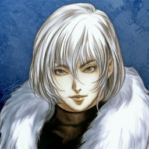
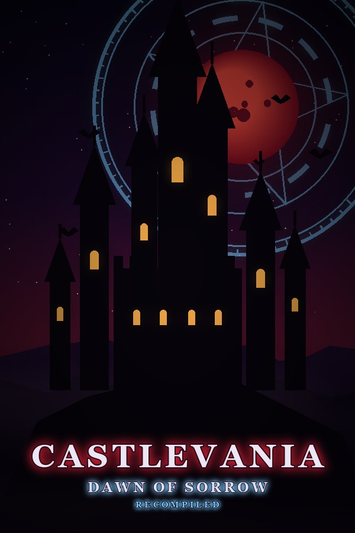
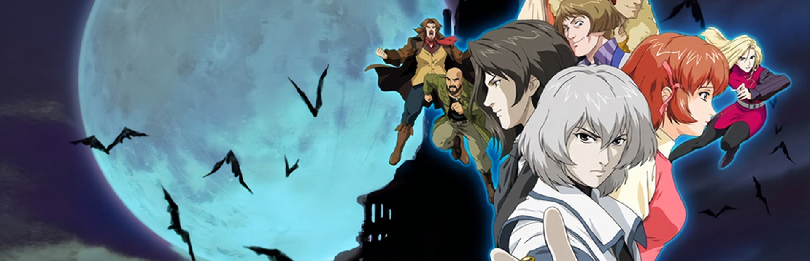
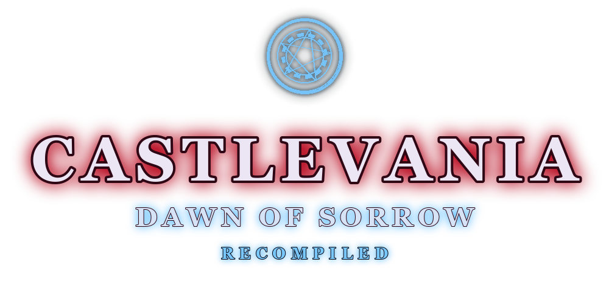
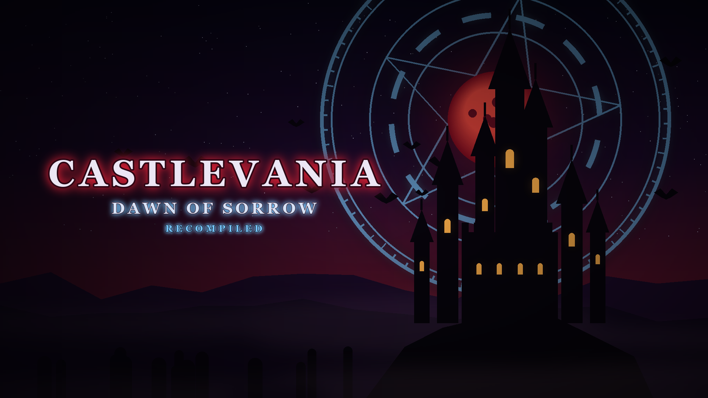
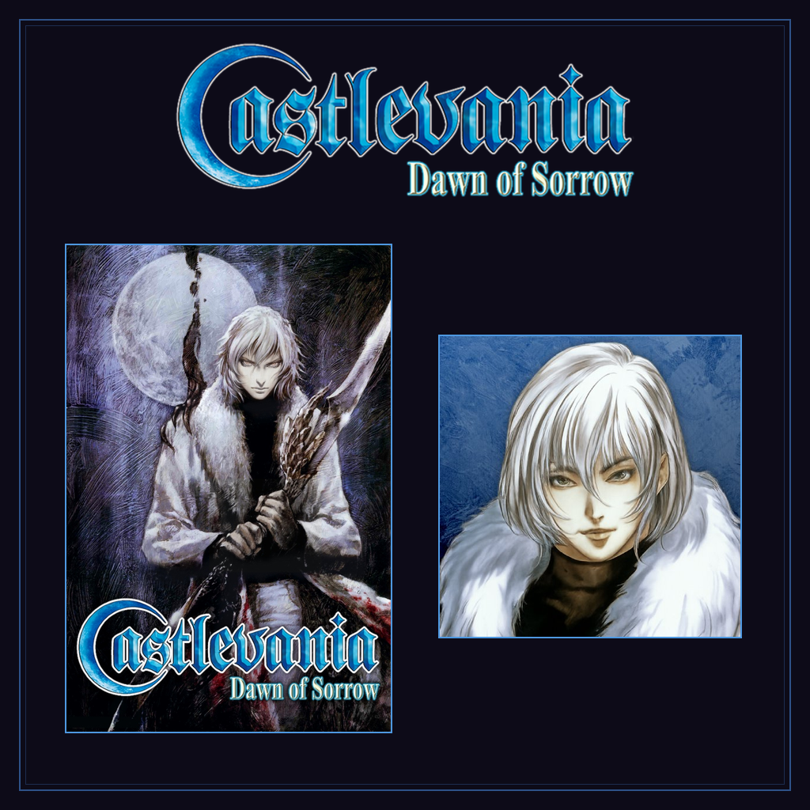

# RecompLauncher Integration / Integração com o RecompLauncher

**[English](#english) | [Português (BR)](#português-br)**

---

## English

This project follows the **RecompLauncher SDK, format 1** ([guide](https://github.com/elripalda/RecompLauncher-SDK/blob/main/docs/guide.md), [schema](https://recomplauncher.com/schema/recomplauncher.json)). Everything the launcher needs is one file, [`recomplauncher.json`](../recomplauncher.json), shipped at the top of each release next to the program.

### What the manifest declares

| Key | Value here |
|---|---|
| `$schema`, `format`, `name`, `repo` | official schema URL, `1`, *Castlevania: Dawn of Sorrow: Recompiled*, `Neguchads/cdos-nintendods-recomp` |
| `inputs[game]` | one file, `.nds` only; `check.ids = ["ACVE"]`; `dumps`: USA (ACVE), 67,108,864 bytes, CRC32 `135737f6` (verified badge) |
| `start` | `runtime/nds_runner.exe`; ROM via `--rom {input:game}`, config `{install}/game.toml`, PT-BR & Definitive deltas (`{install}/mods/ptbr/dos-ptbr.dospatch`, `{install}/mods/definitive/dos-definitive-{en,ptbr}.dospatch`), optional opening video `{install}/mods/intro/opening.mp4`; BIOS identity, settings, saves and savestates under `{data}` |
| `config` | INI at `{data}/saves/dos-settings.ini`; `new` writes all 32 defaults on first start (`en` for menu & game language, `definitive` content profile, enhanced intro enabled) |
| `settings` | 32 options in groups Language, Content & Mods, General, Display, Graphics, Performance, Audio, Controls (choices and sliders) |
| `saves`, `folders`, `actions` | EEPROM `.sav`, INI and savestates; buttons to open Saves, Screenshots and Logs |
| `looks` | `graphics_key = dos_render_driver`, `lines = 192` (DS screen height) for the launcher's ReShade looks |
| `system` | Windows 10+, Direct3D 12 / Vulkan 1.1 / Direct3D 11 / OpenGL 4.3 |
| `exit_codes` | `0` = normal quit, `1` = missing or invalid ROM, `2` = invalid argument or config |

Notes:

- The game is **never shipped**. The player picks their own USA `.nds`; the launcher checks the game code and the CRC32 and shows "Matches the verified USA (ACVE) disc".
- There is **no `prepare` step**: the runner has no windowless setup mode, and the PT-BR translation is applied in memory at start, so nothing needs to be built from the ROM.
- The release has no `recompdata/` folder. The launcher creates `{data}` (`recompdata/`) and passes it as `RECOMPLAUNCHER_DATA`.
- RecompLauncher starts `runtime/nds_runner.exe` with working directory `{install}/runtime`. Because of that, every path in `start.args` uses `{install}/...` (for `game.toml`, `mods/ptbr/dos-ptbr.dospatch`, `mods/definitive/dos-definitive-{en,ptbr}.dospatch`, and optional `mods/intro/opening.mp4`) or `{data}/...` (for `run/bios`, saves, savestates, and `firmware_state.bin`) instead of bare relative paths.
- `looks` can read the API from `dos_render_driver` only when its value contains `vulkan`, `d3d12`, `d3d11` or `opengl`. The default `direct3d12` does not contain `d3d12`, so for it the launcher falls back to detecting the API from the executable.
- Only Windows is built and tested; `system.linux` documents the Vulkan / OpenGL need of the (unverified) Linux build.

### Media kit

Located in [`assets/recomplauncher/`](../assets/recomplauncher). Sizes follow the launcher's Customize window (`ui/customize.js`): cover 600 x 900, background 1920 x 620, logo 1000 x 500 (PNG with transparency), icon 256 x 256.

| Slot | File | Size | Preview |
|---|---|---|---|
| Icon | [`icon.png`](../assets/recomplauncher/icon.png), [`icon.ico`](../assets/recomplauncher/icon.ico) | 256 x 256; ICO 256, 64, 48, 32, 16 |  |
| Cover | [`cover.jpg`](../assets/recomplauncher/cover.jpg), [`cover.png`](../assets/recomplauncher/cover.png) | 600 x 900 |  |
| Hero / background | [`hero.jpg`](../assets/recomplauncher/hero.jpg), [`hero.png`](../assets/recomplauncher/hero.png) | 1920 x 620 |  |
| Logo | [`logo.png`](../assets/recomplauncher/logo.png) | 1000 x 500, RGBA |  |
| Wallpaper | [`wallpaper.png`](../assets/recomplauncher/wallpaper.png) | 1920 x 1080 |  |
| Key artwork (DS cartridge) | [`artwork.png`](../assets/recomplauncher/artwork.png) | 1024 x 1024 |  |
| Catalog entry | [`catalog-entry.json`](../assets/recomplauncher/catalog-entry.json) | JSON | n/a |

The wallpaper and key artwork are for the README, store pages and your own library; I did not find them as fields in the catalog format, so [`catalog-entry.json`](../assets/recomplauncher/catalog-entry.json) lists only `icon`, `cover`, `hero`, `logo` and `media_design` (`kind: "ds"`, the DS cartridge drawn while Easy Setup runs).

How to apply:

1. **Listed recomps:** [submit it](https://recomplauncher.com/submit?platform=pc) or claim it in the [developer hub](https://recompstore.com/hub) and upload these files; `catalog-entry.json` shows the fields and the `media_design` to use. The image URLs point to this repository's `main` branch.
2. **Your own library:** open the game in RecompLauncher, choose **Customize**, and pick `icon.png`, `cover.jpg`, `hero.jpg` and `logo.png` with the file picker for each tab.

Regenerate or check the kit: `python tools/prepare_media_assets.py` (needs Pillow) or `python tools/prepare_media_assets.py --check-only`. The unit tests check sizes and formats with the standard library only.

### Build a release for RecompLauncher

```powershell
python tools/package_recomplauncher.py
```

This validates the manifest (including that every media file exists) and builds `dist/castlevania-dos-recomp-win64.zip` plus `SHA256SUMS.txt` (including `CastlevaniaDawnOfSorrow.exe` and `runtime/nds_runner.exe` with embedded icons, and zero `.nds` inside). Put `recomplauncher.json` at the top of the zip; name release files with the system and architecture (for example `...-Windows-x64.zip`).

### Check it inside the launcher

In RecompLauncher, open Settings, Developers, turn on Developer tools, use **Add a build** on the project folder and read the Developer tab.

### Mod & translation credits

Full researched author attribution for Definitive Edition, Dawn of Dignity, No Required Touch Screen, Fixed Luck, AI Intro Video, and PT-BR T1.0 is documented in [`docs/CREDITS.md`](CREDITS.md).

[Voltar ao topo / Back to top](#recomplauncher-integration--integração-com-o-recomplauncher)

---

## Português (BR)

Este projeto segue o **SDK do RecompLauncher, formato 1** ([guia](https://github.com/elripalda/RecompLauncher-SDK/blob/main/docs/guide.md), [schema](https://recomplauncher.com/schema/recomplauncher.json)). Tudo o que o launcher precisa é um arquivo, [`recomplauncher.json`](../recomplauncher.json), no topo de cada release, ao lado do programa.

### O que o manifesto declara

| Chave | Valor aqui |
|---|---|
| `$schema`, `format`, `name`, `repo` | URL oficial do schema, `1`, *Castlevania: Dawn of Sorrow: Recompiled*, `Neguchads/cdos-nintendods-recomp` |
| `inputs[game]` | um arquivo, só `.nds`; `check.ids = ["ACVE"]`; `dumps`: USA (ACVE), 67.108.864 bytes, CRC32 `135737f6` (selo de verificado) |
| `start` | `runtime/nds_runner.exe`; ROM via `--rom {input:game}`, config `{install}/game.toml`, deltas PT-BR e Definitive (`{install}/mods/ptbr/dos-ptbr.dospatch`, `{install}/mods/definitive/dos-definitive-{en,ptbr}.dospatch`), vídeo de abertura opcional `{install}/mods/intro/opening.mp4`; identidade de BIOS, configurações, saves e savestates em `{data}` |
| `config` | INI em `{data}/saves/dos-settings.ini`; `new` grava todos os 32 padrões na primeira vez (`en` para menu e jogo, perfil `definitive`, abertura aprimorada ativa) |
| `settings` | 32 opções nos grupos Language, Content & Mods, General, Display, Graphics, Performance, Audio, Controls (escolhas e sliders) |
| `saves`, `folders`, `actions` | `.sav` EEPROM, INI e savestates; botões para abrir Saves, Screenshots e Logs |
| `looks` | `graphics_key = dos_render_driver`, `lines = 192` (altura da tela do DS) para os looks (ReShade) do launcher |
| `system` | Windows 10+, Direct3D 12 / Vulkan 1.1 / Direct3D 11 / OpenGL 4.3 |
| `exit_codes` | `0` = saída normal, `1` = ROM ausente ou inválida, `2` = argumento ou configuração inválida |

Notas:

- O jogo **nunca é distribuído**. O jogador escolhe o próprio `.nds` USA; o launcher confere o código do jogo e o CRC32 e mostra "Matches the verified USA (ACVE) disc".
- **Não há etapa `prepare`**: o runner não tem modo de preparo sem janela, e a tradução PT-BR é aplicada em memória ao iniciar, então nada precisa ser gerado a partir da ROM.
- A release não tem pasta `recompdata/`. O launcher cria `{data}` (`recompdata/`) e a repassa como `RECOMPLAUNCHER_DATA`.
- O RecompLauncher executa `runtime/nds_runner.exe` com o diretório de trabalho em `{install}/runtime`. Por isso, todo caminho em `start.args` usa `{install}/...` (para `game.toml`, `mods/ptbr/dos-ptbr.dospatch`, `mods/definitive/dos-definitive-{en,ptbr}.dospatch` e o opcional `mods/intro/opening.mp4`) ou `{data}/...` (para `run/bios`, saves, savestates e `firmware_state.bin`), nunca caminhos relativos puros.
- O `looks` só lê a API de `dos_render_driver` quando o valor contém `vulkan`, `d3d12`, `d3d11` ou `opengl`. O padrão `direct3d12` não contém `d3d12`, então nesse caso o launcher detecta a API pelo executável.
- Só o Windows é compilado e testado; `system.linux` documenta a necessidade de Vulkan / OpenGL do build Linux (não verificado).

### Kit de mídia

Em [`assets/recomplauncher/`](../assets/recomplauncher). Os tamanhos seguem a janela Customize do launcher (`ui/customize.js`): capa 600 x 900, fundo 1920 x 620, logo 1000 x 500 (PNG com transparência), ícone 256 x 256.

| Slot | Arquivo | Tamanho | Prévia |
|---|---|---|---|
| Ícone | [`icon.png`](../assets/recomplauncher/icon.png), [`icon.ico`](../assets/recomplauncher/icon.ico) | 256 x 256; ICO 256, 64, 48, 32, 16 |  |
| Capa | [`cover.jpg`](../assets/recomplauncher/cover.jpg), [`cover.png`](../assets/recomplauncher/cover.png) | 600 x 900 |  |
| Hero / fundo | [`hero.jpg`](../assets/recomplauncher/hero.jpg), [`hero.png`](../assets/recomplauncher/hero.png) | 1920 x 620 |  |
| Logo | [`logo.png`](../assets/recomplauncher/logo.png) | 1000 x 500, RGBA |  |
| Wallpaper | [`wallpaper.png`](../assets/recomplauncher/wallpaper.png) | 1920 x 1080 |  |
| Artwork principal (cartucho DS) | [`artwork.png`](../assets/recomplauncher/artwork.png) | 1024 x 1024 |  |
| Entrada de catálogo | [`catalog-entry.json`](../assets/recomplauncher/catalog-entry.json) | JSON | n/d |

O wallpaper e o artwork principal servem para o README, páginas de loja e a sua biblioteca; não encontrei esses campos no formato do catálogo, então o [`catalog-entry.json`](../assets/recomplauncher/catalog-entry.json) lista só `icon`, `cover`, `hero`, `logo` e `media_design` (`kind: "ds"`, o cartucho de DS desenhado durante o Easy Setup).

Como aplicar:

1. **Recomps listados:** [envie o recomp](https://recomplauncher.com/submit?platform=pc) ou reivindique-o no [hub de desenvolvedores](https://recompstore.com/hub) e envie estes arquivos; o `catalog-entry.json` mostra os campos e o `media_design` a usar. As URLs das imagens apontam para a branch `main` deste repositório.
2. **Sua biblioteca:** abra o jogo no RecompLauncher, escolha **Customize** e selecione `icon.png`, `cover.jpg`, `hero.jpg` e `logo.png` pelo seletor de arquivo em cada aba.

Para regerar ou conferir o kit: `python tools/prepare_media_assets.py` (precisa do Pillow) ou `python tools/prepare_media_assets.py --check-only`. Os testes unitários conferem tamanhos e formatos só com a biblioteca padrão.

### Gerar uma release para o RecompLauncher

```powershell
python tools/package_recomplauncher.py
```

Valida o manifesto (inclusive se todos os arquivos de mídia existem) e gera `dist/castlevania-dos-recomp-win64.zip` mais `SHA256SUMS.txt` (incluindo `CastlevaniaDawnOfSorrow.exe` e `runtime/nds_runner.exe` com ícones embutidos e nenhum `.nds`). Deixe o `recomplauncher.json` no topo do zip; nomeie os arquivos da release com sistema e arquitetura (por exemplo `...-Windows-x64.zip`).

### Conferir dentro do launcher

No RecompLauncher, abra Settings, Developers, ligue Developer tools, use **Add a build** na pasta do projeto e leia a aba Developer.

### Créditos de mods e tradução

Todos os autores pesquisados (Definitive Edition, Dawn of Dignity, No Required Touch Screen, Fixed Luck, AI Intro Video e tradução PT-BR T1.0) estão creditados em [`docs/CREDITS.md`](CREDITS.md).

[Voltar ao topo / Back to top](#recomplauncher-integration--integração-com-o-recomplauncher)
